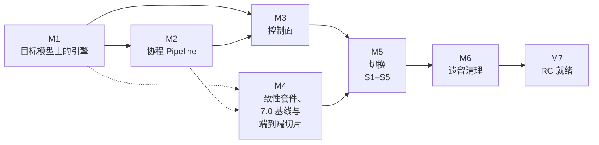

# 路线图 {#roadmap}

面向正在使用 CoSec 7.x 或正在评估 CoSec、想知道 8.0 是什么以及何时可以发布的团队。本页只写到里程碑一级。按 PR 的进度见贡献者用的
[`docs/roadmap.md`](https://github.com/Ahoo-Wang/CoSec/blob/main/docs/roadmap.md)，每一项设计决定见
[RFC](https://github.com/Ahoo-Wang/CoSec/tree/main/docs/rfc)。本页与 RFC 不一致时，以 RFC 为准。

## 8.0 是什么 {#what-8-0-is}

8.0 是 CoSec 的一次彻底重新设计，没有兼容目标：它遵循目标架构，而不是 7.x 的行为
（[RFC 0008 §2](https://github.com/Ahoo-Wang/CoSec/blob/main/docs/rfc/0008-conformance-and-direct-build.md)）。
正确性由 8.0 的规范定义，由一致性套件检查。改变的内容：

- **纯函数决策引擎。** 授权是请求与内存中策略集的函数，不做 I/O
  （[RFC 0002](https://github.com/Ahoo-Wang/CoSec/blob/main/docs/rfc/0002-pure-engine.md)）。
- **基于绑定的唯一扁平算法**，分平台层与租户层，带成员关系与作用域，取代 7.x 中全局策略、主体策略、角色权限的分层顺序
  （[RFC 0004](https://github.com/Ahoo-Wang/CoSec/blob/main/docs/rfc/0004-unified-model.md)）。
- **带类型的条件 AST、`service:verb` 动作与编译执行**，取代 OGNL、SpEL 与内置匹配器
  （[RFC 0005](https://github.com/Ahoo-Wang/CoSec/blob/main/docs/rfc/0005-condition-ast.md)）。
- **策略快照**，取代每个请求读一次仓库
  （[RFC 0003](https://github.com/Ahoo-Wang/CoSec/blob/main/docs/rfc/0003-policy-snapshot.md)）。
- **协程 Pipeline**：`Indeterminate` 决策返回 503，限流改为义务，决策监听器取代装饰器链
  （[RFC 0006](https://github.com/Ahoo-Wang/CoSec/blob/main/docs/rfc/0006-coroutine-pipeline.md)）。
- CoSec 写的错误响应一律使用 **RFC 9457 problem+json**（RFC 0006 Q27）。
- **控制面**：修订记录、发布前的影子窗口，以及授出分析，保证任何人授出的权限不超过自己持有的
  （[RFC 0007](https://github.com/Ahoo-Wang/CoSec/blob/main/docs/rfc/0007-control-plane.md)）。
- 设计上**支持 AOT**
  （[RFC 0001 §3.10](https://github.com/Ahoo-Wang/CoSec/blob/main/docs/rfc/0001-target-architecture.md)）。

7.x 应用必须迁移：策略、权限和配置的形状都会改变，`cosec-migrate` 把 7.x 数据转换成 8.0 的格式。8.0 装配完成时，
[升级](../operations/upgrading.md)会列出每一项改变及其迁移方法。

## 里程碑 {#milestones}

按依赖顺序排列，不给日期，依据 RFC 0008 §4.5 的依赖表与关键路径。状态以 2026-10-29 的 `main` 为准。本页只在里程碑开始或完成时更新（RFC 0008 §4.7），
按 PR 的状态见 [`docs/roadmap.md`](https://github.com/Ahoo-Wang/CoSec/blob/main/docs/roadmap.md)。

| 里程碑 | 你得到什么 | 完成标准 | 状态 |
|---|---|---|---|
| **M1** 目标模型上的引擎 | 绑定、成员关系、条件 AST 与 `service:verb` 动作编译进快照文档；路由映射；把 7.x 数据转换过来的 `cosec-migrate`（RFC 0005 PR-4–PR-6、RFC 0004 PR-4、PR-5） | 快照文档能编译并由扁平引擎求值；`cosec-migrate convert` 能从 7.x 数据生成它们 | 已完成：模型、扁平算法、条件 AST、动作匹配、路由映射与 `cosec-migrate`（含 7.x 匹配器到 AST 的翻译）已合入；只剩切换步骤 |
| **M2** 协程 Pipeline | 挂起式认证与成员关系、外部属性、义务、决策监听器、503 与 problem+json，三个 Web 适配器都接到新 Pipeline（RFC 0006 PR-2–PR-7） | 三个适配器经新 Pipeline 给出相同的响应 | 已完成：认证、成员关系、外部属性、监听器、限流义务与三个适配器都已在新 Pipeline 上；只剩切换时 starter 的装配 |
| **M3** 控制面 | 修订记录、条件发布、校验、授出分析、影子窗口、break-glass、租户自助、变更审计、HTTP API（RFC 0007 PR-3–PR-9） | 每一次写入都经过控制面的库与 HTTP 路由 | 已完成：存储、修订、变更流程、授出分析、授权与审批、影子窗口、break-glass、租户自助、变更审计、平台边界、控制面的库与 HTTP 路由已合入，第 1 轮审查的安全修复也已合入；只剩切换时 starter 的注册 |
| **M4** 一致性套件、基线与端到端切片 | 规则登记表，每条规范性规则都有正例和反例场景；性质检查与变异检查；7.0 性能基线（RFC 0008 PR-1–PR-3）。端到端切片在真实的 CoCache 与 Redis 上把快照、扁平引擎、协程 Pipeline 与 WebFlux 接起来，一能运行就测量性能预算（RFC 0008 §4.4.3）。虚线箭头：切片需要 M1 与 M2 的一部分 | 每条已合入的规则都有两种场景；7.0 基线已录制；切片能运行，第一次测量已记录 | 进行中：一致性套件（含变异检查）、端到端切片与 7.0 的 JMH 基线已合入；k6 端到端测量待做 |
| **M5** 切换 | 依次合入的五个 PR（RFC 0008 §4.4）：S1 在 starter 中装配 8.0 路径，并把 `cosec-gateway-server` 改到 8.0；S2–S4 按模块删除 7.x 路径；S5 写文档与[升级](../operations/upgrading.md) | S1 只在 RFC 0008 §3.9 全部满足时合入（套件全绿、没有待定规则、性质与变异体通过、预算达标），S1 之后没有回头路；S2–S5 依次合入，各做两轮审查 | 完成：S1 在 starter 中装配了 8.0 路径（不可回退点，带 RFC 0008 §3.9 的证据），S2–S4 删除了 7.x 路径，S5 写了文档与[升级](../operations/upgrading.md) |
| **M6** 遗留清理 | 删除只为旧版本存在的代码、构建配置与文档沿革（RFC 0008 §4.6、PR-5、PR-6） | §4.6.1 的清单除"保留"项外为空，守护挂在 `check` 上 | 完成：遗留代码与构建配置已删除（RFC 0008 PR-5），文档守卫在 CI 中阻止已删除的 API 回到文档里（PR-6） |
| **M7** RC 就绪 | 维护者可以发布的候选版本 | 对 RC 候选提交做两轮整体审查：RC 安全审查，然后按模块的正确性审查；`cosec-gateway-server` 的 AOT cache 冒烟测试在 CI 中通过；对集成后的系统做完 RC 安全审查（租户隔离、控制面越权与授出分析、break-glass、快照与缓存投毒、problem+json 的信息泄露、拒绝服务），发现全部修复；由维护者决定发 RC 还是 GA | 进行中：AOT cache 冒烟测试已在 CI 中通过；还剩 ABI 校验（RFC 0011 PR-3）与 RC 安全审查。先发布 `8.0.0-alpha.1` 作为预览（见下文） |

## 发布策略 {#release-policy}

- **`8.0.0-alpha.1` 是预览版，不承诺兼容性。** 公共 API、`cosec.*` 属性、文档与线上格式（`schema: 2`、`CoSec-Identity`）
  以及授权语义，在之后的任何 alpha 或 RC 中都可能改变，预览版之间不提供迁移路径。请在生产以外试用，暂时不要在它上面构建。
- RC 与 GA 等 M7 完成：对整个系统的两轮审查（RC 安全审查，然后按模块审查）及其发现全部修复、ABI 校验（GA 时冻结公共 API，RFC 0011 D4）。此后 8.0 才遵循语义化版本。
- **8.0 不比 7.0 慢。** 性能预算以 7.0 的实测数字设定：编译执行的授权吞吐与 Pipeline 吞吐不低于 7.0 的 100 %，分配不高于 7.0
  （RFC 0008 §3.8）。预算先在端到端切片上测量；达标之前，S1 不会合入。

## 给 7.x 用户 {#for-7-x-users-today}

- `7.x` 接收安全和关键修复，直到 8.0 GA 之后 6 个月；`release/6.1.x` 只接收安全修复
  （[`CONTRIBUTING.md`](https://github.com/Ahoo-Wang/CoSec/blob/main/CONTRIBUTING.md)）。
- 最新的修复是 [7.0.2](https://github.com/Ahoo-Wang/CoSec/releases/tag/v7.0.2)：策略解码器现在拒绝格式错误的策略
  （未知字段、应为列表处写了标量、重复键），不再把它们编译成范围更大的策略。升级前先读它的升级说明：已存入 Redis 的策略在重新发布之前，可能让请求失败。
- 最新的安全公告是
  [GHSA-2293-jx8h-56m8](https://github.com/Ahoo-Wang/CoSec/security/advisories/GHSA-2293-jx8h-56m8)，已在 7.0.1 与 6.1.2 中修复。
- 现在该做的：生产环境继续用 7.0.2，即最新的 7.0.x。想评估 8.0，在测试环境中试用 `8.0.0-alpha.1`，配合[升级](../operations/upgrading.md)；
  RC 之前还会有改动。

## 如何跟进 {#how-to-follow}

- [RFC 索引](https://github.com/Ahoo-Wang/CoSec/tree/main/docs/rfc)：设计、决定与待决问题。
- [`docs/roadmap.md`](https://github.com/Ahoo-Wang/CoSec/blob/main/docs/roadmap.md)：按 PR 的进度与审查轮次。
- GitHub 上的 [Issues](https://github.com/Ahoo-Wang/CoSec/issues) 与 [Pull Requests](https://github.com/Ahoo-Wang/CoSec/pulls)。
