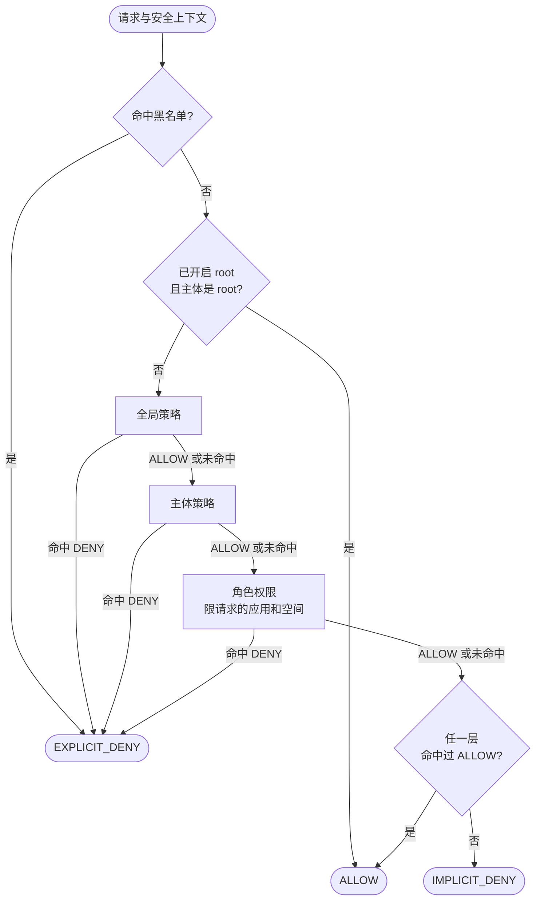

# 安全模型 {#security-model}

面向需要准确知道请求何时被放行的安全评审、架构师和策略作者。本页是求值顺序以及“拒绝优先、默认拒绝、失败即拒绝”这些保证的唯一出处，其他页面只链接到这里，不再复述。

## 求值顺序 {#evaluation-order}

`SimpleAuthorization` 按以下顺序分五层对每个请求求值：

1. **黑名单。** 由 `BlacklistChecker` Bean 判断请求是否被拦截。被拦截即 `EXPLICIT_DENY`，其余各层都不再参与。starter
   默认的检查器不拦截任何请求。
2. **Root。** 仅在开启 root 时生效：[根主体](#root-principal)直接放行，不再查询任何策略或权限。
3. **全局策略**：所有 `global` 类型的策略，对每个请求都生效。
4. **主体策略**：主体凭证中按 id 列出的策略。
5. **角色权限**：在请求所指定的应用和空间内，授予主体角色的权限（见[角色作用域与 inRole](#role-scope-and-inrole)）。

通过以上各层放行的请求，随后还要经过限流：每条匹配的[限流规则](../policies/rate-limiting.md)消耗一个许可，某条规则的许可耗尽时，`ALLOW`
变为 `TOO_MANY_REQUESTS`。被拒绝的请求不消耗许可，因此不会耗尽正常调用方的配额。

**为什么黑名单排在最前，甚至在 root 之前。** 黑名单用于在事故期间立即封禁某个主体或地址。如果 root 能绕过它，被盗的 root
凭证就只能靠重新部署才能拦住。

**为什么全局策略排在主体自己的策略之前。** 全局策略承载对所有人生效的规则，包括保护整个系统的拒绝规则。先评估它们，全局拒绝就能在读取任何主体专属规则之前结束评估。这个顺序只影响报告的是哪条规则：由于[拒绝优先](#deny-first)，决策结果本身与顺序无关。

## 拒绝优先 {#deny-first}

在任何层面，`ALLOW` 都不会胜过已命中的 `DENY`：

- **层内**：所有适用策略中的每条 `deny` 语句，都在任何 `allow` 语句之前检查。策略的先后、策略内语句的先后都不影响结果。角色权限遵循同样的规则。
- **跨层**：任一层出现 `EXPLICIT_DENY` 即结束评估。`ALLOW` 则不会结束评估：其余各层仍会继续评估，只有它们都没有命中
  `DENY` 时，`ALLOW` 才成立。全局 `allow` 推翻不了主体或角色的 `deny`，角色 `allow` 也推翻不了全局 `deny`。

有两个细节决定一条 `deny` 是否会被评估到：

- 策略自身的 `condition` 不成立时，整条策略被跳过，其中的 `deny` 语句也一样。应用权限的 `condition` 与其下所有权限同理。必须始终生效的拒绝，应放在没有条件的策略里。
- 主体策略在仓库中不存在时，请求以错误失败，而不是跳过它。缺失的策略可能正是把该主体挡在外面的那条拒绝，缺了它做决策可能放大权限。

**原因。** 拒绝优先让变更在一个方向上是安全的：新增 `deny` 只会收窄权限，新增 `allow` 永远撤销不了别人写的 `deny`。否则结果将取决于评估顺序，每加一条策略都要重新审查所有已有策略。

## 默认拒绝 {#default-deny}

如果所有层都没有任何语句或权限命中，结果就是 `IMPLICIT_DENY`。只有规则明确授予的地方才有访问权限：新接口在有策略放开之前是关闭的，路径模式写错会关闭一个接口，而不是打开它。

`IMPLICIT_DENY` 与 `EXPLICIT_DENY` 的响应相同。它们的区别在于排查时提供的信息：是什么都没命中，还是命中了一条拒绝。见[排查问题](../operations/troubleshooting.md#find-out-what-decided)。

## 失败即拒绝 {#fail-closed}

CoSec 无法做出决策时就拒绝。所有错误都在同一个地方 `SecurityPipeline` 中被转换为决策，所以 WebFlux、WebMvc 和 Gateway
三个适配器的响应完全一致。状态码见[响应与状态码](../integration/web.md#responses-and-status-codes)。

| 出了什么问题 | 结果 |
|---|---|
| 请求路径无法解析（例如含 `..` 段） | 在授权之前作为错误请求拒绝。 |
| 令牌无效、过期或已吊销 | 请求以匿名主体继续。若随后被拒绝，响应给出令牌的原因（`Token Invalid`、`Token Expired`）。 |
| 因其他原因无法构建安全上下文 | 错误：拒绝。 |
| 无法读取策略或权限（Redis 不可达、内容无法读取、主体策略缺失） | 错误：拒绝。 |
| 条件抛出异常 | 错误：拒绝。 |
| 正则表达式超出时间预算 | `IMPLICIT_DENY`：这是预期中的拒绝，而不是服务器错误。 |

策略与权限缓存的条目永不过期，Redis 读取失败时直接抛出异常。条目过期、或把读取错误当作未命中，看起来都和"这里没有策略"一模一样，会悄无声息地丢掉全局拒绝。见 [Redis 不可用时](../operations/storage.md#when-redis-is-unavailable)。

**原因。** 依赖故障不能让大门敞开。错误响应是看得见的，会被修复；本该拒绝却放行的请求则无人察觉。

### 两个已写明的例外 {#the-two-documented-exceptions}

有两项检查在其后端故障时会放行请求，因为在这里失败即拒绝会把一次 Redis 故障变成整体故障，而换来的保护很少：

- **未设置 `strictFailure` 的限流规则。** 计数存储故障时，该规则被跳过。设置了 `"strictFailure": true` 的规则则以 `TOO_MANY_REQUESTS` 拒绝请求。限流只作用于策略已经放行的请求，所以跳过一条规则永远不会授予策略未授予的权限。见[故障时的行为](../policies/rate-limiting.md#failure-behavior)。
- **令牌吊销。** 吊销存储无法读取时，令牌按未吊销处理。签名和有效期仍会校验，所以风险窗口以访问令牌的有效期为上限：请让访问令牌保持较短的有效期。见[登出与吊销](../integration/authentication.md#logout-and-revocation)。

除此之外，没有其他失败放行的情况。

## 根主体 {#root-principal}

Root 默认关闭。设置 `cosec.authorization.root-enabled: true` 后（见[配置](../operations/configuration.md#authorization)），主体只有同时满足以下两点才是 root：

- 其 id 等于 JVM 系统属性 `cosec.root`（默认 `cosec`）；
- 它属于平台租户 `(platform)`。

Root 主体跳过第 3 到第 5 层，直接放行。黑名单对它依然有效。

**为什么要检查租户。** 主体 id 只在租户内唯一。用户租户的身份提供方也可能签发一个名为 `cosec` 的主体；没有这项检查，这个主体就能绕过所有策略。没有租户的主体永远不是 root。如果需要比 id 更强的信号，请提供自己的 `RootPrincipalMatcher` Bean。

**为什么默认关闭。** Root 会跳过你写的每一条全局拒绝。多数部署并不需要它，所以开启它应当是一个明确的决定，而不是继承来的默认值。

## 信任边界 {#trust-boundaries}

决策的每一项输入，要么来自经过校验的凭证，要么来自客户端。一项授权的可信程度，取决于它所依赖的输入。

| 输入 | 来源 | 由谁控制 |
|---|---|---|
| 主体 id、角色、关联策略、属性 | 经过校验的凭证（JWT 声明、API Key） | 签发凭证的一方 |
| 租户 | 凭证（`tenantId` 声明） | 签发凭证的一方 |
| 路径、方法、查询参数、请求头、Cookie、Origin、Referer | HTTP 请求 | 客户端 |
| 应用（`CoSec-App-Id`）、空间（`CoSec-Space-Id`）、设备（`CoSec-Device-Id`） | 请求头，或同名查询参数 | 客户端 |
| 客户端 IP | 连接本身，或在可信跳数以内的 `X-Forwarded-For` | 超出你所信任代理的部分由客户端控制 |

应遵循的规则：**只有当客户端换成其他任何值都不能得到更多权限时，授权才可以依赖客户端控制的值。** CoSec 自身的作用域划分对空间遵循了这条规则，对应用则没有。

- **空间。** 空间由客户端指定，但只能在凭证所声明的空间中选择。带上 `CoSec-Space-Id: team-a` 时，只有写成 `role@team-a`
  的角色生效；不带该请求头时，只有不带后缀的角色生效。指定其他空间永远拿不到令牌中没有的角色。
- **应用。** CoSec 按原样采用 `CoSec-App-Id`，并把该应用的权限授予主体的角色。一个在两个应用中都有角色的主体，可以发送其中一个应用的 id，却访问属于另一个应用的路径。如果两个应用的权限都能匹配该路径（共用 `/api/**` 这类路径空间的应用），请求就会按客户端所指定应用的授权来决策。

当多个应用共用一个网关或同一个路径空间时，可以用以下任一方式防止应用 id 放大权限：

- 在边缘绑定应用：让每条网关路由设置或覆盖 `CoSec-App-Id`，使客户端的值根本到不了授权环节（见[应用与空间](../integration/web.md#app-and-space)）；
- 为每个应用的路径前缀添加一条全局 `deny`，其条件要求 `request.appId` 必须是拥有该路径的应用；
- 让各应用权限的路径互不重叠，使任何应用的权限都匹配不到其他应用的路径。

另外两条边界：

- **信任上游网关。** 设置 `cosec.inject.enabled: true` 后，服务从令牌中读取主体时不校验签名（仍校验有效期），前提是它前面的网关已经校验过。只在客户端必须经过该网关才能访问的服务上开启。见[网关之后](../integration/authentication.md#behind-a-gateway)。
- **客户端 IP。** 在代理之后，把 `cosec.authorization.remote-ip.max-trusted-index` 设为你所信任的代理跳数；超出部分的条目由客户端写入。见[代理之后的客户端 IP](../integration/web.md#client-ip-behind-proxies)。

## 租户隔离 {#tenant-isolation}

CoSec 本身不隔离租户。策略的 `tenantId` 记录的是策略归属哪个租户；授权时不会把它和主体的租户做比较。`global`
策略对所有租户的主体生效，主体策略则对凭证中列出它的任何主体生效。

因此，隔离来自你编写的策略和签发的凭证：

- 签发的凭证只列出主体所在租户的策略；
- 用 `inTenant` 条件把共享规则限制在某个租户内；
- 把平台租户 `(platform)` 视为特权租户：只有它的主体能成为 [root](#root-principal)。

租户本身来自凭证，所以客户端不换凭证就无法切换租户。

## 角色作用域与 inRole {#role-scope-and-inrole}

主体的角色是凭证中的字符串，每个角色可以带一个空间：

- `clerk` 是默认空间（不带 `CoSec-Space-Id` 的请求所在的空间）中的角色 `clerk`；
- `clerk@team-a` 是仅在空间 `team-a` 中有效的角色 `clerk`；
- 格式错误的角色（角色或空间为空、含多个 `@`）在任何地方都不生效。

角色权限与 `inRole` 条件对作用域的使用方式不同，这个差别很重要。

**角色权限**严格按作用域生效。请求只使用在其空间内生效的角色，且只使用在其应用中做出的授权。`clerk@team-a` 获得的是
`team-a` 中 `clerk` 的授权，绝不会获得其他空间或默认空间中 `clerk` 的授权。见[角色授权的作用域](../policies/role-permissions.md#role-grant-scope)。

**`inRole` 条件**的匹配范围更宽：

| 条件 | 匹配持有以下角色的主体 |
|---|---|
| `"inRole": { "value": "suspended" }` | `suspended`（无论请求在哪个空间）；或 `suspended@<请求的空间>` |
| `"inRole": { "value": "suspended@team-a" }` | 恰好是 `suspended@team-a`（无论请求在哪个空间） |

**为什么不带空间的值在所有空间都匹配。** `inRole` 主要用在拒绝规则中，而空间请求头由客户端选择：如果不带空间的
`inRole: suspended` 只在默认空间匹配，被停用的主体只要随便指定一个其他空间就能逃出这条拒绝。同时匹配
`suspended@<空间>`，能让这类拒绝在令牌开始携带带空间的角色后继续有效。

**这对放行规则意味着什么。** 两种写法都不会把授权限制在请求的空间内。尤其是写成"除非 `inRole: admin` 否则拒绝"（`"negate": true`）的规则，对持有 `admin@team-a` 的主体，只要客户端发送 `CoSec-Space-Id: team-a` 就会解除，而且解除范围是这条拒绝覆盖的所有路径，不只是 team-a 的。若要只在某个空间内授权，请加上针对 `request.spaceId` 的条件，或通过角色权限授权，它会自动按作用域生效。

## 路径变量的作用域 {#path-variable-scope}

`/orders/{orderId}` 这样的 `path` 动作会捕获路径变量，条件通过 `request.path.var.orderId` 读取。这些变量属于捕获它们的那条语句：

- 它们在每一层开始时（任何策略条件运行之前）以及每条语句匹配之前被清空。条件只能看到自己语句的 `path`
  动作捕获的变量，看不到其他语句、策略或层留下的值。
- 在没有自己捕获变量的地方读取路径变量，会在加载策略时被拒绝：策略级条件、应用权限的条件、动作不是 `path`
  动作的语句的条件，以及任何动作（动作在捕获任何东西之前就被评估）。限流规则的条件和 key 遵循同样的规则。

**原因。** 如果变量能跨语句泄漏，条件是否命中就取决于在它之前碰巧运行了哪些语句。一条把 `request.path.var.ownerId`
与主体做比较的拒绝，可能被另一个模式捕获的值满足或绕开。限定作用域让每条语句无论放在哪里含义都相同，而加载时的检查把一条只可能出错的策略变成启动时就能看到的错误。

## CoSec 不防护的范围 {#what-cosec-does-not-protect-against}

CoSec 决定请求能否到达你的处理器。它不会：

- 校验客户端指定的应用或空间是否与路径相符（见[信任边界](#trust-boundaries)）；
- 决定处理器返回哪些记录或字段：请在自己的代码中过滤数据，对象级规则可使用[代码中的检查](../integration/checks.md)；
- 保护并非由它签发的凭证：被盗的令牌在过期或被吊销之前一直有效；
- 拦住被策略误放行的请求：发布前请测试策略（[策略测试](../policies/testing.md)）；
- 取代传输层安全：请在 TLS 之后运行，并妥善保管 `cosec.jwt.secret`。

## 加固清单 {#hardening-checklist}

上线之前：

- 从密钥存储中读取 `cosec.jwt.secret`，并让访问令牌保持较短的有效期。
- 按你的代理链设置 `cosec.authorization.remote-ip.max-trusted-index`。
- 多个应用共用网关或路径空间时，在网关上按路由绑定 `CoSec-App-Id`。
- 只在必须经过校验网关才能访问的服务上开启 `cosec.inject.enabled`。
- 除非确实需要，保持 `cosec.authorization.root-enabled` 关闭。开启时，只从用户无法影响的来源签发平台租户的令牌。
- 必须始终生效的拒绝，放在没有条件的策略里。
- 用于防滥用的限流规则，如果 Redis 故障时也不能失效，请设置 `"strictFailure": true`。
