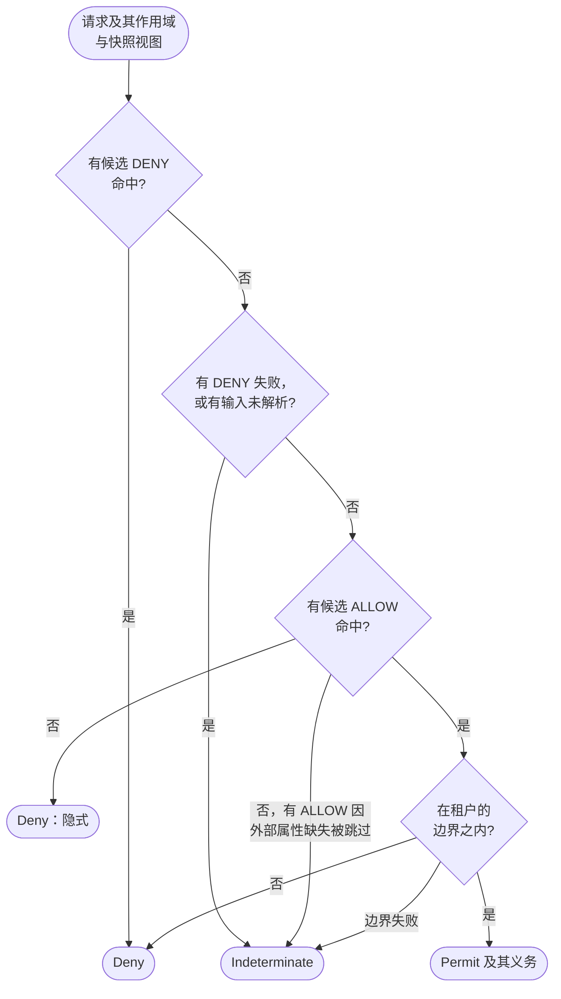

# 安全模型 {#security-model}

面向需要准确知道请求何时被放行的安全评审、架构师和策略作者。本页是决策规则的唯一出处：求值顺序、拒绝优先、默认拒绝、Indeterminate、平台边界、内置策略与 break-glass、失败即拒绝及其两个例外，以及信任边界。其他页面只链接到这里，不再复述。

## 求值顺序 {#evaluation-order}

无论使用哪个适配器，每个请求都经过同一条管道。在引擎决策之前，管道会：

1. 对无法无歧义读取的路径或 `CoSec-*` 参数，直接以 `400` 拒绝（[Web 集成](../integration/web.md#the-request-path)）；
2. 认证凭证。被拒绝的凭证（无效、过期、已吊销）不会中止请求：请求按匿名主体求值（[认证](../integration/authentication.md)）；
3. 解析主体的成员关系，并获取黑名单属性；
4. 用 `ScopeResolver` 解析作用域（租户、应用、空间及主体在该空间的角色）。作用域被拒绝即为拒绝（[信任边界](#trust-boundaries)）；
5. 读取快照视图：平台文档、作用域所在租户的文档，以及主体在作用域应用中有角色时该应用的文档。被黑名单拦截的请求只读取平台文档；
6. 获取候选语句所需的外部属性。

随后引擎（`FlatEvaluator`）对**候选**（对该请求适用的策略）分两轮求值：

1. **DENY 轮。** 遍历每个候选的 DENY 语句。第一条命中的语句即为决策：**Deny**。
2. 如果没有 DENY 命中，但有 DENY 失败（语句本身，或经由它到达的策略条件抛出异常），或者请求需要的某项输入未能解析（[Indeterminate](#indeterminate)），决策为 **Indeterminate**。
3. **ALLOW 轮。** 第一条命中的 ALLOW 语句即为决策：**Permit**。失败的 ALLOW 视为未命中。
4. 如果没有 ALLOW 命中，决策为**隐式拒绝**：Deny，且没有对应语句。
5. Permit 随后还要受租户的[平台边界](#platform-boundary)约束，边界只能把它变成 Deny 或 Indeterminate。
6. Permit 携带需要消耗的限流规则作为义务（[限流](../policies/rate-limiting.md)）。Deny 和 Indeterminate 不消耗任何配额。

管道把决策转换为响应：Permit 继续处理，Deny 返回 `401` 或 `403`，Indeterminate 一律返回 `503`（[响应与状态码](../integration/web.md#responses-and-status-codes)）。

### 候选 {#candidates}

候选是绑定和附加策略让该请求适用的策略，顺序如下（`CandidateOrder`）：

1. 内置黑名单策略 `cosec:blacklist`（[内置策略](#built-in-policies)）；
2. 平台文档中的 `Anyone` 绑定（`"subject": "*"`），然后是租户文档中的；
3. 主体的附加策略（成员关系声明 `policies`），按声明顺序；然后是平台文档和租户文档中针对该主体的绑定；
4. 应用文档的角色绑定，然后是租户文档的角色绑定，按主体在请求空间中拥有的每个角色、按声明顺序；
5. 主体的 [break-glass](#break-glass) 绑定，排在最后。

绑定只在以下条件都满足时适用：它的应用和空间与作用域完全一致（`*` 匹配任意值）；指定了租户的角色绑定指定的是主体所在租户；绑定尚未过期。匿名主体没有附加策略，也不匹配主体绑定、角色绑定和 break-glass：对它只有 `Anyone` 绑定生效。

顺序不会改变决策的类型，只影响多条语句同时命中时报告的是哪一条：DENY 轮总是先遍历完所有候选，ALLOW 轮才开始。

### 策略条件 {#policy-conditions}

策略可以有自己的 `condition`。它在每个请求中最多求值一次，而且只在该策略的某条语句已经按动作和资源命中之后才求值。条件不成立时，策略中的所有语句都不命中，DENY 也一样。条件抛出异常时，经由它到达的 DENY 视为失败的 DENY（Indeterminate），ALLOW 视为未命中。必须始终生效的 DENY，应放在没有条件的策略里。

## 拒绝优先 {#deny-first}

ALLOW 永远不会胜过命中的 DENY。所有候选的 DENY 语句都在任何 ALLOW 语句之前求值，不论它们来自哪个文档、哪个绑定或附加策略。平台的 ALLOW 推翻不了租户的 DENY，租户的 ALLOW 推翻不了平台的 DENY，break-glass 也推翻不了任何 DENY。

命中的 DENY 还胜过一切本会导致 Indeterminate 的情况：失败的语句、缺失的策略、无法读取的文档、无法获取的外部属性。

**原因。** 拒绝优先让变更在一个方向上是安全的：新增 DENY 只会收窄权限，新增 ALLOW 永远撤销不了别人写的 DENY。由于决策只取决于候选的集合，评审者无需推敲它们的顺序。

## 默认拒绝 {#default-deny}

没有任何语句命中时，决策为隐式拒绝。只有 ALLOW 授予的地方才有访问权限：新端点在有策略开放它之前是关闭的，模式里的拼写错误只会关闭端点，而不会开放端点。

隐式拒绝和显式拒绝产生相同的响应，因此响应永远不会告诉调用方某条 DENY 存在。两者只在排查时不同：没有对应语句，或者给出命中的 DENY（[解释一个决策](../integration/checks.md#explaining-a-decision)）。

## Indeterminate {#indeterminate}

Indeterminate 表示“CoSec 无法决策”：可能存在一条没人能检查的 DENY。它永远不是 Permit，管道一律以 `503` 回应。在没有 DENY 命中的前提下，以下情况的决策为 Indeterminate：

- 某条 DENY 语句或经由它到达的策略条件失败；
- 附加或绑定的策略不存在，或附加策略指向的策略不是 `attachable`；
- 附加或绑定的 id 同时对应一条租户策略和一条内容不同的平台策略：两者都不会悄悄胜出；
- 请求需要的文档无法读取、无法编译或未加载。缺失的平台文档视为无法读取，绝不当作空文档，因此在发布平台文档之前，除非有 DENY 命中，每个请求都是 Indeterminate；
- 黑名单无法读取（[黑名单](#blacklist)）；
- 某条 ALLOW 因其读取的外部属性无法获取而被跳过，且没有其他 ALLOW 命中（[外部属性缺失](#missing-external-attributes)）；
- 某条边界语句失败，或租户的边界策略不存在（[平台边界](#platform-boundary)）。

管道还有自己的不可用结果，同样是 `503`：无法解析的成员关系、失败的凭证检查，以及[失败即拒绝](#fail-closed)中列出的其他情况。

## 失败即拒绝 {#fail-closed}

CoSec 无法决策时，不会放行。每种失败都在 `StatusMapping` 这一处变成结果，因此 WebFlux、WebMvc 和 Gateway 适配器的回应完全一致。只有 Permit 能让请求继续。

| 出了什么问题 | 结果 |
|---|---|
| 路径或某个 `CoSec-*` 参数无法无歧义地读取 | `400`，在认证之前 |
| 凭证无效、过期或已吊销 | 按匿名主体求值：Permit 照常继续，Deny 返回 `401` 并给出原因 |
| 认证器失败或未在 `cosec.pipeline.authentication-timeout` 内应答；API key 存储无法读取 | `503` |
| 吊销存储报告错误 | `503`（但见[两个已写明的例外](#the-two-documented-exceptions)） |
| 无法解析成员关系（没有提供者、提供者失败或超时、令牌同时带有提供者标记并声明了角色） | `503`，绝不当作“没有成员关系” |
| 快照源失败 | `503` |
| 文档、策略、语句、黑名单或边界无法读取或求值 | Indeterminate（`503`），除非有 DENY 命中 |
| 某个属性提供者失败或超时 | 只有它自己的属性不可用；见[外部属性缺失](#missing-external-attributes) |
| Permit 时某个 REQUIRED 决策监听器失败或超时 | `503` |
| 整个求值超过 `cosec.pipeline.timeout` | `503` |
| 未被建模的异常（缺陷） | `500` |
| 客户端断开 | 不写任何响应，处理器不会被调用 |

各超时及其默认值见[配置](../operations/configuration.md)。Redis 宕机时的行为见[Redis 不可用时](../operations/storage.md#when-redis-is-unavailable)。

**原因。** 依赖的故障不能打开闸门。错误响应看得见，会被修复；本该拒绝却放行的请求则无人察觉。

### 两个已写明的例外 {#the-two-documented-exceptions}

有两项检查在其后端失败时让请求通过，因为在这两处失败即拒绝会把一次 Redis 故障变成全面故障，而换来的保护很少：

- **令牌吊销的降级读取。** 吊销存储无法读取时，CoCache 的降级读取回答“未吊销”。令牌的签名和有效期仍会校验，因此暴露窗口受访问令牌有效期限制。只有这种降级读取才会把令牌当作未吊销：吊销检查报告的错误会让请求以 `503` 失败，无法解码的吊销记录同样会让读取失败（[登出与吊销](../integration/authentication.md#logout-and-revocation)）。
- **未设置 `strictFailure` 的限流规则。** 规则无法计数时（限流器失败、超时或缺失），该规则被跳过。设置了 `"strictFailure": true` 的规则则以 `503` 拒绝请求。限流只作用于策略已经放行的请求，跳过一条规则不会授予策略没有授予的权限（[限流](../policies/rate-limiting.md)）。

默认情况下没有其他失败即放行的地方。还有一种失效只在你有意写出时存在：带 `onMissing: nomatch` 的 DENY，见下文。

### 外部属性缺失 {#missing-external-attributes}

语句可以读取由 `AttributeProvider` 按请求获取的外部属性（`ext.<provider>.<name>`）。某个属性无法获取时，由语句的 `onMissing` 决定：

- **`indeterminate`**（默认）：读取它的 DENY 视为失败，因此除非另有 DENY 命中，决策为 Indeterminate。读取它的 ALLOW 被跳过；如果没有其他 ALLOW 命中，决策为 Indeterminate（`503`，可重试），而不是隐式拒绝。
- **`nomatch`**：语句直接视为未命中。对 ALLOW 而言无害。对 DENY 而言，意味着提供者故障期间这条 DENY 失效，因此带 `onMissing: nomatch` 的 DENY 无论在哪个文档中，都只有带上控制面记录的确认（`onMissingConfirmed`）才能编译。限流规则只能在平台文档中写 `nomatch`。

失败的提供者只会让它自己的属性不可用：其他提供者的属性照常读取，它们的 DENY 照常命中。读取了没有任何已注册提供者声明的外部属性的语句无法编译。字段说明见[策略语言](../policies/language.md)。

## 内置策略 {#built-in-policies}

每个平台文档都带有以下策略，任何文档都不能定义它们：

| 策略 | 说明 |
|---|---|
| `cosec:blacklist` | 一条 DENY：`environment.blocked` 为 true 时匹配任意资源上的任意动作。永远是第一个候选。不能被绑定。 |
| `cosec:root` | 一条 ALLOW：匹配所有动作和资源。只有 [break-glass](#break-glass) 绑定可以绑定它，且不能被附加。 |
| `cosec:platform-admin`、`cosec:tenant-admin`、`cosec:tenant-viewer` | 控制面自身的权限：对 `doc/...` 和 `scope/...` 资源的 `cosec:*` 动作（[代码中的权限检查](../integration/checks.md#explaining-a-decision)）。 |

8.0 中没有根主体：没有任何主体 id、租户或属性能绕过策略。root 访问是一条指向 `cosec:root` 的 break-glass 绑定，带有过期时间和审计记录。

### 黑名单 {#blacklist}

请求是否被拦截由属性提供者报告：starter 默认不注册任何提供者。基于你自己的 `BlacklistSource` 注册一个 `BlacklistAttributeProvider` Bean，即可按主体（租户加 id）、客户端地址或设备（`CoSec-Device-Id`）拦截。被拦截的请求只读取平台文档，并遇到 `cosec:blacklist`：没有任何东西能放行它，break-glass 也不能。

无法读取的黑名单绝不当作“未拦截”：除非有 DENY 命中，请求为 Indeterminate（`503`）。

**为什么排在最前。** 黑名单用于在事故期间立即封禁某个主体或地址。它是一条 DENY，而拒绝优先，因此任何文档中写的内容都解除不了它。

## break-glass {#break-glass}

break-glass 在有限时间内授予指定主体某条策略，用于紧急情况。break-glass 绑定：

- 只存在于平台文档中，只绑定主体，并且必须有 `expiresAt`；
- 绑定 `cosec:root` 时，只对平台租户 `(platform)` 的主体生效；
- 只能通过控制面创建：一人申请，另一人批准，有效期最长为 `cosec.control.break-glass.max-duration`（[策略测试](../policies/testing.md)）；
- 是最后一个候选。它只放行别处都不放行的请求，所有 DENY 对该主体照常生效。

每个由 break-glass 放行的请求都必须先写入一个 REQUIRED 决策监听器。没有这样的监听器，或它失败时，请求返回 `503`。代码中的权限检查（`AuthorizationChecker`）如果只有 break-glass 放行，结果为 `false`，因为检查不写审计事件（[代码中的权限检查](../integration/checks.md)）。

## 平台边界 {#platform-boundary}

边界限制整个租户最多能被放行什么，不论它自己的文档授予了什么。平台文档定义边界策略（`"boundary": true`，只含 ALLOW 语句）和默认边界（`boundaries.default`）；控制面可以在某个租户的文档中为它设置另一个边界（`boundary`）。平台租户没有边界。

租户有边界时，只有边界策略中有语句命中该请求，Permit 才保持为 Permit。否则变成 Deny；如果有边界语句失败，则变成 Indeterminate。平台没有定义的边界会让请求成为 Indeterminate。边界只能把 Permit 变成 Deny 或 Indeterminate：它从不放行任何东西，没有边界时什么都不改变。被边界拒绝的请求不消耗限流配额。

## 信任边界 {#trust-boundaries}

决策的每项输入要么来自已校验的凭证，要么来自你的配置，要么来自客户端。授权的可信程度取决于它所依赖的输入。

| 输入 | 来源 | 由谁控制 |
|---|---|---|
| 主体 id、属性、角色和附加策略 | 已校验的凭证（JWT 声明、API key），或你的 `MembershipProvider` | 签发凭证的一方 |
| 租户 | 凭证（`tenantId` 声明、API key 的租户）；没有时为 `(0)`。匿名请求永远在 `(0)` | 签发凭证的一方 |
| 应用 | 设置了 `cosec.authorization.scope.app-id` 时取它（声明不同的 `CoSec-App-Id` 会被拒绝）；否则取 `CoSec-App-Id` | 你的配置，或客户端 |
| 空间 | `CoSec-Space-Id`，仅当主体在该空间有角色时接受 | 客户端，限凭证中的空间 |
| 设备 | `CoSec-Device-Id` | 客户端 |
| 方法、路径、查询 | HTTP 请求；路由映射把方法和路径变成动作和资源 | 客户端，限于你的路由映射 |
| 客户端 IP | 连接地址，或 `X-Forwarded-For` 中不超过 `cosec.authorization.remote-ip.max-trusted-index` 跳的条目 | 客户端，限于你信任的代理之外 |
| 请求头、`Origin`、`Referer`（`http.*`） | HTTP 请求 | 客户端 |
| 请求属性（`request.attributes.*`） | 适配器，例如网关的路由 id | 你 |
| 外部属性（`ext.*`） | 你的 `AttributeProvider` Bean | 你 |
| gateway 模式服务的调用方：主体、租户、应用、空间、角色、声明 | `CoSec-Identity` 头 | 网关，以及其他任何能访问该服务的人 |

`ScopeResolver` 如何检查作用域：

- **租户。** 永远取凭证中的租户。客户端不换凭证就无法切换租户。
- **空间。** 只有主体在声明的空间中至少有一个角色时才接受；否则拒绝请求（`SPACE_NOT_MEMBER`），绝不退回默认空间。`*` 永远不是空间。不带 `CoSec-Space-Id` 时，请求位于默认空间。匿名主体没有角色，因此只能位于默认空间。
- **应用。** 设置了 `cosec.authorization.scope.app-id` 时，使用宿主的应用，声明了其他应用的请求被拒绝（`APP_MISMATCH`）。未设置时，按客户端声明的应用原样使用。不能作为应用 id 的声明（空白、`*`、含 `:` 或超过 128 个字符）在两种情况下都会被拒绝。应用在空间之前检查。
- 匹配是精确的：不去除空白，不忽略大小写。

被拒绝的作用域即为 Deny：匿名调用方返回 `401`，已认证调用方返回 `403`（`scope-rejected`）。

**应用是薄弱环节。** 主体的角色属于空间，而不属于应用。没有宿主应用时，由客户端选择哪个应用文档的角色绑定作用于这些角色。如果两个应用的角色绑定在相同的动作和资源上授权（比如两个应用在同一路径前缀下共用 `http` 命名空间），就由客户端决定哪组授权生效。要避免应用 id 放大权限：

- 在每个只服务一个应用的服务上设置 `cosec.authorization.scope.app-id`；
- 在网关上，一个宿主应用覆盖所有路由，因此请让各应用的路由映射和资源互不重叠，或为每个应用的前缀加一条平台 DENY，例如对 `http:path:/orders/**` 拒绝 `http:*`，条件为 `{"not": {"eq": ["scope.app", "order"]}}`。

**客户端 IP。** `max-trusted-index` 是应用前面的代理数量；默认值 `1` 假定有一个代理。CoSec 从 `X-Forwarded-For` 右侧数起取该位置的条目，也就是你的代理追加的那一条。在客户端可直接访问的宿主上，请设置为 `0`，否则客户端可以在该请求头里写入任意地址（[代理之后的客户端 IP](../integration/web.md#client-ip-behind-proxies)）。

**请求头是客户端输入。** 条件可以读取请求头（`http.header.<name>`）、`Origin` 和 `Referer`（`http.origin`、`http.referer` 及其主机）：它们全部由客户端写入。针对请求头的 DENY 只是客户端可以省略的提示，针对请求头的 ALLOW 则是客户端可以冒领的授权。以不同的值发送多次的请求头没有单一的值：针对它的 DENY 为 Indeterminate（`503`），针对它的 ALLOW 不匹配（[属性](../policies/language.md#attributes)）。请求属性（`request.attributes.<name>`，例如网关的路由 id）由宿主设置，而不是客户端。

条件不能读取携带凭证的请求头：`authorization`、`proxy-authorization`、`cookie`、`set-cookie`、`x-api-key` 和 `cosec-identity`。针对它们的条件无法编译。否则策略可以通过决策逐字符泄露其他主体的凭证，或者信任客户端写入的身份。用 `cosec.pipeline.api-key-header` 改名后的 API key 头不在这个列表中。

**网关后面的服务。** gateway 模式（`cosec.pipeline.mode=gateway`）的服务不持有密钥和文档：它相信收到的 `CoSec-Identity` 头，自己不做任何决策。只有当网关是唯一能访问该服务的一方时，上面的保证才成立：

- 网关在每个请求上删除客户端发来的 `CoSec-Identity`，不受它自身配置的影响，并且只在已认证主体的 Permit 上设置它。所以经过网关的请求要么带着网关验证过的身份（以及它做决策时的作用域），要么不带。
- 其他任何能向该服务发请求的人，都可以冒充任意主体、租户和角色。让服务只能从网关访问：网络策略、私有网络或双向 TLS（[网关后面的服务](../operations/deployment.md#services-behind-the-gateway)）。
- 这个头没有签名。服务拒绝签发时间早于 `cosec.pipeline.gateway.max-age`（60 秒）加 `cosec.authentication.revocation.skew` 的头，以及凭证已过期的头，回答 `401` `token-expired`，所以在网络内截获的头只能在这段时间内重放。读不出或出现两次的头是 `400`，从不当作匿名。没有这个头的请求是匿名的。
- 服务看到的就是网关决策时用的内容，仅此而已：那一个作用域的角色，没有策略，只有 `cosec.gateway.identity.claims` 列出的声明。

## 匿名调用方能做什么 {#what-anonymous-callers-can-do}

不带凭证的请求，或凭证被拒绝的请求，是默认租户 `(0)` 中的匿名主体 `(0)`。它：

- 只匹配 `Anyone` 绑定：平台文档的，以及租户 `(0)` 文档的；
- 没有角色和附加策略，永远不匹配主体绑定、角色绑定或 break-glass 绑定；
- 只能位于默认空间：声明了 `CoSec-Space-Id` 的请求以 `401` 被拒绝；
- 被拒绝时返回 `401`，绝不返回 `403`，因此客户端的补救办法总是去认证。凭证被拒绝时，problem 会给出原因（`token-invalid`、`token-expired`、`token-revoked`）。

因此匿名调用方能访问的正好是 `Anyone` 绑定所放行的内容（例如登录端点），除此之外什么都访问不了。

## 租户隔离 {#tenant-isolation}

每个租户有自己的租户文档。请求读取平台文档和其主体所在租户的文档，从不读取其他租户的文档，因此其他租户的文档永远不会改变针对本租户主体的决策。租户文档只能引用它自己的策略和平台的策略，控制面也只允许租户的主体写入自己租户的文档。

以下内容跨租户共享，需要留意：

- **平台文档**作用于所有租户：它的 `Anyone` 绑定作用于每个租户的每个主体，包括匿名主体。
- **应用文档**同样共享。不指定 `tenant` 的应用角色绑定，作用于所有在该作用域持有这个角色的租户主体；在绑定中指定租户，可将其限制在该租户的主体上。
- **平台租户 `(platform)`** 享有特权：只有它的主体能通过 break-glass 绑定到 `cosec:root`，也只有它的主体能在控制面中操作平台文档和应用文档。请只从用户无法影响的来源签发 `(platform)` 令牌。

## 条件中的角色 {#roles-in-conditions}

角色绑定严格使用请求的空间：只有主体在该空间拥有的角色才会让绑定生效。条件可以用三种方式读取角色，其中只有一种受作用域限制：

| 属性 | 内容 |
|---|---|
| `scope.roles` | 主体在请求空间中拥有的角色。 |
| `subject.roles` | 主体在**任意**空间中拥有的角色 id（不带空间）。 |
| `subject.scopedRoles` | 令牌声明中的角色原样：`role`、`role@space`。 |

在 DENY 中使用 `subject.roles`：`{"in": ["suspended", "subject.roles"]}` 这样的 DENY 在所有空间生效，被停用的主体无法通过声明其他空间逃出它。不要用它来授权：以 `subject.roles` 为条件的 ALLOW 在所有空间放行，包括主体并不持有该角色的空间。要在某个空间内授权，请使用角色绑定或 `scope.roles`。

## 路径变量的作用域 {#path-variable-scope}

`order/{orderId}` 或 `http:path:/orders/{id}` 这样的资源模式会捕获变量，条件通过 `resource.var.<name>` 读取。这些变量属于捕获它们的那条语句：其他语句和策略条件都读不到。捕获的值永远不会改变模式；含有 `/`（解码后的 `%2F`）的捕获路径值会以 `400` 拒绝，而不会成为类型化资源 id 的一部分。

**原因。** 如果变量能跨语句泄漏，条件是否命中就取决于在它之前运行了哪些语句。限定作用域让每条语句无论放在哪里含义都相同。

## CoSec 不防护的范围 {#what-cosec-does-not-protect-against}

CoSec 决定请求能否到达你的处理器。它不会：

- 在未设置宿主应用时，校验客户端指定的应用是否与路径相符（见[信任边界](#trust-boundaries)）；
- 阻止网关以外的人访问 gateway 模式的服务：这是网络的职责（[信任边界](#trust-boundaries)）；
- 决定处理器返回哪些记录或字段：请在自己的代码中过滤数据，对象级规则可使用[代码中的权限检查](../integration/checks.md)；
- 保护并非由它签发的凭证：被盗的令牌在过期或被吊销之前一直有效；
- 拦住被策略误放行的请求：发布前请先试验变更（[策略测试](../policies/testing.md)）；
- 取代传输层安全：请在 TLS 之后运行，并妥善保管 `cosec.jwt.secret`。

## 加固清单 {#hardening-checklist}

上线之前：

- 从密钥存储中读取 `cosec.jwt.secret`，并让访问令牌保持较短的有效期。
- 按你的代理链设置 `cosec.authorization.remote-ip.max-trusted-index`，客户端可直接访问的宿主设为 `0`。
- 在每个只服务一个应用的服务上设置 `cosec.authorization.scope.app-id`。
- 以 `maxmemory-policy noeviction` 运行 Redis（[存储](../operations/storage.md)）。
- 在任何人需要 break-glass 之前注册一个 REQUIRED 决策监听器。
- 必须始终生效的 DENY 放在没有条件的策略里，并且永远不要基于客户端写入的请求头授权。
- 用于防滥用的限流规则，如果 Redis 故障时也不能失效，请设置 `"strictFailure": true`。
- 只从用户无法影响的来源签发 `(platform)` 令牌。
- 让每个 gateway 模式的服务只能从网关访问。

**下一步：** 代码如何兑现这些保证，见[架构概览](../architecture/overview.md)；要开始使用 CoSec，见[快速开始](./quick-start.md)。
