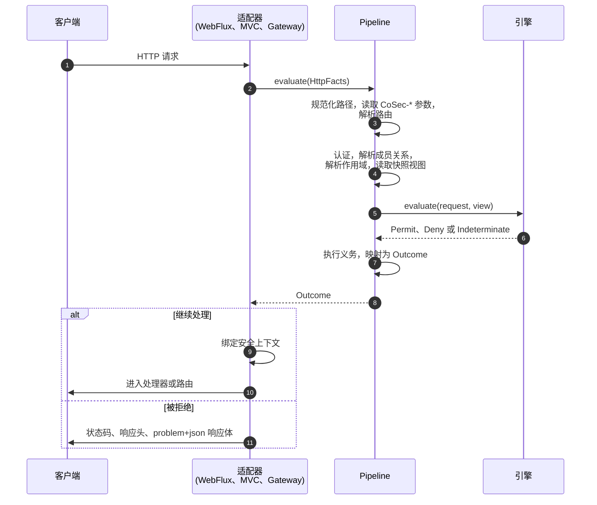

# Web 集成 {#web-integration}

面向把 CoSec 接入 Web 应用或网关的开发者。本页介绍如何选择适配器、请求经过 CoSec 时发生了什么、路由映射、CoSec 写出的响应、它读取的 `CoSec-*` 参数，以及如何在处理器中拿到安全上下文。本页是状态码映射和 problem 类型的唯一出处。

## 选择适配器 {#choosing-an-adapter}

按技术栈请求 `cosec-spring-boot-starter` 的相应 capability 来选择适配器。三个适配器都把请求交给同一个 `Pipeline`，因此对每个请求的回应逐字节一致，区别只在接入方式。

| 技术栈 | Capability | starter 注册的过滤器 | 顺序 |
|---|---|---|---|
| Spring WebFlux | `webflux-support` | `PipelineWebFilter`（`WebFilter`） | `1000` |
| Spring MVC | `webmvc-support` | `PipelineServletFilter`（Servlet `Filter`，所有 URL） | `HIGHEST_PRECEDENCE + 100` |
| Spring Cloud Gateway | `gateway-support` | `PipelineGatewayFilter`（`GlobalFilter`） | `HIGHEST_PRECEDENCE + 10` |

每个适配器都需要相应 capability、`cache-support`（快照文档和令牌吊销都存放在 Redis 中）、JWT 密钥和路由映射；只读取网关转发的身份的服务一样都不需要（[网关之后的服务](#services-behind-the-gateway)）。依赖写法见[快速开始](../guide/quick-start.md#add-the-dependency)；下面只说明不同之处。

**Spring WebFlux。** 过滤器在事件循环上启动管道，不切换线程。真正挂起之后（例如一次 Redis 读取），请求在 `Dispatchers.Default` 上继续，绝不会留在客户端库的 I/O 线程上。

**Spring MVC。** Servlet 过滤器阻塞它的请求线程直到得出结果，这是常规的 Servlet 模型。

**Spring Cloud Gateway。** 类路径上有网关的 `GlobalFilter` 时，starter 注册 `PipelineGatewayFilter`，不注册 `PipelineWebFilter`。差异见[网关](#gateway)。

使用没有 feature variant 的 Maven 时，添加 `cosec-spring-boot-starter`，以及适配器模块本身（`cosec-webflux`、`cosec-webmvc` 或 `cosec-gateway`）和 `cosec-cocache`。每个 capability 背后的模块见[模块列表](../guide/introduction.md#modules)。

## 请求的处理过程 {#how-a-request-is-handled}

每个适配器把请求一次性读入 `HttpFacts`，交给 `Pipeline.evaluate`，后者总是以一个 `Outcome` 结束，出错时也一样。适配器只负责写出这个结果，自己从不做任何决策。



1. 适配器收到请求。
2. 它读取方法、原始路径（不含 context path）、查询串、请求头、Cookie 和[客户端 IP](#client-ip-behind-proxies)，交给管道。
3. 管道对无法无歧义读取的路径或 `CoSec-*` 参数以 `400` 拒绝（[请求路径](#the-request-path)、[应用与空间](#app-and-space)），并把[路由](#route-maps)解析为动作和资源。
4. 它认证凭证（[认证](./authentication.md)），解析主体的成员关系，检查作用域，并读取请求所需的快照文档。
5. 引擎按[安全模型](../guide/security-model.md#evaluation-order)所述做出决策。
6. 返回 Permit、Deny 或 Indeterminate。
7. 执行 Permit 的限流义务（[限流](../policies/rate-limiting.md)），决策变成一个 `Outcome`（[响应与状态码](#responses-and-status-codes)）。
8. 管道把结果返回给适配器。
9. 对 Permit，适配器把安全上下文绑定到你的代码能读取的位置（[访问安全上下文](#accessing-the-security-context)）。
10. 请求继续进入你的处理器，或路由的下游服务。
11. 其他结果得到相应的状态码、响应头和 problem 响应体，永远不会到达你的处理器。

为什么只有一条决策路径，见[架构概览](../architecture/overview.md)。

## 请求路径 {#the-request-path}

CoSec 授权的路径是应用内的请求路径：

| 适配器 | 路径 |
|---|---|
| Spring MVC | 去掉 Servlet context path（`server.servlet.context-path`）后的请求 URI。它保留 `DispatcherServlet` 的映射前缀：设置 `spring.mvc.servlet.path=/api` 时，`/api/admin/users` 按 `/api/admin/users` 授权。 |
| WebFlux、Gateway | 应用内的路径，不含 `spring.webflux.base-path`。 |

在其他一切之前，`PathNormalizer` 会检查它。在所有适配器上，路径：

- **去掉 `;` 路径参数**，与 Spring 的路由方式一致：`/orders;jsessionid=1/42` 按 `/orders/42` 授权；
- **不解码**：未映射请求的资源就是收到的路径，包括百分号转义。模式如何匹配编码后的路径，见[策略语言](../policies/language.md)；
- **在认证之前以 `400` `invalid-request` 拒绝**的情况：去掉路径参数并解码一次之后，含有 `.` 或 `..` 段（包括编码后的 `;`，以及以 `\` 或 `%5C` 作分隔符时）；含有格式错误的百分号转义；长度超过 2048 个字符；或某一段超过 256 个字符。因此 Servlet 容器会解析成 `/admin` 的 `/public/..;/admin` 会被拒绝。

## 路由映射 {#route-maps}

路由映射为服务的每条路由指定一个动作和一个类型化资源，策略因此可以说 `order/42` 上的 `order:read`，而不是 `GET /orders/42`。WebFlux 和 WebMvc 宿主加载 `cosec.authorization.routes.location` 中列出的路由映射（默认 `classpath:cosec-routes.json`；可用逗号分隔多个）：

```json
{
  "service": "order",
  "routes": [
    { "method": "GET",  "path": "/orders/{orderId}",        "action": "order:read",   "resource": "order/{orderId}" },
    { "method": "POST", "path": "/orders/{orderId}/cancel", "action": "order:cancel", "resource": "order/{orderId}" }
  ]
}
```

- 路由匹配方法与其 `method` 完全相同、路径匹配其 `path` 模式的请求。资源模板中的 `{变量}` 取自路径的捕获值。
- 没有路由匹配的请求保留动作 `http:<METHOD>` 和资源 `http:path:<path>`。针对 `service:verb` 动作的语句永远覆盖不到它：没有任何路由会退回通配符。
- 路由映射要么整体加载，要么完全不加载。位置不存在、文件格式错误（字段未知或缺失、键重复、值类型错误）、某条路由格式错误，或两条路由可能匹配同一个请求（方法相同、路径无法证明互不相交），都会导致启动失败并给出位置。若有意不使用路由映射，把该属性设为空值。
- 为空或含有 `/`（解码后的 `%2F`）的捕获值不能作为类型化资源 id 的一段：请求以 `400` `invalid-request` 拒绝，绝不会被当作另一个资源求值。

Spring Cloud Gateway 宿主不加载路由映射：每个网关请求都位于 `http` 命名空间。

使用 `openapi-support` 和 Spring Boot Actuator 时，端点 `cosecServiceGenerator/routes` 根据服务的 OpenAPI 文档生成路由映射，`cosecServiceGenerator/app` 生成对应的、通过控制面发布的应用文档（[角色权限](../policies/role-permissions.md)）。

## 响应与状态码 {#responses-and-status-codes}

每个状态码都来自管道中的 `StatusMapping`；适配器只负责把它写进响应。只有 Permit 的请求才会进入你的处理器。

| 状态码 | problem 类型 | 何时出现 |
|---|---|---|
| `200`（继续处理） | 无，由处理器回应 | 决策为 Permit，且每条限流义务都还有许可。 |
| `400` | `invalid-request` | 路径无法无歧义地读取（[请求路径](#the-request-path)）、某个 `CoSec-*` 参数的值相互冲突（[应用与空间](#app-and-space)），或路由捕获了不能作为资源 id 段的值（[路由映射](#route-maps)）。引擎根本看不到这个请求。在网关之后：无法读取的 `CoSec-Identity`（[网关之后的服务](#services-behind-the-gateway)）。 |
| `401` | `unauthorized` | Deny，且调用方是匿名的：没有凭证。包括作用域被拒绝，例如声明了 `CoSec-Space-Id` 的匿名请求。 |
| `401` | `token-invalid` | Deny，且凭证因无效被拒绝：令牌校验不通过，或 API key 未知、已停用或已过期。在网关之后：版本未知、来自未来或没有凭证有效期的 `CoSec-Identity`。 |
| `401` | `token-expired` | Deny，且令牌已过期。在网关之后：`CoSec-Identity` 或其凭证过旧。 |
| `401` | `token-revoked` | Deny，且该令牌或其主体的全部令牌已被吊销。 |
| `403` | `forbidden` | Deny，且调用方已认证：显式 DENY、隐式拒绝或平台边界。 |
| `403` | `scope-rejected` | 调用方已认证，且作用域被拒绝：声明了与宿主不同的应用，或主体在声明的空间中没有角色。 |
| `429` | `too-many-requests` | Permit，但某条匹配的[限流规则](../policies/rate-limiting.md)已没有许可。 |
| `503` | `unavailable` | 无法做出决策：Indeterminate；认证器或成员关系提供者失败或超时；快照源失败；严格的限流规则无法计数；Permit 时某个 REQUIRED 决策监听器失败；只有 break-glass 放行却没有 REQUIRED 监听器；或超过了 `cosec.pipeline.timeout`。 |
| `500` | `internal-error` | 未被建模的异常：CoSec 的缺陷。在网关上，还包括身份无法转发的 Permit（[转发身份](#forwarding-the-identity)）。 |

被拒绝的凭证不是错误。请求按匿名主体求值：Permit 照常继续（公开路径带着过期令牌也能访问），只有 Deny 才会指出凭证的问题。显式拒绝和隐式拒绝都是 `forbidden`（或 `unauthorized`），因此响应永远不会告诉调用方某条 DENY 存在。为什么出错时拒绝，见[失败即拒绝](../guide/security-model.md#fail-closed)；各状态码的常见原因见[故障排查](../operations/troubleshooting.md)。

### problem 响应体 {#problem-bodies}

每个不继续处理的响应都带有 RFC 9457 响应体，内容类型为 `application/problem+json`：

```json
{"type":"https://cosec.ahoo.me/problems/forbidden","title":"Forbidden","status":403,"code":"FORBIDDEN","requestId":"0ef3c9d2a4b14d7e","traceId":"4bf92f3577b34da6a3ce929d0e0e4736"}
```

| 成员 | 内容 |
|---|---|
| `type` | `https://cosec.ahoo.me/problems/<slug>`，对应上表的每一行。 |
| `title` | `Invalid Request`、`Unauthorized`、`Token Invalid`、`Token Expired`、`Token Revoked`、`Forbidden`、`Scope Rejected`、`Too Many Requests`、`Service Unavailable`、`Internal Server Error`。 |
| `status` | HTTP 状态码。 |
| `code` | slug 的大写下划线形式：`INVALID_REQUEST`、`UNAUTHORIZED`、`TOKEN_INVALID`、`TOKEN_EXPIRED`、`TOKEN_REVOKED`、`FORBIDDEN`、`SCOPE_REJECTED`、`TOO_MANY_REQUESTS`、`UNAVAILABLE`、`INTERNAL_ERROR`。 |
| `requestId` | 与 `CoSec-Request-Id` 响应头的值相同。 |
| `traceId` | 追踪 id，仅当适配器处捕获到追踪时出现。 |

成员总是按这个顺序出现，响应体不含任何其他内容：没有策略、语句、绑定、原因或异常信息。它由一个手写的编码器（`ProblemEncoder`）写出，因此无论宿主的 JSON 配置如何，三个适配器写出的字节都相同。响应体是 ASCII：请求 id 中的所有非 ASCII 字符和控制字符都会被转义。这套词汇也以 `schema/problem.schema.json` 发布。

### 响应头 {#response-headers}

- **`CoSec-Request-Id`**，出现在每个结果上，包括 `400`：如果调用方自己发送的 `CoSec-Request-Id` 请求头是一个普通 id（1 到 64 个 `A-Z a-z 0-9 . _ -` 字符），就用它，否则生成一个。网关会把它转发给下游。
- **`RateLimit-Limit`、`RateLimit-Remaining`、`RateLimit-Reset`**，在匹配的限流规则被计数时出现：继续处理的响应上（取剩余许可最少的规则）以及 `429` 上。`429` 还带有 `Retry-After`。它们的取值见[响应与响应头](../policies/rate-limiting.md#responses-and-headers)。
- `503` 从不带 `Retry-After`。

## 应用与空间 {#app-and-space}

客户端通过请求头或同名查询参数发送 `CoSec-*` 参数：

| 参数 | 含义 | 条件中的读取方式 |
|---|---|---|
| `CoSec-App-Id` | 请求所属的应用。设置了 `cosec.authorization.scope.app-id` 时以它为准；此时不同的值会被拒绝。 | `scope.app` |
| `CoSec-Space-Id` | 应用中的空间。仅当主体在该空间有角色时接受；为空表示默认空间。 | `scope.space`（以及该空间中的角色 `scope.roles`） |
| `CoSec-Device-Id` | 调用方的设备。除非策略或黑名单读取它，否则仅供参考。 | `environment.device` |
| `CoSec-Request-Id` | 仅限请求头：请求 id（[响应头](#response-headers)）。 | |

读取规则：

- 请求头名称匹配时忽略大小写；查询参数名称精确匹配。
- 同一参数可以发送多次，放在请求头、查询串或两者中都可以，只要所有非空值都相同。空值被忽略。
- 任何位置出现两个不同的值，请求就有歧义：管道和你的处理器可能读到不同的作用域。这样的请求以 `400` `invalid-request` 拒绝。`CoSec-*` 查询值含格式错误的百分号转义时同样如此。
- 永远不读取请求体：授权过滤器不读取请求体。

`ScopeResolver` 如何检查应用和空间，以及客户端因此能控制什么，见[信任边界](../guide/security-model.md#trust-boundaries)。令牌如何携带 `role@space` 见[角色与空间](./authentication.md#roles-and-spaces)，角色绑定如何限定到应用和空间见[角色权限](../policies/role-permissions.md)。请从[安全上下文](#accessing-the-security-context)读取已校验的作用域，而不是读请求头：请求头只是客户端的声明。

## 访问安全上下文 {#accessing-the-security-context}

对继续处理的请求，适配器绑定一个根据管道结果构建的 `SecurityContext`（`me.ahoo.cosec.api.context`）。被拒绝的请求永远不会到达你的处理器。

| 成员 | 内容 |
|---|---|
| `principal.id` | 主体；匿名调用方为 `(0)`。 |
| `tenant.tenantId` | 作用域的租户：主体的租户，匿名调用方为 `(0)`。 |
| `principal.roles` | 主体在请求空间中的角色。 |
| `principal.policies` | 主体的附加策略。 |
| `principal.attributes` | 凭证的属性（令牌的 `attributes` 声明；API key 则有 `apiKeyId`）。在网关之后：转发来的 `claims`。 |
| `scope.appId`、`scope.spaceId`、`scope.roles` | `ScopeResolver` 校验后的作用域：应用、空间（默认空间为空）以及该空间中的角色。 |

**WebFlux 和网关**：从 exchange 属性中读取，或从请求的 Reactor 上下文中读取。exchange 的 principal 也已设置，因此 `exchange.getPrincipal()` 返回 CoSec 主体。

```kotlin
import me.ahoo.cosec.webflux.ReactiveSecurityContexts.getSecurityContext
import me.ahoo.cosec.webflux.ServerWebExchanges.getSecurityContext

fun currentUser(): Mono<String> =
    Mono.deferContextual { context -> Mono.just(context.getSecurityContext().principal.id) }

// 手头有 exchange 时；CoSec 没有处理该请求时为 null
val securityContext = exchange.getSecurityContext()
```

**Spring MVC**：从绑定到线程的持有者中读取，或从 Servlet 请求中读取。请求完成时过滤器会清除持有者，因此要在请求线程上读取，不要在你自己启动的线程上读取。

```kotlin
import me.ahoo.cosec.context.SecurityContextHolder
import me.ahoo.cosec.servlet.ServletRequests.getSecurityContext

val securityContext = SecurityContextHolder.requiredContext
// 或者
val securityContext = httpServletRequest.getSecurityContext()
```

这个上下文正是 `AuthorizationChecker` 接受的上下文，用于询问同一主体能否做别的事（[代码中的权限检查](./checks.md)）。

## 代理后的客户端 IP {#client-ip-behind-proxies}

策略、限流键、黑名单和审计事件看到的客户端 IP 是 `environment.ip`。把 `cosec.authorization.remote-ip.max-trusted-index` 设为应用前面的代理数量（默认 `1`）。CoSec 随后从 `X-Forwarded-For` 右侧数起取该位置的条目，也就是你最外层代理追加的那一条，因此客户端写在该请求头左侧的值永远不会被使用。条目数少于该值时，使用最左侧的条目。

`0` 表示忽略 `X-Forwarded-For`，使用 socket 地址：在客户端可直接访问的宿主上请设为 `0`，否则客户端可以声称任意地址。没有 `X-Forwarded-For`，或有多个这样的请求头时，同样使用 socket 地址。IP 永远不会通过反向 DNS 解析。

## 请求属性 {#request-attributes}

除了凭证、作用域、动作和资源，条件还可以读取 HTTP 请求携带的内容（`http.header.<name>`、`http.origin`、`http.referer` 及其主机），它们由客户端写入；以及**请求属性** `request.attributes.<name>`，它们由适配器设置，客户端无法设置。网关过滤器会设置 `request.attributes.cosec.audit.routeId`，即匹配到的路由 id；在[选择不转发](#forwarding-the-identity)身份的路由上，还会设置 `request.attributes.cosec.identity.forward`（`false`）。属性名称，以及多次发送的请求头如何读取，见[策略语言](../policies/language.md)；其中哪些由客户端控制，见[信任边界](../guide/security-model.md#trust-boundaries)。

请求本身不携带的信息，由 `AttributeProvider` Bean 以**外部属性** `ext.<provider>.<name>` 提供，并且只在候选语句读取时才获取（[外部属性缺失](../guide/security-model.md#missing-external-attributes)）。内置的外部属性：

| 属性 | 由谁添加 | 值 |
|---|---|---|
| `ext.ip2region.country`、`.province`、`.city`、`.isp` | `ip2region-support`，需开启 `cosec.ip2region.enabled`（默认开启） | 客户端 IP 的归属地，来自内嵌的 [ip2region](https://github.com/lionsoul2014/ip2region) 数据库。 |
| `ext.blacklist.principal`、`.ip`、`.device` | 你的 `BlacklistAttributeProvider` Bean | 请求是否被拦截（[黑名单](../guide/security-model.md#blacklist)）。 |

```json
{ "eq": ["ext.ip2region.country", "中国"] }
```

要添加自己的外部属性，声明一个 `AttributeProvider` Bean（[扩展 CoSec](../architecture/extending.md)）。

## CORS {#cors}

浏览器发送 CORS 预检请求时不带凭证，因此授权会以 `401` 回应它们。使用 WebFlux 时，注册 `OrderedCorsWebFilter`；它的顺序为 `999`，正好在 `PipelineWebFilter` 之前，自己回应预检请求：

```kotlin
@Bean
fun corsWebFilter(source: CorsConfigurationSource) = OrderedCorsWebFilter(source)
```

使用 Spring MVC 时，注册一个顺序早于 `HIGHEST_PRECEDENCE + 100` 的 CORS 过滤器。

## 网关 {#gateway}

在 Spring Cloud Gateway 上，`PipelineGatewayFilter` 在任何路由过滤器运行之前授权请求。它与 WebFlux 过滤器有三点不同：

- 它只作用于网关路由：没有路由匹配的请求，以及网关自己的 actuator 端点，都不经 CoSec 授权。请通过管理端口或网络策略保护 actuator；
- 它不加载路由映射，因此每个请求都是 `http:path:<path>` 上的 `http:<METHOD>`；
- 它把结果中的 `CoSec-Request-Id` 转发给下游服务，替换客户端发送的任何值，使后端日志与网关共享同一个请求 id。Permit 时它还转发校验过的身份（[转发身份](#forwarding-the-identity)），并且除非设置了 `cosec.gateway.identity.forward-authorization=true`，它会移除客户端的 `Authorization` 请求头。

宿主应用（`cosec.authorization.scope.app-id`）对整个网关只有一个值，不能按路由设置。一个网关面向多个应用时，如何防止客户端声明的应用放大权限，见[信任边界](../guide/security-model.md#trust-boundaries)。

网关后面的服务要么信任网关转发的身份（[网关之后的服务](#services-behind-the-gateway)），要么运行自己的管道并再次校验令牌（[网关之后](./authentication.md#behind-a-gateway)）。

**开箱即用的网关。** `cosec-gateway-server` 是一个集成了 CoSec、从 Redis 读取文档的 Spring Cloud Gateway 应用，以容器镜像发布：

```bash
docker run -p 8080:8080 -e SPRING_DATA_REDIS_URL=redis://redis:6379 -e COSEC_JWT_SECRET=... ahoowang/cosec-gateway:<version>
```

镜像同时以 `ghcr.io/ahoo-wang/cosec-gateway` 发布。请先发布它的平台文档（[快速开始](../guide/quick-start.md#publish-the-platform-document)）；在此之前每个经路由的请求都是 `503`。路由和 CoSec 通过标准 Spring 配置设置；默认值见其 [`application.yaml`](https://github.com/Ahoo-Wang/CoSec/blob/main/platform/gateway-server/src/main/resources/application.yaml)。Kubernetes 示例清单在 [`k8s/`](https://github.com/Ahoo-Wang/CoSec/tree/main/k8s) 中。它们从名为 `cosec-jwt-secret` 的 Secret 读取 JWT 密钥；请先创建它，并把镜像标签设为你部署的版本：

```bash
kubectl create secret generic cosec-jwt-secret --from-literal=secret=<随机值>
```

### 转发身份 {#forwarding-the-identity}

对已认证主体的 Permit，网关在 `CoSec-Identity` 请求头中告诉下游服务它校验了谁。这样服务自己不需要密钥、key、文档或 Redis。默认开启（`cosec.gateway.identity.enabled`）。

**客户端无法伪造它。** 每个网关宿主都会在任何其他过滤器运行之前移除客户端发送的 `CoSec-Identity`（`IdentityStripFilter`），并在最后一跳、所有路由过滤器之后再移除一次（`IdentityHeadersFilter`），只发送管道转发的值。无论 `cosec.pipeline.mode` 或 `cosec.enabled` 如何设置，两者都会运行，因此添加该请求头的路由过滤器也无法转发身份。读取 `http.header.cosec-identity` 的条件无法编译。

**不转发身份的情况**：匿名的 Permit、被拒绝的请求、元数据选择不转发的路由，或设置了 `cosec.gateway.identity.enabled=false`。后端是第三方时，让该路由选择不转发：

```yaml
spring:
  cloud:
    gateway:
      server:
        webflux:
          routes:
            - id: partner
              uri: https://partner.example.com
              predicates:
                - Path=/partner/**
              metadata:
                cosec-identity: false
```

**它携带的内容。** 值是紧凑 JSON 的 base64url 编码（无填充），格式版本 1；JSON Schema 是 [`schema/cosec-identity.schema.json`](https://github.com/Ahoo-Wang/CoSec/blob/main/schema/cosec-identity.schema.json)。

| 成员 | 内容 |
|---|---|
| `v` | `1`。 |
| `tenant`、`sub` | 网关校验的租户和主体。 |
| `scope` | `{app, space}`，即网关解析出的应用和空间。 |
| `roles` | 主体在该空间中的角色：决策所用的角色。 |
| `auth` | `{method, jti, exp}`：主体的认证方式（`jwt` 和 `api-key` 是 CoSec 自带的；其他任何非空名称都按原样读取，因此使用其他认证器的网关也能工作）、令牌的 `jti` 或 key 的 id，以及凭证的过期时间。绝不包含凭证本身。 |
| `iat` | 网关生成该请求头的时间，单位为 epoch 秒。 |
| `rid` | 网关的请求 id。 |
| `claims` | 只包含 `cosec.gateway.identity.claims` 中列出的主体属性（令牌的 `attributes` 声明，或 API key 的属性）：字符串、数字和布尔值。 |

它绝不携带令牌、API key、cookie 或其他请求头、策略、匹配的语句、外部属性值或客户端 IP。

**失败即拒绝。** 以下情况请求返回 `500` `internal-error` 并记录日志，不做任何截断：身份大于 `cosec.gateway.identity.max-size`（8 KB）；列出的某个声明不是字符串、数字或布尔值，或长于 1024 个字符；凭证永不过期（例如没有 `expires-at` 的 [API key](./authentication.md#api-keys)）：服务无法为这样的身份设定边界。

**`Authorization`。** 网关在转发前移除客户端的 `Authorization` 请求头，因此被攻破的服务永远看不到令牌。只有当后面的服务要再次校验令牌，或要代表用户调用其他 API 时，才设置 `cosec.gateway.identity.forward-authorization=true`。

### 网关之后的服务 {#services-behind-the-gateway}

网关之后的服务设置 `cosec.pipeline.mode=gateway`（默认为 `enforce`）。它只需要自己的 Web 适配器（`webflux-support` 或 `webmvc-support`），并且除非它也签发令牌，应设置 `cosec.jwt.enabled=false`：

```yaml
cosec:
  pipeline:
    mode: gateway
  jwt:
    enabled: false
```

在这个模式下，适配器通过 `IdentityGate` 读取转发来的身份，starter 不装配认证器、快照、路由映射、限流、控制面、`AuthorizationChecker` 或 Redis。服务不基于策略做任何决策：决策已由网关做出。它相信收到的任何 `CoSec-Identity`，因此**只有网关能访问到它**：如何保证这一点以及启动时的检查，见部署指南中的[网关后面的服务](../operations/deployment.md#services-behind-the-gateway)。

| 请求 | 回应 |
|---|---|
| 没有 `CoSec-Identity` | 作为匿名主体 `(0)` 继续；由你的代码决定它能看到什么。 |
| 有效的身份 | 以该主体、在该作用域中继续。 |
| 无法读取（不是 base64url、不符合格式、有未知或重复的成员、角色重复、`iat` 或 `exp` 超过 9999 年）、发送了不止一次、大于 `cosec.pipeline.gateway.max-size`（8 KB），或作用域在本服务无法解析（例如应用不是 `cosec.authorization.scope.app-id`） | `400` `invalid-request` |
| 未知版本、`iat` 在未来，或没有 `auth.exp` | `401` `token-invalid` |
| `auth.exp` 已过，或 `iat` 早于 `cosec.pipeline.gateway.max-age`（60 秒） | `401` `token-expired` |

这些时间检查为网关的时钟留出 `cosec.authentication.revocation.skew`（5 秒）的偏差。最大时长限制了在网络内部重放截获的请求头：吊销只在网关检查。响应带有网关的 `CoSec-Request-Id`。

继续处理的请求的[安全上下文](#accessing-the-security-context)包含：

| 成员 | 内容 |
|---|---|
| `principal.id`、`tenant.tenantId` | `sub` 和 `tenant`；没有身份时两者都是 `(0)`。 |
| `principal.roles`、`scope.roles` | `roles`。 |
| `principal.policies` | 空。 |
| `principal.attributes` | `claims`。 |
| `scope.appId`、`scope.spaceId` | `scope.app` 和 `scope.space`。 |
| `attributes["cosec.identity.rid"]`、`attributes["cosec.identity.jti"]` | 网关的请求 id 和凭证的 id（`auth.jti`）。 |

## 控制面路由 {#control-plane-routes}

启用 `control-support`（以及 `cache-support`）时，starter 在 WebFlux 或 WebMvc 宿主上以函数式路由在 `{cosec.control.http.base-path}/v1`（默认 `/cosec/control/v1`）下提供控制面的 HTTP API。API 的功能见[策略测试](../policies/testing.md)和[解释一个决策](./checks.md#explaining-a-decision)；它的请求按以下方式处理：

- **先经过管道。** 控制请求对宿主来说是普通请求：你的文档必须放行它（例如对已认证调用方放行 `http:path:/cosec/control/v1/**` 上的 `http:POST`），否则它会像其他请求一样被拒绝。在平台文档发布之前，每个请求（包括控制路由）都是 `503`，因此第一份平台文档要通过 `cosec-migrate publish` 发布（[快速开始](../guide/quick-start.md#publish-the-platform-document)）。
- **再经过控制面自己的检查。** 每次调用都以请求的主体身份，在应用 `cosec.control.app-id`（默认 `cosec-control`）的默认空间中、基于已确认为最新的文档再次授权。匿名请求返回 `401`。租户隔离最先检查，而且不是策略：租户的主体只能操作自己租户的文档。
- **请求体大小。** 在 WebMvc 上最多读取 `cosec.control.http.max-body-size`（默认 `16MB`）；更大的请求体返回 `400` `invalid-request`，且不会被读取。在 WebFlux 上，请求体受 Spring 的 `spring.codec.max-in-memory-size`（默认 256 KB）限制：在接收大文档的控制面宿主上请调大它。
- **网关宿主。** 网关的全局过滤器只作用于网关路由，因此 starter 额外添加一个只作用于基础路径的 `PipelineWebFilter`。控制路由像在 WebFlux 宿主上一样被授权；网关的路由仍由网关过滤器处理。

控制 API 以相同格式回应 problem，类型除上文所列外还有它自己的：`not-found`（`404`）、`conflict`（`409`）、`gone`（`410`）、`precondition-failed`（`412`）、`unprocessable`（`422`）和 `precondition-required`（`428`）。`400`、`409`、`410`、`412`、`422` 和 `428` 会在 `detail` 成员中解释调用方自己的请求；`401`、`403`、`404`、`500` 和 `503` 不带任何细节，因此拒绝永远不会透露某个文档、变更或 DENY 是否存在。

**下一步：** 签发、刷新和吊销适配器读取的令牌，见[认证](./authentication.md)。
