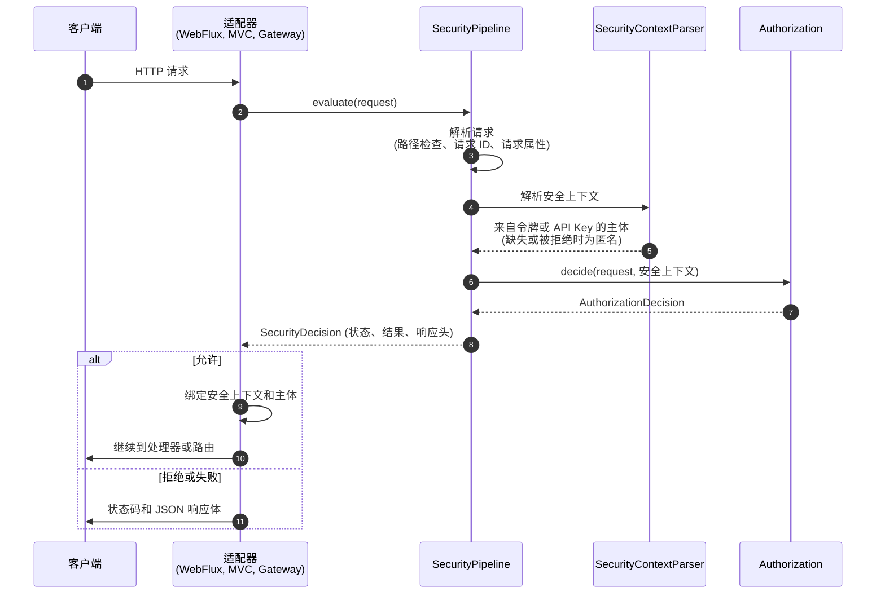

# Web 集成 {#web-integration}

面向把 CoSec 接入 Web 应用或网关的开发者。本页介绍如何选择适配器、一个请求在 CoSec 中经过哪些步骤、CoSec
写出的响应、它读取的请求头和请求属性，以及如何在处理器中拿到安全上下文。

## 选择适配器 {#choosing-an-adapter}

按技术栈选择适配器：在 `cosec-spring-boot-starter` 上声明对应的 capability。三种适配器运行同一个
`SecurityPipeline`，对每个请求的回答完全相同，只是接入方式不同。

| 技术栈 | Capability | starter 注册的组件 | 顺序 |
|---|---|---|---|
| Spring WebFlux | `webflux-support` | `ReactiveAuthorizationFilter`（`WebFilter`） | `1000` |
| Spring MVC | `webmvc-support` | `AuthorizationFilter`（Servlet `Filter`，拦截所有 URL） | Spring Boot 默认的过滤器顺序 |
| Spring Cloud Gateway | `gateway-support` | `AuthorizationGatewayFilter`（`GlobalFilter`） | `HIGHEST_PRECEDENCE + 10` |

每种适配器都需要三样东西：对应的 capability；一个 `PolicyRepository` 和一个 `AppRolePermissionRepository`
（来自 `cache-support`，或者你自己的 Bean，见[选择存储](../operations/storage.md#choosing-a-store)）；以及 JWT 密钥。
下面的片段只列出各适配器不同的部分。包含第一条策略和登录接口的完整流程见[快速开始](../guide/quick-start.md)。

**Spring WebFlux**

```kotlin
dependencies {
    implementation(platform("me.ahoo.cosec:cosec-bom:<version>"))
    implementation("me.ahoo.cosec:cosec-spring-boot-starter") {
        capabilities { requireCapability("me.ahoo.cosec:webflux-support") }
    }
    implementation("me.ahoo.cosec:cosec-spring-boot-starter") {
        capabilities { requireCapability("me.ahoo.cosec:cache-support") }
    }
}
```

```yaml
cosec:
  jwt:
    secret: ${COSEC_JWT_SECRET}
```

**Spring MVC**：同上，把 `webflux-support` 换成 `webmvc-support`。Servlet 过滤器会阻塞请求线程直到得出决策，这是
Servlet 的常规模型。CoSec 匹配的是 `HttpServletRequest.servletPath`，它不包含上下文路径
（`server.servlet.context-path`）：策略里的路径要相对于上下文路径来写。`DispatcherServlet` 保持映射到 `/`（默认值）。
如果设置了 `spring.mvc.servlet.path`，servlet path 就只剩这个前缀，CoSec 看到的所有请求都一样。

**Spring Cloud Gateway**：同上，换成 `gateway-support`。只要网关的 `GlobalFilter` 在类路径上，starter 就注册
`AuthorizationGatewayFilter`，不再注册 `ReactiveAuthorizationFilter`。因此关闭网关过滤器
（[功能开关](../operations/configuration.md#feature-switches)）会让网关完全没有授权。网关额外做的事见[网关](#gateway)。

Maven 没有 feature variant，需要直接引入 `cosec-spring-boot-starter` 和适配器模块本身（`cosec-webflux`、
`cosec-webmvc` 或 `cosec-gateway`）。每个 capability 对应的模块见[模块列表](../guide/introduction.md#modules)。

## 请求的处理过程 {#how-a-request-is-handled}

每个适配器都把请求交给 `SecurityPipeline`，后者总会得出一个 `SecurityDecision`，出错时也一样。适配器只负责把这个
决策写出去，自己从不做决定。



1. 适配器收到请求。
2. 把传输层的请求交给管道。
3. 管道把它转换成 CoSec 的 `Request`。路径含遍历片段时到此为止，返回 `400`。否则取调用方的 `CoSec-Request-Id`
   或生成一个，解析[客户端 IP](#client-ip-behind-proxies)，并运行每个[请求属性](#request-attributes) appender。
4. 安全上下文解析器读取凭证：配置了 API Key 且请求带了 API Key 时用它，否则用令牌（[认证](./authentication.md#tokens)）。
   启用令牌吊销或阻塞式 API Key 存储时，响应式适配器在 `boundedElastic` 上执行这一步，不占用事件循环。
5. 凭证缺失或被拒绝不算错误：请求以匿名身份继续，拒绝原因会保留下来，用于解释之后的 `401`。解析器的其他错误一律得到
   `500`。
6. 授权链按[安全模型](../guide/security-model.md#evaluation-order)中的顺序做出决定。
7. 返回决策，以及可能的限流结果。
8. 管道把决策映射为状态码，见[下表](#responses-and-status-codes)。
9. 对于允许的请求，适配器把安全上下文（WebFlux 和网关还有 exchange 的 principal）绑定到你的代码能读到的地方
   （[访问安全上下文](#accessing-the-security-context)）。
10. 请求继续到你的处理器，或者路由的下游服务。
11. 被拒绝或失败的请求得到状态码和 JSON 响应体，不会到达你的处理器。

## 响应与状态码 {#responses-and-status-codes}

所有状态码都来自 `SecurityPipeline`，适配器只是把它写到响应上。

| 状态码 | 何时出现 | 响应体中的 `reason` |
|---|---|---|
| `200`（请求放行） | 授权决策允许。 | 无，由处理器响应 |
| `400` | 路径含 `.` 或 `..` 片段（包括百分号编码的形式），或百分号转义格式错误（`InvalidRequestPathException`）。 | 无响应体 |
| `401` | 被拒绝，且调用方是匿名的：没有凭证，或凭证被拒绝。 | 凭证被拒绝时为 `Token Expired` 或 `Token Invalid`；否则为 `Implicit Deny` 或 `Explicit Deny` |
| `403` | 被拒绝，且调用方已认证。 | `Implicit Deny` 或 `Explicit Deny` |
| `403` | 正则条件超出了时间预算（`RegexTimeoutException`）。这是预期内的拒绝，不是服务端错误。 | `Implicit Deny` |
| `429` | 请求本已允许，但匹配的[限流规则](../policies/rate-limiting.md)没有剩余许可。 | `Too Many Requests` |
| `500` | 其他任何错误。CoSec 失败即拒绝，而不是去猜。 | `Implicit Deny` |

`500` 包括但不限于：

- `MissingPolicyException`：主体（或全局策略索引）列出了仓库里没有的策略。它可能正是挡住这个请求的拒绝策略，所以
  CoSec 不会在缺少它的情况下求值。
- `CacheReadException`：策略或权限不在本地缓存里且读不到 Redis，或者存储的值无法解码（例如没有迁移的 6.x 数据）。
  见 [Redis 不可用时](../operations/storage.md#when-redis-is-unavailable)。
- `PathVariableScopeException`：存储的策略或权限在作用域之外读取 `request.path.var.*`，读取时被拒绝
  （[路径变量](../policies/language.md#path-variables)）。
- 抛出异常的自定义匹配器、仓库或 API Key 存储（包括连不上 Redis 的 Redis API Key 存储）。

为什么出错就拒绝，见[失败即拒绝](../guide/security-model.md#fail-closed)；两个有意为之的例外，见[两个已写明的例外](../guide/security-model.md#the-two-documented-exceptions)。每个状态码的常见原因见
[故障排查](../operations/troubleshooting.md#by-status-code)。

被拒绝的请求带有 JSON 响应体，内容类型为 `application/json`：

```json
{ "authorized": false, "reason": "Implicit Deny" }
```

**响应头。** 通过路径检查的请求都带有 `CoSec-Request-Id`：调用方自己传了就用它的值，否则用生成的 ID。网关还会把它
转发给下游。如果有限流规则匹配了这个请求，响应（无论允许还是拒绝）还会带上：

| 响应头 | 值 |
|---|---|
| `RateLimit-Limit` | 规则的限额。 |
| `RateLimit-Remaining` | 当前窗口剩余的许可数。 |
| `RateLimit-Reset` | 距离窗口重置的秒数，最小为 `1`。 |
| `Retry-After` | 仅在 `429` 时出现：同样的秒数。 |

多条规则同时匹配时，允许的响应描述其中最紧的一条，`429` 描述耗尽的那一条；见
[响应与响应头](../policies/rate-limiting.md#responses-and-headers)。

## 访问安全上下文 {#accessing-the-security-context}

安全上下文包含主体、主体的租户和解析后的请求。对于允许的请求，处理器可以按下面的方式读取；被拒绝的请求不会到达处理器。

**WebFlux 和网关**：从请求的 Reactor 上下文中读取，或从 exchange 的属性中读取。exchange 的 principal 也已设置，所以
`exchange.getPrincipal()` 返回的就是 CoSec 主体。

```kotlin
import me.ahoo.cosec.webflux.ReactiveSecurityContexts.getSecurityContext
import me.ahoo.cosec.webflux.ServerWebExchanges.getSecurityContext

fun currentUser(): Mono<String> =
    Mono.deferContextual { context -> Mono.just(context.getSecurityContext().principal.id) }

// 手里有 exchange 时；请求没经过 CoSec 则为 null
val securityContext = exchange.getSecurityContext()
```

**Spring MVC**：从线程绑定的 holder 中读取，或从 Servlet 请求中读取。请求结束时过滤器会清空 holder，所以要在请求线程上读，
不要在自己启动的线程里读。

```kotlin
import me.ahoo.cosec.context.SecurityContextHolder
import me.ahoo.cosec.servlet.ServletRequests.getSecurityContext

val securityContext = SecurityContextHolder.requiredContext
// 或者
val securityContext = httpServletRequest.getSecurityContext()
```

如果要在代码中判断当前主体能否做另一件事，见[代码中的权限检查](./checks.md)。

## 应用与空间 {#app-and-space}

三个请求头说明请求发生在哪里。每个都可以改用同名查询参数传递；两者都有时以请求头为准。

| 请求头 | 含义 | 谁读取它 |
|---|---|---|
| `CoSec-App-Id` | 请求所属的应用。角色授权只在授予它的应用中生效。 | 角色权限，条件中的 `request.appId` |
| `CoSec-Space-Id` | 应用内的空间。只有主体写成 `role@<该空间>` 的角色生效；不带这个头时，只有不带后缀的角色生效。 | 角色权限，`inRole`，条件中的 `request.spaceId` |
| `CoSec-Device-Id` | 调用方的设备。仅供参考：除非策略用到它，CoSec 不据此做任何决定。 | 条件中的 `request.deviceId`，审计事件，链路追踪 |

角色、空间和授权如何组合，见[角色授权的作用域](../policies/role-permissions.md#role-grant-scope)；令牌如何携带
`role@space`，见[角色与空间](./authentication.md#roles-and-spaces)。

这三个值都由客户端设置。空间只能在凭证声明的角色中做选择，但应用 ID 是 CoSec 原样接受的；多个应用共享路径时这意味着
什么、如何在网关上绑定它，见[信任边界](../guide/security-model.md#trust-boundaries)。

## 代理后的客户端 IP {#client-ip-behind-proxies}

策略和审计事件通过 `request.remoteIp` 看到客户端 IP。把 `cosec.authorization.remote-ip.max-trusted-index`
（[授权配置](../operations/configuration.md#authorization)）设为应用前面的代理数量。CoSec 会从 `X-Forwarded-For`
右侧数这么多项（也就是你自己的代理追加的那些），取那一项，所以客户端写在这个头左侧的值永远不会被采用。`0` 表示忽略
`X-Forwarded-For`，使用套接字地址。请求没有 `X-Forwarded-For`，或有多个这样的头时，同样使用套接字地址。IP 从不做反向
DNS 解析。

## 请求属性 {#request-attributes}

请求属性是授权前附加到请求上的字符串值。条件以 `request.attributes.<name>` 读取它们，审计事件也会包含它们。客户端无法设置
请求属性：它们只来自 `RequestAttributesAppender` Bean。

| 属性 | 由谁添加 | 值 |
|---|---|---|
| `ipRegion` | `ip2region-support` | 客户端 IP 的地理位置（国家、地区、城市、运营商），查自内置的 [ip2region](https://github.com/lionsoul2014/ip2region) 数据库。查询失败时不存在。 |
| `cosec.audit.routeId` | `gateway-support`，且开启审计 | 匹配到的网关路由 ID。 |

```json
{ "contains": { "part": "request.attributes.ipRegion", "value": "中国" } }
```

要添加自己的属性，声明一个 `RequestAttributesAppender` Bean；所有 appender 依次执行
（[请求与安全上下文](../architecture/extending.md#request-and-security-context)）。

## CORS {#cors}

浏览器发送 CORS 预检请求时不带凭证，所以授权会对它们返回 `401`。在 WebFlux 中注册 `OrderedCorsWebFilter`；它的顺序是
`999`，紧挨在授权过滤器之前，自己回答预检请求：

```kotlin
@Bean
fun corsWebFilter(source: CorsConfigurationSource) = OrderedCorsWebFilter(source)
```

在 Spring MVC 中，注册一个在 `AuthorizationFilter` 之前运行的 CORS 过滤器。

## 网关 {#gateway}

在 Spring Cloud Gateway 上，CoSec 在任何路由过滤器运行之前完成授权。除了所有适配器都做的事，`AuthorizationGatewayFilter`
还会：

- 把 `CoSec-Request-Id` 转发给下游服务，让下游日志使用和网关相同的请求 ID；
- 把匹配到的路由 ID 作为[请求属性](#request-attributes) `cosec.audit.routeId` 添加到请求上。

网关后面的服务不必再次授权：它们可以从转发来的令牌中读取主体，而不校验签名。配置方法以及什么情况下这样做是安全的，见
[网关之后](./authentication.md#behind-a-gateway)。

**开箱即用的网关。** `cosec-gateway-server` 是一个带 CoSec 授权、基于 Redis 的策略存储和本地策略初始化的 Spring Cloud
Gateway 应用，以容器镜像发布：

```bash
docker run -p 8080:8080 -e COSEC_JWT_SECRET=... ahoowang/cosec-gateway:<version>
```

镜像也发布为 `ghcr.io/ahoo-wang/cosec-gateway`。路由和 CoSec 通过标准的 Spring 配置来设置；默认值见它的
[`application.yaml`](https://github.com/Ahoo-Wang/CoSec/blob/main/cosec-gateway-server/src/main/resources/application.yaml)。
Kubernetes 清单示例在 [`k8s/`](https://github.com/Ahoo-Wang/CoSec/tree/main/k8s) 中。它们从名为 `cosec-jwt-secret`
的 Secret 读取 JWT 密钥；请先创建这个 Secret，并把镜像标签设为你部署的版本：

```bash
kubectl create secret generic cosec-jwt-secret --from-literal=secret=<random value>
```
