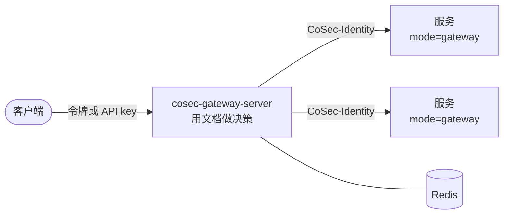

# 部署网关服务 {#deploying-the-gateway-server}

面向用 Docker 镜像或在 Kubernetes 上运行 `cosec-gateway-server`（前置了 CoSec 的现成 Spring Cloud Gateway）的运维人员，
以及要自己构建类似镜像的团队。本页介绍镜像里有什么、它向后面的服务转发什么、它在应答请求之前需要什么、就绪与关闭、
仓库中的 Kubernetes 清单、CI 如何检查镜像，以及镜像自带的 JDK 25 AOT 缓存。这里提到的每个配置项都在[配置](./configuration.md)中。

## 镜像 {#the-image}

CI 在每次推送到 `main`、`7.x` 和发布分支时、为每个版本标签、每晚，以及在改动镜像的拉取请求中，用 [`platform/gateway-server/Dockerfile`](https://github.com/Ahoo-Wang/CoSec/blob/main/platform/gateway-server/Dockerfile)
构建镜像，发布为 `ahoowang/cosec-gateway`、`ghcr.io/ahoo-wang/cosec-gateway` 和
`registry.cn-shanghai.aliyuncs.com/ahoo/cosec-gateway`，支持 `linux/amd64` 和 `linux/arm64`。网关服务是一个应用：只以
镜像发布，从不作为库发布。

**标签。** 分支推送以分支名为标签（`main`、`7.x`；名称中的 `/` 变为 `-`），拉取请求以 `pr-<编号>` 为标签，每晚的构建会刷新 `main`：这些标签随每次构建移动，所以不要在生产中运行它们。版本标签 `v8.0.0-beta.4` 发布 `8.0.0-beta.4`，它指向唯一的一个发布。预发布版本没有其他标签；稳定版本还会把 `<主版本>.<次版本>`（`8.0`）移到它最新的补丁版本。请固定确切的版本，或固定你测试过的镜像的摘要（`ahoowang/cosec-gateway@sha256:...`）：浮动标签可能在两次重启之间悄悄变化。[`k8s/`](#kubernetes) 里的清单在 `k8s/base/kustomization.yaml` 中固定了版本。

- **JDK。** CoSec 的库以 Java 21 为目标，这也是基于它们的应用所需的版本。镜像本身是一个应用，运行在 JDK 25，即
  Alibaba Dragonwell 25（`dragonwell:25-ubuntu`）上，并带有 JDK 25 的 [AOT 缓存](#aot-cache)：它的运行时是 25，而不是 21。
- **必需配置。** `COSEC_JWT_SECRET`（没有默认值，见[认证](../integration/authentication.md)）和 Redis 地址，例如
  `SPRING_DATA_REDIS_URL`。
- **目录结构。** 应用位于 `/opt/cosec-gateway-server`，以非特权用户 `appuser` 运行。镜像的默认值在 jar 里；你的配置是 `config/application.yaml`（挂载到那里），它被追加读取并逐 key 覆盖，所以只设置路由的文件也保留下面所有默认值。列表（例如 `routes`）整体替换。JVM 参数在 `bin/cosec-gateway-server` 中（ZGC，2 GiB 堆）。通过 `JAVA_OPTS` 追加参数，它排在这些参数之后，因此会覆盖它们（[内存](#memory)）。镜像不启动 JMX agent；要附加，在 `JAVA_OPTS` 里设置并绑定到回环地址：`-Dcom.sun.management.jmxremote -Dcom.sun.management.jmxremote.port=5555 -Dcom.sun.management.jmxremote.host=127.0.0.1 -Djava.rmi.server.hostname=127.0.0.1 -Dcom.sun.management.jmxremote.authenticate=false -Dcom.sun.management.jmxremote.ssl=false`，再用 `kubectl port-forward` 或 `docker exec` 连接；`jcmd` 不需要它。
- **包含什么。** 网关过滤器、Redis 快照存储（`cosec-cocache`）、追踪、Kafka 模块、ip2region，以及指标：`cosec-micrometer` 和 Prometheus 注册表，所以 `cosec.authorization`、`cosec.snapshot.*` 和[可观测性](./observability.md#metrics)中的其他指标都存在，并从管理端口的 `/actuator/prometheus` 抓取（见下）。它的默认值在 jar 里（[`application.yaml`](https://github.com/Ahoo-Wang/CoSec/blob/main/platform/gateway-server/src/main/resources/application.yaml)），关闭了 Kafka 审计（`cosec.audit.kafka.enabled: false`）、登录（`cosec.authentication.login.enabled: false`）和 ip2region（`cosec.ip2region.enabled: false`，与 [Kubernetes](#kubernetes) 的 base 一样）：读取 `ext.ip2region.*` 的文档需要 `COSEC_IP2REGION_ENABLED=true`。它没有控制面：文档由 `cosec-migrate` 或同一个 Redis 上的控制面应用发布。它按出厂配置不能使用 [API key](../integration/authentication.md)：`cosec.api-key.enabled=true` 会因为缺少 `MembershipProvider` Bean 而启动失败，镜像里没有它；基于它派生、带有 `MembershipProvider` Bean（cosec-cocache 的，配上你的 `MembershipLoader`，或你自己的）的镜像可以。
- **端口。** 网关监听 **8080**，探针是 `/livez` 和 `/readyz`：Spring Boot 存活与就绪分组，由网关自己的端口提供，因此探针证明客户端使用的监听器在应答。它们不是网关路由，所以 CoSec 不对它们决策，并且在任何文档发布之前就会应答（存活 `200`，就绪 `503`）。actuator 在**管理端口 8081** 上，从不在网关的端口上：`/actuator/health`（以及 `/actuator/health/liveness`、`/readiness`）和抓取端点 `/actuator/prometheus`。CoSec 授权的是网关的路由，不是 actuator：把 8081 留在集群或主机内部，只发布给监控网络（`-p 8080:8080` 只发布网关）。8081 上的探针证明 actuator 的服务器在应答，不证明 8080 上的监听器在应答：探测 8080 上的 `/livez`。
- **指标。** 8081 上的 `/actuator/prometheus` 包含 CoSec、Spring Cloud Gateway、JVM 和 CoCache 的指标。CoSec 的标签都是有界的（决策的 `result`、`source`、`problem`、`cause`；快照的 `kind`、`state`、`result`；监听器名）；租户、主体、路径、令牌都不会成为标签。`disk_*` 指标带有工作目录的路径。
- **Docker 健康检查。** 镜像的 `HEALTHCHECK` 每 30 秒探测一次 8080 上的 `/livez`：应用运行后即为 up，与 Redis 中有什么无关。它从不探测 `/actuator/health`，后者在平台文档安装之前一直是 `DOWN`（[就绪](#readiness)）。

```bash
docker run -d -p 8080:8080 \
  -e SPRING_DATA_REDIS_URL=redis://redis:6379 \
  -e COSEC_JWT_SECRET=... \
  ahoowang/cosec-gateway
```

## 网关授权什么 {#what-the-gateway-authorizes}

CoSec 作为 Spring Cloud Gateway 的全局过滤器运行，而全局过滤器只作用于网关的路由。因此每个被路由的请求都会被授权，
在 `http` 命名空间中（网关不加载路由映射），而网关自己的 actuator 端点（包括健康探针）不会：应用端口上暴露了 `health`
以外 actuator 端点的网关不会启动（[网关上的 actuator](../integration/web.md#actuator-on-a-gateway)）。路由就是
`spring.cloud.gateway.server.webflux.routes` 下普通的 Spring Cloud Gateway 配置。请求如何变成动作和资源、结果如何
变成响应，见 [Web 集成](../integration/web.md)。

被路由的请求向后端带去：

- **`CoSec-Identity`**，在已认证主体的 Permit 上，发往接收身份的路由：指向已注册服务的路由（`lb://`），或元数据为
  `cosec-identity: true` 的路由。它带着网关验证过的身份，以及它做决策时的作用域。无论
  `cosec.pipeline.mode` 或 `cosec.enabled` 怎样设置，网关都会从每个请求中删除客户端发来的 `CoSec-Identity`：先于其他
  任何过滤器删除一次，在发往后端的请求上再删除一次。匿名的 Permit、指向其他 URI 又没有该元数据的路由，以及元数据为
  `cosec-identity: false` 的路由，不带身份。用 `cosec.gateway.identity.enabled=false` 关闭转发；其余
  `cosec.gateway.identity.*` 配置项见[配置](./configuration.md)。
- **不带凭证**：不带 `Authorization` 头、API key 头、`authorization` 查询参数和 `authorization` cookie，除非设置
  `cosec.gateway.identity.forward-authorization=true`，即便如此也只发往本会接收身份的路由。只为要再次校验令牌、或需要用用户的令牌
  调用其他 API 的后端打开它。其他 cookie 原样转发。
- **`CoSec-Request-Id`**，网关自己的请求 id。

永不过期的凭证（没有 `expires-at` 的 API key）不会被转发：在接收身份的路由上，这样的请求回答 `500`，网关记录
`Request [<requestId>]: the identity cannot be forwarded.`

## 网关后面的服务 {#services-behind-the-gateway}

网关后面的服务可以自己做决策（默认的 `cosec.pipeline.mode=enforce`，有自己的文档和密钥），也可以用
`cosec.pipeline.mode=gateway` 信任网关的决策。在 gateway 模式下，服务只从 `CoSec-Identity` 读取调用方：它没有密钥、
没有文档、没有 Redis、没有路由映射，也没有决策监听器。如何配置这样的服务，见
[网关后面的服务](../integration/web.md#services-behind-the-gateway)。

用策略决策的宿主也可以使用同样的信任：[`cosec.pipeline.caller=forwarded-identity`](./configuration.md#pipeline) 让 `enforce` 模式的宿主以 `CoSec-Identity` 头作为调用方，同时装配快照和控制面。控制面宿主，或内嵌控制面的 IAM 服务就这样运行：它不校验任何凭证，所以要声明什么能访问它，用同样的声明（`only-gateway-can-reach`；服务直接调用它时用 `only-trusted-callers-can-reach`），没有声明宿主不会启动。hidden-method 过滤器在那里同样被拒绝。这样的宿主上，web 适配器不再决策请求，与 `gateway` 模式相同：经过网关的请求由网关决策；没有经过网关的调用，只由控制面对每个操作按调用方声明的主体所做的授权来决策。因此这种宿主上应用自己的路由（内嵌部署的 IAM 服务）要么在网关授权，要么不授权。



**只有网关可以访问 gateway 模式的服务。** 服务相信它收到的任何 `CoSec-Identity`，所以其他能向它发请求的人都可以
自称任何人。在网络上保证这一点：只放行网关 pod 的 Kubernetes `NetworkPolicy`、私有网络，或网关与服务之间的双向 TLS。[`k8s/examples/gateway-mode-service-networkpolicy.yaml`](https://github.com/Ahoo-Wang/CoSec/blob/main/k8s/examples/gateway-mode-service-networkpolicy.yaml) 是这样一个服务的 `NetworkPolicy`，只放行来自网关 pod 的访问。
每个这样的服务只有在你声明确实如此时才会启动（`STA-7`）：

```yaml
cosec:
  pipeline:
    mode: gateway
    identity:
      only-gateway-can-reach: true   # 或 COSEC_PIPELINE_IDENTITY_ONLYGATEWAYCANREACH=true
```

没有默认值。缺少这一行、设为 `false` 或设为 `true` 以外的任何值，服务都启动失败，信息会说明该模式信任什么、网络必须满足什么，以及要添加的那一行（[网络边界未声明导致启动失败](./troubleshooting.md#startup-fails-because-the-network-boundary-is-not-stated)）。设置之后，启动日志会记录一行 `INFO`，说明运维方已作此声明。这条声明不签署任何东西：保持它为真是你的责任。为头签名计划在 8.1。

**网关之后不要有 hidden-method 过滤器**（`STA-6`）。网关决策的是请求行的方法，并且从它转发的每个请求、每条路由上移除 `X-HTTP-Method-Override`、`X-HTTP-Method` 和 `X-Method-Override`（不区分大小写；`PIP-31`，不可配置）。服务里的 hidden-method 过滤器仍会按表单字段 `_method` 所指把 `POST` 当作另一个方法执行，而网关无法从请求体里移除它，于是 `http:DELETE` 上的 `DENY` 会被绕过。`gateway` 模式的服务在 `spring.mvc.hiddenmethod.filter.enabled` 或 `spring.webflux.hiddenmethod.filter.enabled` 为 `true`（默认都关闭），或应用声明了 `HiddenHttpMethodFilter` bean 时启动失败。自己决策的宿主（`enforce`）不受影响：那里 CoSec 的过滤器在 hidden-method 过滤器之后运行。过滤器无论是独立的 bean，还是通过 `FilterRegistrationBean` 注册的，都会被发现。

**不是 CoSec 服务的后端。** 网关前面也可能是 CoSec 一无所知的后端。网关转发它决策的方法并移除那三个覆盖头，但无法移除表单字段或查询参数：从请求体或查询中选择方法的后端（例如 Rails 和 Laravel 读取的 `_method` 字段）必须关闭这一功能，否则 `http:DELETE` 上的 `DENY` 会被绕过。CoSec 只在能看到过滤器的地方拒绝启动，即以 gateway 模式运行 starter 的服务。

`cosec.pipeline.mode` 既不是 `enforce` 也不是 `gateway` 时启动失败；在 Spring Cloud Gateway 主机上设为 `gateway`
时也启动失败：网关自己总是用文档做决策。这条边界为什么重要、截获的头能做什么，见
[信任边界](../guide/security-model.md#trust-boundaries)。

## 第一个请求之前 {#before-the-first-request}

网关在没有任何文档时也能启动，但在平台文档发布之前，对每个被路由的请求都回答 `503`
（[最初的文档](./storage.md#the-first-documents)），在此期间报告自己未就绪（[就绪](#readiness)）。每个环境都需要：

1. **`maxmemory-policy noeviction`、持久化、副本和备份。** Redis 是文档和吊销记录的唯一一份：没有持久化，重启之后每个请求都是 `503`，已吊销的令牌又会生效（[Redis 要求](./storage.md#redis-requirements)）。关于 `noeviction`：每个实例在启动时用 `INFO memory` 检查，否则不启动。在拒绝 `INFO` 的 Redis 上，自行设置 `noeviction`，
   并设置 `COSEC_AUTHORIZATION_SNAPSHOT_EVICTIONCHECK=warn`。
2. **文档。** 用 `cosec-migrate publish --to-redis <uri> --in <dir>` 发布它们；如果将由控制面管理，再用
   `cosec-migrate bootstrap` 指定第一个管理员。网关、控制面和 `cosec-migrate` 必须使用同一个 Redis 和同一个
   `cosec.key-prefix`（`--key-prefix`）。
3. **实例 id（如果按实例收紧 Redis 权限）。** 网关默认参与影子窗口，使用随机的实例 id。要给每个 pod 独立的 Redis 用户，
   为每个 pod 设置 `COSEC_AUTHORIZATION_SHADOW_INSTANCEID`（[谁可以写哪些 key](./storage.md#who-may-write-which-keys)）。
4. **各处相同的属性提供者。** 每个网关实例、其他每个数据面实例和控制面所在的主机，都必须注册相同的
   `AttributeProvider`，以相同的类型声明相同的 `ext.*` 属性。文档按平台的声明和主机的提供者编译，所以控制面主机接受的
   变更，在缺少该提供者的实例上可能编译失败：在影子窗口中，该实例报告 `CANDIDATE_ERROR`，窗口无法正常关闭，变更不会
   发布；不经窗口发布时，该实例对需要该文档的每个请求回答 `503`，除非有 DENY 匹配。

## 就绪 {#readiness}

**预热什么。**平台文档总是在实例就绪之前加载。当某个应用或租户在启动后的第一个请求不能等待时，把应用列入 `prewarm-apps`，或把租户列入 `prewarm-tenants`：承载流量的应用和租户，以及文档大到加载并编译所需时间超过 [`cold-load-timeout`](./configuration.md#snapshot)（2 秒）的那些，因为等待更久的请求是 `503`。每个列出的文档都会推迟就绪，加载或编译不了的文档会让实例一直未就绪（[实例未就绪](./troubleshooting.md#instance-is-not-ready)），所以只列没有它就不应提供服务的文档，而不是每个租户。让 `cold-load-timeout` 小于 [`cosec.pipeline.timeout`](./configuration.md#pipeline)（5 秒），并给管道的其余部分留出余量：等满整个管道超时的请求是 `503`，原因为 `deadline`，不论加载自身的限制是多少。

实例只有在安装了平台文档，以及 [`prewarm-apps` 和 `prewarm-tenants`](./configuration.md#snapshot) 列出的每个文档
（列表为空表示只有平台文档）之后才算就绪。在此之前它会对每个被路由的请求回答 `503`，所以 starter 把 Spring Boot 的
就绪状态改为 `REFUSING_TRAFFIC`，文档安装后再改回 `ACCEPTING_TRAFFIC`。跟随 `/actuator/health/readiness` 的负载均衡器
在此期间不会给它流量，前提是它能访问到那条路径：对 CoSec 来说它是普通请求，所以在应用的应用端口上需要一条语句允许它（[应用上的 actuator](../integration/web.md#actuator-on-an-application)）。存活状态不受缺失文档的影响：存活状态保持 `CORRECT`，缺少文档不是重启实例的理由。HTTP 存活探针则是另一回事：在应用的应用端口上，第一份文档发布之前它回答 `503`，WebFlux 应用的管理端口也一样，kubelet 会在 pod 能就绪之前就重启它。WebMvc 应用的存活探针指向它的管理端口（不经 CoSec），WebFlux 应用则在应用端口上用 `tcpSocket` 探针。

有 Spring Boot Actuator 时，`cosecSnapshot` 健康指示器在这些文档安装后报告 `UP`，之前报告 `DOWN`，细节为 `platform`
（`installed`、`invalid`、`failed`、`absent` 或 `loading`）、`prewarmed` 和 `missing`（尚未安装的文档），存储的文档在这里
无法编译时还有 `invalid`（数量）和 `invalidFirst`（按键和修订号列出的前十个）。要在就绪端点上看到这些细节，把它加入 readiness 组：

```yaml
management:
  endpoint:
    health:
      group:
        readiness:
          include: readinessState,cosecSnapshot
```

`cosecSnapshot` 也是 `/actuator/health` 的一部分，因此在平台文档发布之前它报告 `DOWN`。在 Redis 上，它旁边的
`cosecSnapshotEviction` 在 Redis 可能驱逐快照时为 `DOWN`：这是给监控用的告警，不属于就绪组，否则 Redis 策略的一次改动会让
所有实例同时退出轮转（[可观测性](./observability.md)）。它也会让聚合的 `/actuator/health` 变为 `DOWN`，因此负载均衡器或平台的
健康检查应探测就绪组，或者一个排除了它的组（`management.endpoint.health.group.<group>.exclude=cosecSnapshotEviction`），而不是
`/actuator/health`。

## 关闭 {#shutdown}

关闭时，决策监听器停止接收事件，把队列中的事件投递给 `BEST_EFFORT` 监听器（审计日志、Kafka、指标），最多
[`cosec.observability.listener.drain-timeout`](./observability.md#decision-listeners)（5 秒），然后丢弃剩下的。随后 Kafka
审计监听器最多再用同样长的时间等待它手中的发送。让 pod 的终止宽限期足够容纳 Spring 自身的优雅关闭加上两倍这段时间。

## Kubernetes {#kubernetes}

[`k8s/`](https://github.com/Ahoo-Wang/CoSec/tree/main/k8s) 中是 [Kustomize](https://kustomize.io/) 清单：一个 base，
每类集群一个 overlay。部署时用 overlay，不要单独部署 base。

| 目录 | 用途 | 内容 |
|---|---|---|
| `base/` | 供 overlay 在其上构建 | Deployment 和一个 Service（80 端口转发到容器的 8080；管理端口 8081 是 Service 不发布的容器端口）。`application.yaml`（路由和上面的 `cosec.*` 设置）生成一个 ConfigMap，挂载为 `/opt/cosec-gateway-server/config/application.yaml`，追加在镜像默认值之后读取；其中的 CORS 来源、发现列表和路由只是演示，请替换；它的名字带有文件的哈希，所以修改文件会滚动更新 pod。镜像是 `ghcr.io/ahoo-wang/cosec-gateway`，标签在 `images:` 中设置。每个网关 768Mi，堆 256 MiB。 |
| `overlays/dev/` | 在任何集群上试用 CoSec，包括 kind 和 minikube | 命名空间 `cosec-dev`，一个使用 base 资源配置的网关，以及一个单实例 Redis 7.4，`maxmemory-policy noeviction`，没有密码。Redis 的数据放在 `emptyDir` 中，容器重启后还在，pod 删除后就没了：删除 Redis 的 pod 就删除了文档。 |
| `overlays/production/` | 你自己的 overlay 的起点 | 命名空间 `cosec`；你的 Redis，地址来自 ConfigMap `cosec-gateway-redis`（主机和端口；Redis Cluster 则用 `SPRING_DATA_REDIS_CLUSTER_NODES`），凭证来自 Secret `cosec-redis-secret`（`password`，ACL 用户再加 `username`）；按 CPU 伸缩的 HorizontalPodAutoscaler，2 到 10 个网关（目标为每个网关请求的 1 CPU 的 70 %；需要 metrics server）；一个 PodDisruptionBudget，一次只驱逐一个网关，未就绪的网关总是可以驱逐，所以排空节点从不等待平台文档；一个 NetworkPolicy，放行任何来源访问 8080 端口、只放行 `monitoring` 命名空间访问管理端口；每个网关 3200Mi，堆 2 GiB，分散到不同节点。 |

### 部署 {#deploying}

1. **创建命名空间和 JWT 密钥。** 仓库中没有任何密钥，而没有这个密钥网关无法启动（`COSEC_JWT_SECRET`，见[认证](../integration/authentication.md)）：

   ```bash
   kubectl create namespace cosec-dev
   kubectl -n cosec-dev create secret generic cosec-jwt-secret --from-literal=secret="$(openssl rand -base64 48)"
   ```

   使用 production overlay 时，命名空间用 `cosec`，并且还要创建 Redis 凭证：
   `kubectl -n cosec create secret generic cosec-redis-secret --from-literal=password=<password>`。
2. **production：指向你的 Redis。** 在 overlay 的 `kustomization.yaml` 中，于 ConfigMap `cosec-gateway-redis` 里设置地址。
   Redis 必须以 `maxmemory-policy noeviction` 运行（[Redis 要求](./storage.md#redis-requirements)）。把你的路由、命名空间和
   镜像标签放在你自己的 overlay 中，建在这个 overlay 之上：用
   `configMapGenerator: [{name: cosec-gateway-config, behavior: replace, files: [application.yaml]}]` 替换配置，
   并在 `images:` 中设置标签。
3. **应用 overlay：**

   ```bash
   kubectl apply -k k8s/overlays/dev
   ```

4. **发布平台文档。** 在它安装之前，每个网关都在运行，但报告自己未就绪，不在 Service 中（[就绪](#readiness)），
   `kubectl rollout status` 会一直等待。这是有意的设计：否则它会对每个被路由的请求回答 `503`。使用 dev overlay 时，用
   `kubectl -n cosec-dev port-forward svc/redis 6379` 连到它的 Redis，再用
   `cosec-migrate publish --to-redis redis://localhost:6379 --in <dir>` 发布（[最初的文档](./storage.md#the-first-documents)）。
5. **发一个请求试试**，通过 `kubectl -n cosec-dev port-forward svc/cosec-gateway 8080:80`。

### 清单设置了什么 {#what-the-manifests-set}

- **不注入 Service 链接**（`enableServiceLinks: false`）。否则 Kubernetes 会把 `COSEC_GATEWAY_SERVICE_HOST`、
  `COSEC_GATEWAY_PORT_80_TCP_ADDR` 这类由 Service `cosec-gateway` 派生的变量放进网关的环境。Spring 把它们读作
  `cosec.gateway.*` 配置项；检查 CoSec 不读取的 `cosec.*` key 时，会跳过这些确切的变量
  （[未知配置项](./configuration.md#unknown-properties)）。网关通过 DNS 找到服务，环境里并不需要它们。
- **Pod 安全。** 网关以镜像中的 `appuser` 运行（uid 999；镜像只给出用户名、没有给出 uid，所以清单写明 uid，让
  `runAsNonRoot` 能够检查），根文件系统只读，不允许提权，丢弃所有 capability，使用运行时默认的 seccomp 配置，不挂载
  service account 令牌：它从不调用 Kubernetes API。两个 overlay 都符合 `restricted` Pod 安全标准。它只写三个
  `emptyDir` 卷：`logs/`（GC 日志）、`data/`（`OutOfMemoryError` 时的堆转储）和 `/tmp`（Netty 的原生传输、JVM 的性能数据）。
  AOT 缓存只读不写。
- **探针。** 启动探针和存活探针读取 `/livez`，就绪探针读取 `/readyz`，都在容器的 `http` 端口上：这两个分组由 `application.yaml` 启用（`management.endpoint.health.probes.enabled`），并由网关的端口提供（`add-additional-paths`）。所以 pod 在 Redis 里还没有平台文档时就能启动，并在文档安装前留在 Service 之外。不要让探针指向 `/actuator/health`：在那之前它一直是 DOWN，启动探针指向它会让 pod 被重启。
- **Actuator。** 在管理端口上（`management.server.port: 8081`，容器端口 `management`，Service 不发布它）暴露 `health` 和 `prometheus`；能读取和修改路由的 `gateway` 端点处于关闭状态（`management.endpoint.gateway.access: none`）。在 WebFlux 宿主上，管理端口不只是 actuator：Spring Boot 的管理服务器也会在那里提供应用自己的 `RouterFunction`（CoSec 自己的路由，控制 API 和登录路由，在那里是 `404`，`CTL-69`）。CoSec 授权的是网关的路由，不是它的 actuator 端点：production 的 NetworkPolicy 只放行来自 `monitoring` 命名空间的管理端口（改成你的 Prometheus 所在处），dev overlay 没有策略。
- **关闭。** `preStop` 先暂停 5 秒，让 Service 先摘掉这个 pod；`terminationGracePeriodSeconds: 45` 覆盖这段暂停、
  Spring 的优雅关闭（最多 30 秒）和决策监听器的排空（[关闭](#shutdown)）。
- **JVM 参数**，通过 `JAVA_OPTS` 传入：下面的内存大小；`-XX:+ExitOnOutOfMemoryError`，让耗尽内存的 JVM 被重启；`-Djava.net.preferIPv4Stack=true`（因为
  [netty#16082](https://github.com/netty/netty/issues/16082)）。镜像不启动 JMX agent。

### 内存 {#memory}

网关的内存由堆、直接内存和 JVM 自身的原生内存组成。base 和 production overlay 按各自的限制设置它们：

| | `dev`（base） | `production` |
|---|---|---|
| 内存请求与限制 | 768Mi | 3200Mi |
| 堆（`-Xms` = `-Xmx`） | 256 MiB | 2 GiB |
| 直接内存，Netty 的缓冲区（`-XX:MaxDirectMemorySize`） | 最多 64 MiB | 最多 256 MiB |
| 原生内存：AOT 缓存的类数据（约 105 MiB）、JIT 代码、metaspace、GC 结构、线程 | 约 220 MiB | 约 250 MiB |
| 留给页缓存和峰值 | 约 230 MiB | 约 650 MiB |
| CPU 请求与限制 | 250m，1 | 1，2 |

- **ZGC 在启动时提交整个堆**，以共享内存的形式立即计入容器。容不下堆的限制会让 pod 在几秒内失败，而不是在承载流量几小时后。
- **堆需要空闲空间。** ZGC 在网关分配内存的同时回收；堆中大部分是存活数据时，请求线程要等它。编译后的文档在堆上：按你的文档和
  流量确定堆的大小，再把限制设为堆，加上直接内存，加上约 250 MiB，再加四分之一。
- **镜像自己的默认值放不进小集群。** 它的启动脚本设置 `-Xms2048M -Xmx2048M -XX:MaxMetaspaceSize=256M
  -XX:MaxDirectMemorySize=512M -Xss1m -XX:+UseZGC`，加上原生部分约 2.8 GiB，并把 GC 日志写到 `logs/`，把 `OutOfMemoryError`
  时的堆转储写到 `data/`。直接内存是上限，不是预留：Netty 的池化缓冲区（HTTP 服务端与 Redis 客户端）按流量需要占用它，所以网关实际用多少取决于负载和 CPU
  数。要看实际用量，读 `/actuator/prometheus` 上的 `jvm_buffer_memory_used_bytes{id="direct"}`，或在 pod 内运行 `jcmd <pid> VM.native_memory`。`JAVA_OPTS` 在命令行上排在默认值之后，所以其中的大小生效；`JAVA_TOOL_OPTIONS` 改不了它们，因为 JVM 最先读取它。
  固定的 `-Xmx` 也会覆盖 `-XX:MaxRAMPercentage`，所以要给出明确的大小。base 在 `JVM_MEMORY_OPTS` 中设置它们，production
  overlay 替换这个变量；修改时同时修改内存请求和限制。
- **CPU。** JVM 按 CPU 限制确定 GC、JIT 和 Netty 的线程数，自动伸缩器按 CPU 请求计算。

**能放下多少文档。**编译后的文档在堆上，CoSec 最多保留 `max-apps` 个应用文档（1,024）、`max-tenants` 个租户文档（16,384），以及与它们分开计的、已知没有文档的 id（`max-absent-apps` 256、`max-absent-tenants` 65,536），外加从不被丢弃的平台文档（[实例如何读取文档](./storage.md#how-instances-read-documents)）。在一阵冷加载期间，一个族可能短暂保留最多两倍。一个文档占多少取决于它的策略、语句和绑定；[为 SaaS 网关定容量](#sizing-a-saas-gateway)给出了测得的数字和由此得出的堆。要测量你自己的文档：用平台文档和一个租户启动实例，依次请求需要每个租户文档的路径，在一次完整回收之后读取 `jvm_memory_used_bytes{area="heap"}`，或 `jcmd <pid> GC.heap_info`，取几个数量。堆太小时见[pod 内存耗尽](./troubleshooting.md#a-pod-runs-out-of-memory)。

原生部分在镜像中测得（8.0 预览版构建，`linux/arm64`，Docker，使用上述限制和只读根文件系统）：在没有发布平台文档、每个请求都回答
`503` 的情况下，向一条路由和健康端点发送约 45,000 个请求后，容器占用 471 MiB（dev）和 1,277 MiB（production），没有进程因内存被杀。

## 为 SaaS 网关定容量 {#sizing-a-saas-gateway}

当网关为多租户平台的所有服务做决定时，持有文档的实例只有网关的副本：它后面的服务以网关模式运行，不持有任何文档（[网关后面的服务](#services-behind-the-gateway)）。
每个副本为它服务的每个租户持有一个条目，无论该租户有没有租户文档，并且每隔 `revalidate-interval` 向 Redis 确认一次。下面的数字针对
10,000 和 50,000 个租户、12 个应用（每个 12 个系统角色、目录 100 项权限），以及（租户有租户文档时）含 5 个各 20 项权限的自定义角色和
20 条角色绑定的租户文档。它们是在一个 JVM 上用生产编译器测得的，用内存存储代替 Redis。

### 一个副本持有什么 {#what-a-replica-holds}

| 条目 | 它占用的堆 |
|---|---|
| 这种形状的一个租户文档（3.5 KB JSON） | 约 30 KB |
| 一个没有租户文档的租户 | 约 470 字节 |
| 这种形状的一个应用文档（14 KB JSON） | 约 235 KB，12 个共 2.8 MB |
| 被丢弃的文档留下的内容（它的最后修订，用于发现回退） | 约 130 字节 |
| 一个令牌的"未撤销"回答，保留 30 秒 | 约 290 字节 |
| 一个主体的"未撤销"回答，保留 30 秒 | 约 230 字节 |

默认上限全部用满时（16,384 个租户文档和 65,536 个没有租户文档的租户），租户条目约占 520 MB。撤销查询的本地副本只保留副本最近 30 秒内见过的
令牌和主体，每种最多 `cosec.authentication.revocation.cache.maximum-size`（500,000）个，两种都用满约 260 MB。堆按这些所占的两倍加 256 MiB
（网关的其余部分）来定，让 ZGC 有回收的余地；再把内存限制设为堆，加直接内存，加约 250 MiB，再加四分之一（[内存](#memory)）。生产 overlay 按所有默认值都到上限套用这条规则：
租户文档（约 490 MB）、没有租户文档的租户（约 30 MB）和两份撤销副本（约 260 MB）共约 780 MB，所以堆为 2 GiB、限制为 3200Mi。达不到这些上限的副本需要得更少：
下面的设置按副本实际持有的内容定堆。

条目已被持有的租户，其请求不读 Redis。超出上限的租户在它下一个请求时再读一次：租户文档从 Redis 读并重新编译（约 55 µs CPU），没有租户文档的
租户只读 Redis。请求在租户间均匀分布时，上限小于租户数的副本约有 1 − 上限 ÷ 租户数 的请求要读 Redis：50,000 个都有文档的租户、
`max-tenants` 为 16,384 时，每 1,000 个请求中有 670 个要读。

### 一轮重新确认要多久 {#how-long-a-revalidation-pass-takes}

一轮确认持有的每个条目，每次 `reload-concurrency`（16）个：

- **它的时长**约为 条目数 × 一次条件读取 ÷ `reload-concurrency`。81,920 个条目（默认上限用满）在每次读取 0.3 ms 时为 1.5 秒，1 ms 时为 5.1 秒。
- **滞后**低于 `revalidate-interval` 加一轮的时长；一轮超过间隔后，低于两轮的时长：这时各轮一轮接一轮地跑（[实例如何读取文档](./storage.md#how-instances-read-documents)）。
- **每个副本的读取**为 条目数 ÷ `revalidate-interval`；一轮更长时为 条目数 ÷ 一轮的时长。

每次条件读取占用 Redis 主线程 7 到 13 µs，与文档大小无关（[重新确认在 Redis 上的开销](./storage.md#what-revalidation-costs-redis)）。
对每个副本都持有所有租户的一组副本：

| 每个副本的条目数 | `revalidate-interval` | 5 个副本 | 10 个副本 | 20 个副本 | 50 个副本 |
|---|---|---|---|---|---|
| 10,000 | 10 s | 每秒 5,000 次读取，一个 Redis 节点的 4–7 % | 每秒 10,000 次，7–13 % | 每秒 20,000 次，14–26 % | 每秒 50,000 次，35–65 % |
| 50,000 | 10 s | 每秒 25,000 次，18–33 % | 每秒 50,000 次，35–65 % | 每秒 100,000 次，70–130 % | 每秒 250,000 次，175–325 % |
| 50,000 | 30 s | 每秒 8,300 次，6–11 % | 每秒 16,700 次，12–22 % | 每秒 33,000 次，23–43 % | 每秒 83,000 次，58–108 % |

**何时调大 `revalidate-interval`。** 当 副本数 × 条目数 ÷ 间隔 × 10 µs 接近一个 Redis 节点的一半时调大它：开销按比例下降，而副本可能错过一条
失效消息丢失的变化的时间也按同样比例增长。让 `lag-warn` 保持在它之上。Redis Cluster 按主节点数分摊这些数字。

### 可直接套用的设置 {#settings-to-copy}

| 租户数 | 有租户文档的租户 | 30 秒内的活跃令牌 | `max-tenants` | `max-absent-tenants` | `revalidate-interval` | 堆上的租户条目 + 撤销副本 | `-Xms` = `-Xmx` | 内存限制 |
|---|---|---|---|---|---|---|---|---|
| 10,000 | 10 % | 最多 150,000 | 默认（16,384） | 默认（65,536） | `10s` | 34 + 80 MB | `1536m` | `2560Mi` |
| 10,000 | 100 % | 最多 150,000 | 默认 | 默认 | `10s` | 300 + 80 MB | `1536m` | `2560Mi` |
| 50,000 | 10 % | 最多 500,000 | 默认 | 默认 | `10s` | 170 + 260 MB | `1536m` | `2560Mi` |
| 50,000 | 100 % | 最多 500,000 | `60000` | 默认 | `30s` | 1.49 GB + 260 MB | `4g` | `6Gi` |

50,000 个租户都有租户文档时：

```yaml
cosec:
  authorization:
    snapshot:
      max-tenants: 60000
      revalidate-interval: 30s
```

并把 `JVM_MEMORY_OPTS` 设为 `-Xms4g -Xmx4g -XX:MaxDirectMemorySize=256m -XX:MaxMetaspaceSize=256m`，内存请求和限制设为 `6Gi`。
你自己的文档可能更大或更小：按[内存](#memory)所说测量，并据此调整堆。

### 新副本的代价 {#what-a-new-replica-costs}

刚启动的副本，或伸缩器新加的副本，持有平台文档、它的路由指定的应用（[`prewarm-host-apps`](./configuration.md#snapshot)），以及 `prewarm-apps`、`prewarm-tenants` 的文档；就绪等待这些。它对应用是热的，对租户是冷的。其他每个租户在它上面的第一个
请求要等一次 Redis 读取，租户文档还要等编译：在 Redis 0.3 ms 应答时总共约 0.6 ms，最多 `cold-load-timeout`（2 秒）。请求均匀分布时，
一个服务 10,000 个租户的新副本在见过每个租户一次之前，大多数请求都要读 Redis。把最繁忙的租户列入 `prewarm-tenants`，让它们不走这条路径。

副本刚上线时，请求并不均匀：几乎每个请求都属于它没见过的租户，因此不同的冷文档以请求的速率到达，快于它的两个编译线程的处理速度。被已满的编译队列（64）拒绝的文档会等待，每隔几毫秒重新编译，直到 `cold-load-timeout`；只有那时它的请求才是 `503`。实测（`ColdBurstBenchmark`，4 个 vCPU 的 CI 运行器，租户文档含 30 条策略和 60 个绑定，默认选项），同时请求一批不同的冷租户：

| 批量 | 全部得到服务的用时 | 这次改动之前被拒绝的（立即失败） |
|---|---|---|
| 100 | 13 ms | 100 个中 26 个 |
| 500 | 67 ms | 500 个中 403 个 |
| 2,000 | 620 ms | 2,000 个中 1,794 个 |

也就是每秒约 3,000 个冷租户文档：超过约 `cold-load-timeout` 乘以这个速率（同一瞬间约 6,000 个不同租户）的批量会在截止时间被拒绝，绝不更晚，也绝不放行，每个被拒绝的租户会由它的下一个请求加载。更大的文档编译更慢，会降低这个速率。

限制这个速率的是编译线程，而不是它们前面的队列。在四个共享 vCPU 上用两个线程，副本每秒约接收 3,500 个冷文档；在有富余核心的主机上，提高它的是 `compile-threads`。更深的队列（`compileQueueCapacity`，64）只对超出编译池在 `cold-load-timeout` 内能编译完的批量有意义，而每个排队的编译都持有它的文档，对这些租户文档约 15 KB。用同一个基准测得：

| 编译队列 | 满队列占用的内存 | 2,000 的批量 | 10,000 的批量：截止时间时得到服务 / 被拒绝 |
|---|---|---|---|
| 64（默认） | 约 0.9 MB | 571 ms，全部得到服务 | 5,517 / 4,483 |
| 1,024 | 约 15 MB | 525 ms，全部得到服务 | 5,499 / 4,501 |
| 16,384 | 约 240 MB | 487 ms，全部得到服务 | 8,361 / 1,639 |

### 网关上的成员关系 {#memberships-at-the-gateway}

镜像没有 `MembershipProvider`，所以成员的角色来自访问令牌的 `roles` claim：默认空间写 `roleId`，其他空间写 `roleId@space`
（[角色与空间](../integration/authentication.md#roles-and-spaces)）。令牌中的角色 id 不带应用限定，所以给每个应用的角色起各自的 id
（`wms.clerk`）：两个应用都定义的角色 id 会在两个应用中都授予权限。

| 成员持有的角色 | id | `roles` claim | 整个访问令牌（HS256） |
|---|---|---|---|
| 12 个应用中各一个，默认空间 | 短（`app07.role03`） | 181 字节 | 572 字节 |
| 12 个应用中各一个，5 个空间（60 个） | 短（`app07.role03@space-0001`） | 1.6 KB | 2.4 KB |
| 12 个应用中各一个，5 个空间（60 个） | 两侧各约 25 个字符 | 3.3 KB | 4.7 KB |

令牌在每个请求的 `Authorization` 中传递，请求头合计超过 `server.max-http-request-header-size`（默认 8 KB）时 Reactor Netty 拒绝该请求：
约 100 个长 `role@space` 条目就会达到。网关转发的 `CoSec-Identity` 请求头只带请求所在空间的角色。

没有哪项按请求的开销取决于一个租户有多少成员。网关验证令牌、解析它携带的角色，并查两次撤销（令牌的和它的主体的），都按调用者为键；租户文档
不列出它的成员。撤销查询为每个"未撤销"的回答在本地保留 30 秒，每张表、每个副本最多 `cosec.authentication.revocation.cache.maximum-size`
（500,000）个条目，每个约 300 字节：30 秒内见到的不同令牌多于这个数的副本，对其余令牌要在请求路径上读 Redis
（[配置](./configuration.md#local-cache-settings)）。

从成员身上移除的角色还能用多久：

- **刷新令牌的服务有 `MembershipRefresh` 时：** 直到成员当前的访问令牌过期，最多 `cosec.jwt.token-validity.access`（10 分钟）。
- **设置了 `cosec.jwt.session.memberships-on-refresh: from-token` 时**（提供刷新路由、又没有 `MembershipRefresh` 的主机要写明的选择，`STA-8`）：
  刷新会沿用旧的 claim，所以直到成员下次登录：最多 `cosec.jwt.session.lifetime`（30 天），只要成员在
  `cosec.jwt.token-validity.refresh`（7 天）内刷新（[被移除的角色还能用多久](../integration/authentication.md#how-long-a-removed-role-lives)）。
- **立即：** `TokenRevoker.revokeSubject(tenant, principal)` 在每个副本上拒绝该成员在此之前签发的每个令牌；丢失失效消息的副本最多再多 30 秒，
  刚好在之后签发的令牌还有 `cosec.authentication.revocation.skew`（5 秒）（[撤销一个主体的所有令牌](../integration/authentication.md#revoking-every-token-of-a-principal)）。

## CI 如何检查镜像 {#how-ci-checks-the-image}

镜像推送后，[`docker-deploy.yml`](https://github.com/Ahoo-Wang/CoSec/blob/main/.github/workflows/docker-deploy.yml) 的
`aot-smoke` 作业针对一个 Redis 7 服务容器运行
[`aot-smoke.sh`](https://github.com/Ahoo-Wang/CoSec/blob/main/platform/gateway-server/aot-smoke.sh)。它用
`cosec-migrate publish` 发布一个平台文档，以 `-XX:AOTMode=on` 启动镜像（无法映射的缓存会让作业失败），添加一条指向
网关自身健康端点的 `/smoke/**` 路由，然后检查：健康探针回答 `200`，匿名请求回答带 `application/problem+json` 的
`401`，带有效 HS256 令牌的请求回答 `200`，匹配到 DENY 的请求回答带 `application/problem+json` 的 `403`。它还运行镜像自己的
`HEALTHCHECK`（每 2 秒一次，而不是 30 秒），要求它探测 liveness 组，并且 Docker 报告容器健康。同样的步骤
也可以用来快速检查你自己的部署。

## 系统测试 {#the-system-test}

[`system-test.yml`](https://github.com/Ahoo-Wang/CoSec/blob/main/.github/workflows/system-test.yml) 把 CoSec 当作一次部署来运行，
这是单元、切片和嵌入式服务器测试都做不到的：用提交构建的网关镜像（它自己的 Dockerfile，AOT 缓存已训练）、它的两个副本和第三个
在吊销无法读取时拒绝令牌的网关、一个 `cosec.pipeline.mode=gateway` 的后端服务、签发令牌的 IAM、一个自己执行决策的 Spring MVC
服务，以及控制面的两种部署方式，各用一套自己的栈：控制面主机镜像的两个副本（同样用提交构建，在网关的 `/cosec/control` 路由之后）加调用主机服务端口的 IAM，
和内嵌控制面的 IAM（工作流把测试套件各跑一次），以及 `maxmemory-policy noeviction` 的 Redis，在 GitHub 托管的运行器上用 Docker Compose 启动。场景只通过网络驱动它，并像运维人员
那样使用 `cosec-migrate` 和 `docker compose stop`、`start`、`restart`。它不属于 `check`；每晚在 `main` 上运行，在修改它的拉取请求上运行，
也可以按需运行。

在某个提交（例如候选发布版本）上运行（一次运行约五分钟）：

```bash
gh workflow run system-test.yml --ref main -f ref=<commit>
```

`-f image=ghcr.io/ahoo-wang/cosec-gateway:<tag>` 测试已发布的网关镜像而不是现构建一个；只接受 `ghcr.io/ahoo-wang/` 的镜像。
每次运行把容器日志与状态、JUnit 结果和每个场景的记录（每个请求与响应）上传为制品 `system-test-<run id>-<attempt>`，摘要会列出
每个失败的场景以及它等待的界限。

它覆盖的内容，每一项都是网络上可观察的结果：

- **冷启动**：没有文档时每个请求都是 `503`，就绪检查拒绝而存活检查保持；`cosec-migrate publish` 和 `bootstrap` 之后，每个进程就绪并做出决策；
- 真实网关转发的**身份**（`CoSec-Identity`，带 CoSec 自己令牌的会话）、被剥离的内容（伪造的身份、客户端的凭证）、
  [`contract/`](https://github.com/Ahoo-Wang/CoSec/tree/main/contract) 中的问题类型，以及模式可能误读的路径；
- **跨进程的文档**：拒绝优先、租户隔离、应用、空间；
- **一个网关面向多个应用**：两条路由分别指定应用 `shop` 和 `ledger`，两个应用定义相同的角色 id 但授予不同；一个应用的凭证在另一个应用的路由上被拒绝，
  应用文档的更新在界限内到达两个网关且各自按其修订决策，之后重启的副本在就绪之前就已持有两个应用，每个应用的第一个请求不触发任何加载，租户的定制不会越出其应用。这里的角色来自令牌；成员关系来自提供者时，只持有一次的角色
  适用于每个定义该 id 的应用，这一点该栈不覆盖（它没有提供者）；
- 通过控制面的**策略变更**：从被拒绝的变更、真实流量上的影子窗口，到批准、发布和回滚，无需重启即在每个进程生效，经网关到控制面主机；
- **无人批准的租户开通**（两种部署都有）：在控制面应用的文档里定义一次的角色，其权限写明成员自己的租户，由成员身份而不是任何租户文档里的绑定持有（`wiki/examples/control-tenant-admin/`）；IAM 创建不授予任何人任何东西的租户文档，并以自己的主体发布；租户管理员经网关登录，发布对自己文档的变更，访问别的租户的文档按键和按列表都被拒绝；平台租户的主体为某个租户写的绑定仍要等人批准；
- **内嵌的控制面**（自己的栈）：IAM 自己的调用是 SDK 的进程内调用，记录写 `in-process`；关闭控制面路由（`cosec.control.http.enabled=false`）时它不提供任何路由，仍能调用 SDK；关闭了维护任务的实例在启动时说明；
- 控制面主机的**服务路径**：绑定到只读策略的服务主体可以读取，写入按动作被拒绝；服务端口不提供平台文档，也不提供平台文档的变更，无论按文档还是按 id；
  自报身份的主体提出租户变更、运行或跳过其窗口并发布，Kafka 中的变更事件记录了谁自报、哪个连接送来，不论调用方写了什么转发头；自报为 API key 的凭证永远不能批准，
  自报为令牌的可以（网络边界的代价）；重复、过期或过旧的身份被拒绝；没有声明什么可以到达它，宿主不启动；两个副本共用一个存储时，在一个上提出的变更在另一个上影子运行，
  启动它的副本被停止后，窗口仍会关闭；
- **吊销**（登出、某个主体）、刷新轮换与重用、两个网关共同计数同一个桶的**限流**，以及 **API key**；
- **Redis 故障**：已安装的文档继续决策，从未读取过的租户为 `503`，故障时关闭的租户在其滞后后停止，
  `cosec.authentication.revocation.fail-closed` 的两种设置按文档行为，每个进程无需重启即恢复；**副本在流量下重启**时不放行任何应被拒绝的请求；
- 签发方**时钟超前**的令牌，在 `cosec.authentication.revocation.skew` 之内与之外；
- 经网关的 **TypeScript 客户端**（`@ahoo-wang/cosec-fetcher`），以及一次决策的**指标**。

同一工作流的第二个作业用该镜像在 [kind](https://kind.sigs.k8s.io/) 集群上应用 [`k8s/`](https://github.com/Ahoo-Wang/CoSec/tree/main/k8s)
的清单：dev overlay 在没有其演示路由所指的 Service 时也能启动；`cosec-migrate publish` 之前 Pod 存活但不在 Service 中，之后变为就绪；
做出一次决策（`401`、`403`，以及只在缺失的后端失败的放行）；从另一个 Pod 读取管理端口的 Prometheus 端点，而 Service 不发布该端口；
供网关后端服务使用的示例 `NetworkPolicy` 通过 API 服务器的校验，并选中该服务的 Pod 与网关的 Pod。最后一项只说明该策略写的是它该写的，
并不证明它被强制执行：kind 的网络插件不强制执行 `NetworkPolicy`，请像示例开头所说的那样在你自己的集群上测试强制执行。

它不衡量性能（[JMH](../architecture/overview.md#measuring)）、网关与其后端服务之间的版本差异，也不覆盖 Redis Cluster、TLS 和按实例的用户。

每一次等待都是针对某个已记录属性的、有上限的轮询，并以该属性命名（快照复核间隔、吊销缓存的 30 秒、故障时关闭的滞后、影子窗口），
从不是睡眠，也从不重试：一个十次里失败一次的场景就是一个发现。套件缩短的界限（几秒的影子窗口、20 秒的故障时关闭滞后）都在
[`profile/shortened-bounds.yaml`](https://github.com/Ahoo-Wang/CoSec/blob/main/test/system-test/profile/shortened-bounds.yaml)，
每个都标明它替换的默认值：仅是测试配置，切勿复制进部署。

## AOT 缓存 {#aot-cache}

镜像自带一份 AOT 缓存（JDK 25，[JEP 483](https://openjdk.org/jeps/483)、[JEP 514](https://openjdk.org/jeps/514)、
[JEP 515](https://openjdk.org/jeps/515)）：网关启动时加载的类，已经读取、解析、加载和链接，外加一次训练运行得到的方法 profile。
JVM 启动时直接映射这个文件，不再重复这些工作。不需要改代码，也不涉及 Spring AOT。

**8.0 不支持 Spring AOT 和 GraalVM 原生镜像。** CoSec 的构建不处理它们（`processAot`），也不测试原生镜像，所以 CoSec 能否在其中运行是未知的。CoSec 带有的运行时提示（hints）只有 `cosec-cocache` 为解码快照文档的 Jackson 模块注册的那些；它们并不完整（starter 的配置元数据和它通过反射读取的框架成员都没有提示），也从未被原生构建验证过。计划在之后的 8.x 版本中支持。这里描述的 JDK AOT 缓存是受支持的加快启动的方式。如果你仍然尝试，预期它会失败关闭而不是不加检查地运行：[未知属性检查](./configuration.md#unknown-properties)从类路径读取 CoSec 的配置元数据，找不到时会把每个 `cosec.*` 键都当作未知键，并拒绝启动。

### 它改变了什么 {#what-it-changes}

- **启动，以及启动后的最初几秒。** 到 `Started GatewayServerKt` 的时间减少约四分之一，见[启动实测](#measured-startup)。
  方法 profile 让 JIT 更早编译热点方法，预热时间随之缩短。
- **不改变峰值吞吐。** JIT 编译完热点路径后，有缓存和没有缓存的 JVM 运行的是同样的代码。授权性能见[架构概览](../architecture/overview.md#performance)。
- **内存。** 启动后的常驻内存（RSS）更大，因为它计入了 104 MiB 缓存中已映射的部分：[实测](#measured-startup)中容器内多 26 MiB，原生多 66 MiB。这些页由文件支撑，不是堆。
- **镜像大小。** 缓存让镜像增加约 104 MiB。

### 镜像如何使用它 {#how-the-image-uses-it}

`Dockerfile` 在最终阶段用 [`aot-train.sh`](https://github.com/Ahoo-Wang/CoSec/blob/main/platform/gateway-server/aot-train.sh)
训练缓存，所用的 jar 和路径与容器运行时完全一致，结果写入 `/opt/cosec-gateway-server/aot/cosec-gateway-server.aot`。

1. **记录。** 脚本用 `-XX:AOTMode=record` 和与生产相同的 JVM 参数启动网关，等到管理端口上的 `/actuator/health/liveness` 有响应后发送几个请求，
   再用 `SIGTERM` 停止它。它使用临时的 HTTP 和管理端口，因为多平台构建会同时训练所有平台，这些 JVM 可能共享同一个网络。
2. **创建。** 第二次运行使用 `-XX:AOTMode=create`，把记录下的配置生成缓存。
3. **检查。** 第三次运行使用 `-XX:AOTMode=on`；如果生产参数无法映射缓存，构建失败。

训练不需要 Redis，也不需要网络。它设置 `cocache.backend=memory`，CoCache 把缓存保存在进程内，整个应用不连 Redis 也能启动；
内存后端总能通过驱逐检查。代价是：只有 Redis 响应后才加载的类（Lettuce 连接路径），以及只有在真实文档上做决策时才加载的类，
不在缓存里（没有平台文档，训练中的每个请求都被拒绝）。它们按常规方式加载，所以第一个经过授权的请求和没有缓存时开销相同。

容器通过 `JDK_JAVA_OPTIONS` 而不是 `JAVA_OPTS` 传入 `-XX:AOTCache=…`，所以设置 `JAVA_OPTS` 不会丢掉缓存。
每次启动都会在 stderr 打印 `NOTE: Picked up JDK_JAVA_OPTIONS: …`。容器里的其他 `java` 命令也会带上这个参数：不带网关参数的命令（例如 `java -version`）
无法使用缓存，会打印[下文](#when-the-cache-is-not-used)所述的 `[aot]` 错误，这些错误无害。

缓存没有用 Spring Boot 推荐的 `-Dspring.context.exit=onRefresh` 训练。这种模式在应用上下文刷新后、服务器接收请求之前就让 JVM
退出，所以请求路径上的类（Netty、WebFlux、路由查找、错误处理器、actuator）不会进入缓存。脚本只在检查那一步使用它：那一步只需要
缓存能被映射，不需要训练。

### 缓存何时不被使用 {#when-the-cache-is-not-used}

与 JVM 不匹配的缓存会被忽略：JVM 照常启动，只是没有加速，并在日志中说明原因。以下情况都会这样：缓存文件缺失或被截断；
类路径上的某个 jar 与训练时不同（路径、大小或修改时间）；运行它的是另一个 JDK 构建；GC 不同（例如用 `-XX:+UseG1GC` 而不是训练时的 ZGC）。
此时 JVM 会打印类似这样的日志：

```text
[error][aot] An error has occurred while processing the AOT cache. Run with -Xlog:aot for details.
[error][aot] Unable to map shared spaces
```

这是默认的 `-XX:AOTMode=auto` 的行为。**生产环境中绝不要设置 `-XX:AOTMode=on`**：设置后，不匹配的缓存会让 JVM 无法启动。
要确认缓存是否被使用，在 `JAVA_OPTS` 中加上 `-Xlog:aot`。要关闭缓存，用 `-e JDK_JAVA_OPTIONS=` 启动容器。

修改 `config/application.yaml` 或环境变量不会让缓存失效，因为配置不在类路径上。如果配置开启了更多功能，就会加载训练时没见过的类；重新训练即可覆盖它们。

### 训练自己的缓存 {#training-your-own-cache}

jar、JDK 或 GC 变化时都要重新训练。基于本镜像构建的镜像，在改动之后运行同一个脚本即可，它会原地覆盖缓存：

```dockerfile
FROM ahoowang/cosec-gateway
COPY --chown=appuser:appgroup application.yaml config/application.yaml
RUN aot-train.sh /opt/cosec-gateway-server /opt/cosec-gateway-server/aot/cosec-gateway-server.aot
```

运行在 JDK 25 上的自有 Spring Boot 应用，同样是这两步。两步都要使用生产环境的类路径和 JVM 参数，并在同一目录下运行：

```bash
# 1. 记录：运行有代表性的负载，然后正常停止 JVM（SIGTERM 即可）。
java -XX:AOTMode=record -XX:AOTConfiguration=app.aotconf -cp "$CLASSPATH" com.example.App
# 2. 创建：不需要负载，会自行退出。
java -XX:AOTMode=create -XX:AOTConfiguration=app.aotconf -XX:AOTCache=app.aot -cp "$CLASSPATH" com.example.App
# 生产
java -XX:AOTCache=app.aot -cp "$CLASSPATH" com.example.App
```

- **在运行的地方训练。** 缓存记录了类路径，包括每个 jar 的修改时间。请在 jar 就位后、在镜像的最终阶段训练；事后把 jar 复制到其他阶段或目录，缓存就无法使用。
- **两步还是一步。** JDK 25 也提供一步模式 `-XX:AOTCacheOutput=app.aot`，在训练 JVM 退出时由子 JVM 创建缓存。镜像使用两步，是因为训练运行以
  `SIGTERM` 结束：这样每一步都有自己的退出码，创建失败不会被被停止进程的 143 掩盖。
- **训练时不要用真实密钥。** 用一次性的凭证训练；构建步骤及其日志不是放真实密钥的地方。
- **多平台构建**会为每个平台各训练一次，因为缓存与 CPU 架构绑定。在 QEMU 模拟下构建的平台训练要慢好几倍；`aot-train.sh`
  最多等待 `AOT_TRAIN_TIMEOUT` 秒（默认 300）完成启动。

### 启动实测 {#measured-startup}

到 Spring Boot 日志中 `Started GatewayServerKt` 的时间，以及启动一秒后 JVM 的常驻内存。这些数据是 2026 年 10 月在网关改用 8.0 管道之前测得的，此后没有重新测量。每次运行都是新的 JVM，两种情况交替进行。全部在 Apple M4（10 核）上运行。

**容器中：** 镜像（Dragonwell 25.0.4，`linux/arm64`）连接一个 Redis 7 容器，两种情况各 15 次。机器较忙（1 分钟负载 4.4 到 6.7），所以离散度较大：

| | 中位数 | 最快 | 四分位距 | RSS（中位数） |
|---|---|---|---|---|
| 无缓存 | 3.45 s | 2.46 s | 2.60 – 3.70 s | 524 MiB |
| 有缓存 | 2.53 s | 1.83 s | 2.37 – 2.77 s | 550 MiB |

**直接在 macOS 上：** OpenJDK 25.0.5、镜像的 JVM 参数和 `cocache.backend=memory`，两种情况各 7 次，负载 3.2 到 3.8。macOS 上 Redis 后端无法启动
（Lettuce 需要 epoll 或 io_uring 传输），所以这些运行使用内存后端。离散度小得多：

| | 中位数 | 范围 | RSS（中位数） |
|---|---|---|---|
| 无缓存 | 2.41 s | 2.40 – 2.45 s | 453 MiB |
| 有缓存 | 1.84 s | 1.80 – 1.88 s | 519 MiB |

两种环境下，有缓存时启动都快了约四分之一：容器中位数快 27 %，最快一次快 26 %，原生快 24 %。有缓存时，网关加载的类中有 83 % 来自缓存
（15,884 个中的 13,127 个）。原始结果、命令和机器信息见
[`docs/perf/gateway-aot-cache`](https://github.com/Ahoo-Wang/CoSec/tree/main/docs/perf/gateway-aot-cache)。

**下一步：**每个设置项及其默认值，见[配置](./configuration.md)。
