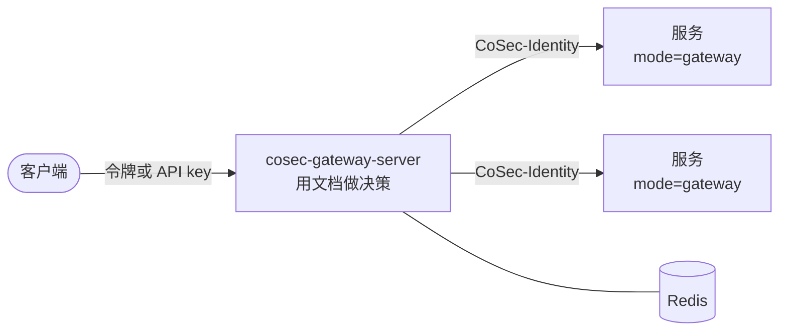

# 部署网关服务 {#deploying-the-gateway-server}

面向用 Docker 镜像或在 Kubernetes 上运行 `cosec-gateway-server`（前置了 CoSec 的现成 Spring Cloud Gateway）的运维人员，
以及要自己构建类似镜像的团队。本页介绍镜像里有什么、它向后面的服务转发什么、它在应答请求之前需要什么、就绪与关闭、
仓库中的 Kubernetes 清单、CI 如何检查镜像，以及镜像自带的 JDK 25 AOT 缓存。这里提到的每个配置项都在[配置](./configuration.md)中。

## 镜像 {#the-image}

CI 在每次推送时用 [`cosec-gateway-server/Dockerfile`](https://github.com/Ahoo-Wang/CoSec/blob/main/cosec-gateway-server/Dockerfile)
构建镜像，发布为 `ahoowang/cosec-gateway`、`ghcr.io/ahoo-wang/cosec-gateway` 和
`registry.cn-shanghai.aliyuncs.com/ahoo/cosec-gateway`，支持 `linux/amd64` 和 `linux/arm64`。网关服务是一个应用：只以
镜像发布，从不作为库发布。

- **JDK。** 镜像运行在 Alibaba Dragonwell 25（`dragonwell:25-ubuntu`）上。代码和其他 CoSec 模块一样按 Java 17 编译，
  JDK 17 基线不变。
- **必需配置。** `COSEC_JWT_SECRET`（没有默认值，见[认证](../integration/authentication.md)）和 Redis 地址，例如
  `SPRING_DATA_REDIS_URL`。
- **目录结构。** 应用位于 `/opt/cosec-gateway-server`，以非特权用户 `appuser` 运行。配置文件是
  `config/application.yaml`；JVM 参数在 `bin/cosec-gateway-server` 中（ZGC，2 GiB 堆）。通过 `JAVA_OPTS` 追加参数。
- **包含什么。** 网关过滤器、Redis 快照存储（`cache-support`）、追踪和 Kafka 模块。它的配置关闭了 Kafka 审计
  （`cosec.audit.kafka.enabled: false`）、登录（`cosec.authentication.login.enabled: false`）和 ip2region
  （`cosec.ip2region.enabled: false`）。它没有控制面：文档由 `cosec-migrate` 或同一个 Redis 上的控制面应用发布。

```bash
docker run -d -p 8080:8080 \
  -e SPRING_DATA_REDIS_URL=redis://redis:6379 \
  -e COSEC_JWT_SECRET=... \
  ahoowang/cosec-gateway
```

## 网关授权什么 {#what-the-gateway-authorizes}

CoSec 作为 Spring Cloud Gateway 的全局过滤器运行，而全局过滤器只作用于网关的路由。因此每个被路由的请求都会被授权，
在 `http` 命名空间中（网关不加载路由映射），而网关自己的 actuator 端点（包括健康探针）不会。路由就是
`spring.cloud.gateway.server.webflux.routes` 下普通的 Spring Cloud Gateway 配置。请求如何变成动作和资源、结果如何
变成响应，见 [Web 集成](../integration/web.md)。

被路由的请求向后端带去：

- **`CoSec-Identity`**，在已认证主体的 Permit 上：网关验证过的身份，以及它做决策时的作用域。无论
  `cosec.pipeline.mode` 或 `cosec.enabled` 怎样设置，网关都会从每个请求中删除客户端发来的 `CoSec-Identity`：先于其他
  任何过滤器删除一次，在发往后端的请求上再删除一次。匿名的 Permit，以及元数据为 `cosec-identity: false` 的路由，不带
  身份。用 `cosec.gateway.identity.enabled=false` 关闭转发；其余 `cosec.gateway.identity.*` 配置项见
  [配置](./configuration.md)。
- **不带 `Authorization` 头**，除非设置 `cosec.gateway.identity.forward-authorization=true`。只为需要用用户的令牌
  调用其他 API 的后端打开它。
- **`CoSec-Request-Id`**，网关自己的请求 id。

永不过期的凭证（没有 `expires-at` 的 API key）不会被转发：这样的请求回答 `500`，网关记录
`Request [<requestId>]: the identity cannot be forwarded.`

## 网关后面的服务 {#services-behind-the-gateway}

网关后面的服务可以自己做决策（默认的 `cosec.pipeline.mode=enforce`，有自己的文档和密钥），也可以用
`cosec.pipeline.mode=gateway` 信任网关的决策。在 gateway 模式下，服务只从 `CoSec-Identity` 读取调用方：它没有密钥、
没有文档、没有 Redis、没有路由映射，也没有决策监听器。如何配置这样的服务，见
[网关后面的服务](../integration/web.md#services-behind-the-gateway)。



**只有网关可以访问 gateway 模式的服务。** 服务相信它收到的任何 `CoSec-Identity`，所以其他能向它发请求的人都可以
自称任何人。在网络上保证这一点：只放行网关 pod 的 Kubernetes `NetworkPolicy`、私有网络，或网关与服务之间的双向 TLS。
每个这样的服务在启动时以 `WARN` 记录：

```text
cosec.pipeline.mode=gateway: this service believes any CoSec-Identity header it receives. Only the CoSec gateway, which strips the clients' own, may be able to reach it: anyone else who can is whoever they claim.
```

`cosec.pipeline.mode` 既不是 `enforce` 也不是 `gateway` 时启动失败；在 Spring Cloud Gateway 主机上设为 `gateway`
时也启动失败：网关自己总是用文档做决策。这条边界为什么重要、截获的头能做什么，见
[信任边界](../guide/security-model.md#trust-boundaries)。

## 第一个请求之前 {#before-the-first-request}

网关在没有任何文档时也能启动，但在平台文档发布之前，对每个被路由的请求都回答 `503`
（[最初的文档](./storage.md#the-first-documents)），在此期间报告自己未就绪（[就绪](#readiness)）。每个环境都需要：

1. **`maxmemory-policy noeviction` 的 Redis。** 每个实例在启动时用 `CONFIG GET` 检查，否则不启动
   （[Redis 要求](./storage.md#redis-requirements)）。在隐藏了 `CONFIG GET` 的托管 Redis 上，自行设置 `noeviction`，
   并设置 `COSEC_AUTHORIZATION_SNAPSHOT_EVICTION_CHECK=warn`。
2. **文档。** 用 `cosec-migrate publish --to-redis <uri> --in <dir>` 发布它们；如果将由控制面管理，再用
   `cosec-migrate bootstrap` 指定第一个管理员。网关、控制面和 `cosec-migrate` 必须使用同一个 Redis 和同一个
   `cosec.authorization.snapshot.key-prefix`。
3. **实例 id（如果按实例收紧 Redis 权限）。** 网关默认参与影子窗口，使用随机的实例 id。要给每个 pod 独立的 Redis 用户，
   为每个 pod 设置 `COSEC_AUTHORIZATION_SHADOW_INSTANCE_ID`（[谁可以写哪些 key](./storage.md#who-may-write-which-keys)）。
4. **各处相同的属性提供者。** 每个网关实例、其他每个数据面实例和控制面所在的主机，都必须注册相同的
   `AttributeProvider`，以相同的类型声明相同的 `ext.*` 属性。文档按平台的声明和主机的提供者编译，所以控制面主机接受的
   变更，在缺少该提供者的实例上可能编译失败：在影子窗口中，该实例报告 `CANDIDATE_ERROR`，窗口无法正常关闭，变更不会
   发布；不经窗口发布时，该实例对需要该文档的每个请求回答 `503`，除非有 DENY 匹配。

## 就绪 {#readiness}

实例只有在安装了平台文档，以及 [`prewarm-apps` 和 `prewarm-tenants`](./configuration.md#snapshot) 列出的每个文档
（列表为空表示只有平台文档）之后才算就绪。在此之前它会对每个被路由的请求回答 `503`，所以 starter 把 Spring Boot 的
就绪状态改为 `REFUSING_TRAFFIC`，文档安装后再改回 `ACCEPTING_TRAFFIC`。跟随 `/actuator/health/readiness` 的负载均衡器
在此期间不会给它流量。存活状态不受影响：缺少文档不是重启实例的理由。

有 Spring Boot Actuator 时，`cosecSnapshot` 健康指示器在这些文档安装后报告 `UP`，之前报告 `DOWN`，细节为 `platform`
（`installed`、`failed`、`absent` 或 `loading`）和 `prewarmed`。要在就绪端点上看到这些细节，把它加入 readiness 组：

```yaml
management:
  endpoint:
    health:
      group:
        readiness:
          include: readinessState,cosecSnapshot
```

`cosecSnapshot` 也是 `/actuator/health` 的一部分，因此在平台文档发布之前它报告 `DOWN`。

## 关闭 {#shutdown}

关闭时，决策监听器停止接收事件，把队列中的事件投递给 `BEST_EFFORT` 监听器（审计日志、Kafka、指标），最多
[`cosec.observability.listener.drain-timeout`](./observability.md#decision-listeners)（5 秒），然后丢弃剩下的。让 pod 的
终止宽限期足够容纳 Spring 自身的优雅关闭加上这段时间。

## Kubernetes {#kubernetes}

[`k8s/`](https://github.com/Ahoo-Wang/CoSec/tree/main/k8s) 中有示例清单：

| 文件 | 内容 |
|---|---|
| `cosec-gateway-config.yaml` | 一个 ConfigMap，含 `application.yaml` 和 `bootstrap.yaml`，挂载到 `/opt/cosec-gateway-server/config/`：路由和上面的 `cosec.*` 设置。 |
| `cosec-gateway-deployment.yml` | Deployment：`COSEC_JWT_SECRET` 来自 Secret `cosec-jwt-secret`，Redis Cluster 来自 Secret `redis-secret`（`SPRING_DATA_REDIS_CLUSTER_NODES`、`SPRING_DATA_REDIS_PASSWORD`、自适应拓扑刷新），启动探针为 `/actuator/health`，就绪探针为 `/actuator/health/readiness`，存活探针为 `/actuator/health/liveness`，以及注入 OpenTelemetry Java agent 的注解。 |
| `cosec-gateway-reids.yaml` | Secret `redis-secret`，值为占位符。 |
| `cosec-gateway-service.yaml` | 一个 Service，80 端口转发到容器的 8080。 |
| `cosec-gateway-hpa.yaml` | 一个 HorizontalPodAutoscaler，按 CPU 在 2 到 10 个副本之间伸缩。 |

Deployment 中的镜像是 `ghcr.io/ahoo-wang/cosec-gateway:7.0.0`：把标签改成你部署的版本。自己创建 `cosec-jwt-secret`
（`kubectl create secret generic cosec-jwt-secret --from-literal=secret=<random value>`），并在 `redis-secret` 中填入
你的节点和密码。`cosec-migrate` 通过 `--to-redis` 连接一台 Redis 服务器。

`/actuator/health` 上的启动探针只有在平台文档安装后才通过（[就绪](#readiness)）。在第一次部署前发布文档，或者把启动
探针指向 `/actuator/health/liveness`，让 Redis 中还没有平台文档时 pod 也能启动，并留在 Service 之外。

## CI 如何检查镜像 {#how-ci-checks-the-image}

镜像推送后，[`docker-deploy.yml`](https://github.com/Ahoo-Wang/CoSec/blob/main/.github/workflows/docker-deploy.yml) 的
`aot-smoke` 作业针对一个 Redis 7 服务容器运行
[`aot-smoke.sh`](https://github.com/Ahoo-Wang/CoSec/blob/main/cosec-gateway-server/aot-smoke.sh)。它用
`cosec-migrate publish` 发布一个平台文档，以 `-XX:AOTMode=on` 启动镜像（无法映射的缓存会让作业失败），添加一条指向
网关自身健康端点的 `/smoke/**` 路由，然后检查：健康探针回答 `200`，匿名请求回答带 `application/problem+json` 的
`401`，带有效 HS256 令牌的请求回答 `200`，匹配到 DENY 的请求回答带 `application/problem+json` 的 `403`。同样的步骤
也可以用来快速检查你自己的部署。

## AOT 缓存 {#aot-cache}

镜像自带一份 AOT 缓存（JDK 25，[JEP 483](https://openjdk.org/jeps/483)、[JEP 514](https://openjdk.org/jeps/514)、
[JEP 515](https://openjdk.org/jeps/515)）：网关启动时加载的类，已经读取、解析、加载和链接，外加一次训练运行得到的方法 profile。
JVM 启动时直接映射这个文件，不再重复这些工作。不需要改代码，也不涉及 Spring AOT。

### 它改变了什么 {#what-it-changes}

- **启动，以及启动后的最初几秒。** 到 `Started GatewayServerKt` 的时间减少约四分之一，见[启动实测](#measured-startup)。
  方法 profile 让 JIT 更早编译热点方法，预热时间随之缩短。
- **不改变峰值吞吐。** JIT 编译完热点路径后，有缓存和没有缓存的 JVM 运行的是同样的代码。授权性能见[架构概览](../architecture/overview.md#performance)。
- **内存。** 启动后的常驻内存（RSS）更大，因为它计入了 104 MiB 缓存中已映射的部分：[实测](#measured-startup)中容器内多 26 MiB，原生多 66 MiB。这些页由文件支撑，不是堆。
- **镜像大小。** 缓存让镜像增加约 104 MiB。

### 镜像如何使用它 {#how-the-image-uses-it}

`Dockerfile` 在最终阶段用 [`aot-train.sh`](https://github.com/Ahoo-Wang/CoSec/blob/main/cosec-gateway-server/aot-train.sh)
训练缓存，所用的 jar 和路径与容器运行时完全一致，结果写入 `/opt/cosec-gateway-server/aot/cosec-gateway-server.aot`。

1. **记录。** 脚本用 `-XX:AOTMode=record` 和与生产相同的 JVM 参数启动网关，等到 `/actuator/health/liveness` 有响应后发送几个请求，
   再用 `SIGTERM` 停止它。它使用临时的 HTTP 和 JMX 端口，因为多平台构建会同时训练所有平台，这些 JVM 可能共享同一个网络。
2. **创建。** 第二次运行使用 `-XX:AOTMode=create`，把记录下的配置生成缓存。
3. **检查。** 第三次运行使用 `-XX:AOTMode=on`；如果生产参数无法映射缓存，构建失败。

训练不需要 Redis，也不需要网络。它设置 `cocache.backend=memory`，CoCache 把缓存保存在进程内，整个应用不连 Redis 也能启动；
内存后端总能通过驱逐检查。代价是：只有 Redis 响应后才加载的类（Lettuce 连接路径），以及只有在真实文档上做决策时才加载的类，
不在缓存里（没有平台文档，训练中的每个请求都被拒绝）。它们按常规方式加载，所以第一个经过授权的请求和没有缓存时开销相同。

容器通过 `JDK_JAVA_OPTIONS` 而不是 `JAVA_OPTS` 传入 `-XX:AOTCache=…`，所以设置 `JAVA_OPTS` 不会丢掉缓存。
每次启动都会在 stderr 打印 `NOTE: Picked up JDK_JAVA_OPTIONS: …`。容器里的其他 `java` 命令也会带上这个参数：不带网关参数的命令（例如 `java -version`）
无法使用缓存，会打印[下文](#when-the-cache-is-not-used)所述的 `[aot]` 错误，这些错误无害。

缓存没有用 Spring Boot 推荐的 `-Dspring.context.exit=onRefresh` 训练。网关启用了 Spring Cloud bootstrap 上下文，
它最先刷新，于是 JVM 在应用上下文创建之前就退出了。这次运行返回 0、什么都不打印，得到的缓存几乎不包含应用本身。

### 缓存何时不被使用 {#when-the-cache-is-not-used}

与 JVM 不匹配的缓存会被忽略：JVM 照常启动，只是没有加速，并在日志中说明原因。以下情况都会这样：缓存文件缺失或被截断；
类路径上的某个 jar 与训练时不同（路径、大小或修改时间）；运行它的是另一个 JDK 构建；GC 不同（例如用 `-XX:+UseG1GC` 而不是训练时的 ZGC）。
此时 JVM 会打印类似这样的日志：

```text
[error][aot] An error has occurred while processing the AOT cache. Run with -Xlog:aot for details.
[error][aot] Unable to map shared spaces
```

这是默认的 `-XX:AOTMode=auto` 的行为。**生产环境中绝不要设置 `-XX:AOTMode=on`**：设置后，不匹配的缓存会让 JVM 无法启动。
要确认缓存是否被使用，在 `JAVA_OPTS` 中加上 `-Xlog:aot`。要关闭缓存，用 `-e JDK_JAVA_OPTIONS=` 启动容器。

修改 `config/application.yaml` 或环境变量不会让缓存失效，因为配置不在类路径上。如果配置开启了更多功能，就会加载训练时没见过的类；重新训练即可覆盖它们。

### 训练自己的缓存 {#training-your-own-cache}

jar、JDK 或 GC 变化时都要重新训练。基于本镜像构建的镜像，在改动之后运行同一个脚本即可，它会原地覆盖缓存：

```dockerfile
FROM ahoowang/cosec-gateway
COPY --chown=appuser:appgroup application.yaml config/application.yaml
RUN aot-train.sh /opt/cosec-gateway-server /opt/cosec-gateway-server/aot/cosec-gateway-server.aot
```

运行在 JDK 25 上的自有 Spring Boot 应用，同样是这两步。两步都要使用生产环境的类路径和 JVM 参数，并在同一目录下运行：

```bash
# 1. 记录：运行有代表性的负载，然后正常停止 JVM（SIGTERM 即可）。
java -XX:AOTMode=record -XX:AOTConfiguration=app.aotconf -cp "$CLASSPATH" com.example.App
# 2. 创建：不需要负载，会自行退出。
java -XX:AOTMode=create -XX:AOTConfiguration=app.aotconf -XX:AOTCache=app.aot -cp "$CLASSPATH" com.example.App
# 生产
java -XX:AOTCache=app.aot -cp "$CLASSPATH" com.example.App
```

- **在运行的地方训练。** 缓存记录了类路径，包括每个 jar 的修改时间。请在 jar 就位后、在镜像的最终阶段训练；事后把 jar 复制到其他阶段或目录，缓存就无法使用。
- **两步还是一步。** JDK 25 也提供一步模式 `-XX:AOTCacheOutput=app.aot`，在训练 JVM 退出时由子 JVM 创建缓存。镜像使用两步，是因为训练运行以
  `SIGTERM` 结束：这样每一步都有自己的退出码，创建失败不会被被停止进程的 143 掩盖。
- **训练时不要用真实密钥。** 用一次性的凭证训练；构建步骤及其日志不是放真实密钥的地方。
- **多平台构建**会为每个平台各训练一次，因为缓存与 CPU 架构绑定。在 QEMU 模拟下构建的平台训练要慢好几倍；`aot-train.sh`
  最多等待 `AOT_TRAIN_TIMEOUT` 秒（默认 300）完成启动。

### 启动实测 {#measured-startup}

到 Spring Boot 日志中 `Started GatewayServerKt` 的时间，以及启动一秒后 JVM 的常驻内存。这些数据是 2026 年 10 月在网关改用 8.0 管道之前测得的，此后没有重新测量。每次运行都是新的 JVM，两种情况交替进行。全部在 Apple M4（10 核）上运行。

**容器中：** 镜像（Dragonwell 25.0.4，`linux/arm64`）连接一个 Redis 7 容器，两种情况各 15 次。机器较忙（1 分钟负载 4.4 到 6.7），所以离散度较大：

| | 中位数 | 最快 | 四分位距 | RSS（中位数） |
|---|---|---|---|---|
| 无缓存 | 3.45 s | 2.46 s | 2.60 – 3.70 s | 524 MiB |
| 有缓存 | 2.53 s | 1.83 s | 2.37 – 2.77 s | 550 MiB |

**直接在 macOS 上：** OpenJDK 25.0.5、镜像的 JVM 参数和 `cocache.backend=memory`，两种情况各 7 次，负载 3.2 到 3.8。macOS 上 Redis 后端无法启动
（Lettuce 需要 epoll 或 io_uring 传输），所以这些运行使用内存后端。离散度小得多：

| | 中位数 | 范围 | RSS（中位数） |
|---|---|---|---|
| 无缓存 | 2.41 s | 2.40 – 2.45 s | 453 MiB |
| 有缓存 | 1.84 s | 1.80 – 1.88 s | 519 MiB |

两种环境下，有缓存时启动都快了约四分之一：容器中位数快 27 %，最快一次快 26 %，原生快 24 %。有缓存时，网关加载的类中有 83 % 来自缓存
（15,884 个中的 13,127 个）。原始结果、命令和机器信息见
[`docs/perf/gateway-aot-cache`](https://github.com/Ahoo-Wang/CoSec/tree/main/docs/perf/gateway-aot-cache)。
