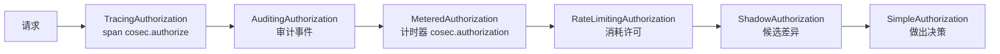

# 可观测性 {#observability}

面向需要知道 CoSec 做了什么决策、为什么这样决策的运维和安全团队。本页介绍每个决策产生的审计事件、追踪 span、指标和日志，
各自能告诉你什么，以及如何开启。要看一个决策检查过的每条规则，而不只是做出决定的那一条，请使用
[解释器](#explaining-a-decision)。

## 决策链 {#the-decision-chain}

`Authorization` bean 是包在 `SimpleAuthorization` 外面的一串装饰器。每个装饰器看到的是它内层的决策，所以审计事件、指标和
span 报告的都是最终决策，包括限流。



| 装饰器 | 存在条件 |
|---|---|
| `TracingAuthorization` | classpath 上有 `opentelemetry-support` |
| `AuditingAuthorization` | `cosec.audit.enabled`（默认 `true`） |
| `MeteredAuthorization` | `micrometer-support`、一个 `MeterRegistry` bean，以及 `cosec.metrics.enabled`（默认 `true`） |
| `RateLimitingAuthorization` | `cosec.limiter.enabled`（默认 `true`）且有限流器 |
| `ShadowAuthorization` | `cosec.shadow.enabled=true`（[影子模式](../policies/testing.md#trying-changes-in-shadow-mode)） |

`SimpleAuthorization` 依次检查黑名单、root（开启时）、全局策略、主体的策略和角色权限（[求值顺序](../guide/security-model.md#evaluation-order)）。
做出决定的那一层作为决策的 **来源（source）** 报告。

这些观测用的装饰器都不会改变决策：审计 sink 失败只会被记录日志并忽略。

## 审计事件 {#audit-events}

开启 `cosec.audit.enabled`（默认）时，每个决策都会产生一个 `AuditEvent`，授权因错误失败时也会。

| 字段 | 内容 |
|---|---|
| `eventId`、`timestamp`、`tenantId` | 事件本身 |
| `principal` | `id`、`authenticated`、`roles`、`policies` |
| `request` | `id`（即 `CoSec-Request-Id`）、`appId`、`spaceId`、`remoteIp`、`method`、`path`、`routeId`（Spring Cloud Gateway）、`device.id`、`device.userAgent` |
| `authorization.decision` | `ALLOW`、`EXPLICIT_DENY`、`IMPLICIT_DENY`、`TOO_MANY_REQUESTS` 或 `ERROR` |
| `authorization.reasonCode` | `ALLOW`、`EXPLICIT_DENY`、`IMPLICIT_DENY`、`TOKEN_EXPIRED`、`TOKEN_INVALID`、`TOO_MANY_REQUESTS`、`REGEX_TIMEOUT` 或 `ERROR` |
| `authorization.reason`、`authorization.elapsedNanos` | 原因文本和评估耗时 |
| `authorization.source` | `type`：`BLACKLIST`、`ROOT`、`GLOBAL_POLICY`、`PRINCIPAL_POLICY`、`ROLE_PERMISSION`、`NONE`（没有匹配）或 `UNKNOWN`；以及匹配到的 `policy`（`id`、`type`、`statement.index`、`statement.name`）或 `role`（`id`、`permission.id`、`permission.name`） |
| `trace` | 追踪开启时的 `traceId` 和 `spanId` |

因令牌被拒而被拒绝的请求带有 `TOKEN_EXPIRED` 或 `TOKEN_INVALID`，所以能把一波过期令牌和一条坏掉的策略区分开。

### Sink {#sinks}

事件只会发往一个 `AuditEventSink`：

| Sink | 使用条件 | 事件去向 |
|---|---|---|
| 你的 `AuditEventSink` bean | 你声明了一个 | 你发往的任何地方 |
| `KafkaAuditEventSink` | `kafka-support`、一个 `KafkaTemplate` bean、`cosec.audit.kafka.enabled`（默认 `true`），且你没有声明 sink | topic [`cosec.audit.kafka.topic`](./configuration.md#audit)（`cosec-audit`） |
| `LoggingAuditEventSink` | 其他情况 | logger `me.ahoo.cosec.audit`，每个事件一行 JSON |

日志 sink 以 `DEBUG` 记录 `ALLOW`，以 `WARN` 记录拒绝和 `TOO_MANY_REQUESTS`，以 `ERROR` 记录 `ERROR`，所以在默认的 `INFO`
级别下只会出现拒绝和错误。

Kafka sink 以租户和主体 id（JSON 数组 `[tenantId, principalId]`）作为每条记录的 key，值是 JSON 格式的事件。它从一个后台线程
发送，队列容量 1,024 个事件，既保持事件顺序，也从不阻塞请求。队列满时事件被丢弃，并只记录一次告警
（`Dropping audit events because the Kafka audit queue is full or shutting down.`）；发送失败也会记录日志。关闭时最多花 10 秒
清空队列。

自定义 sink 不能阻塞：它在完成决策的那个线程上同步执行。它抛出的异常会被记录（`Failed to publish audit event.`），绝不影响决策。

## 追踪 {#tracing}

使用 `opentelemetry-support` 时，每次授权是一个名为 `cosec.authorize` 的 span（instrumentation `me.ahoo.cosec`），是当前请求
span 的子 span：

| 属性 | 值 |
|---|---|
| `user.id`、`user.roles` | 主体 id 和角色 |
| `cosec.tenant_id`、`cosec.app_id`、`cosec.space_id`、`device.id`、`cosec.request_id` | 请求上下文（空值不写入） |
| `cosec.policies` | 主体的策略 |
| `cosec.authorize.result` | `ALLOW`、`EXPLICIT_DENY` 或 `IMPLICIT_DENY` |
| `cosec.authorize.policy.id`、`cosec.authorize.statement.index`、`cosec.authorize.statement.name` | 匹配到的策略语句 |
| `cosec.authorize.role.id`、`cosec.authorize.permission.id` | 匹配到的角色权限 |

同时开启审计时，审计事件会带上 span 的 `traceId` 和 `spanId`，把事件和它的 trace 关联起来。

## 指标 {#metrics}

使用 `micrometer-support` 并有 `MeterRegistry`（例如来自 Spring Boot Actuator）时，每个决策都由计时器 `cosec.authorization`
记录（`cosec.metrics.enabled`，默认 `true`）。它有两个标签，每个标签只有少量固定取值，所以无论有多少策略和主体，时间序列数
都是有界的：

| 标签 | 取值 |
|---|---|
| `result` | `allow`、`explicit_deny`、`implicit_deny`、`too_many_requests`、`error` |
| `source` | `global_policy`、`principal_policy`、`role_permission`、`root`、`blacklist`、`none`、`unknown` |

`error` 总是与 `source=unknown` 一起出现。计时器只测量授权，不包括令牌解析。

对 `explicit_deny` 和 `error` 的速率设置告警。突然上升通常意味着攻击、坏掉的策略，或读不了的策略存储
（[故障排查](./troubleshooting.md#every-request-fails-with-500)）。

CoCache 会在同一个 registry 中为 CoSec 的缓存记录它自己的指标（例如 `cocache.hits`）；见 [CoCache 文档](https://cocache.ahoo.me)。

## 日志 {#logs}

```yaml
logging:
  level:
    me.ahoo.cosec.authorization.SimpleAuthorization: DEBUG   # the matched policy statement or role permission
    me.ahoo.cosec.audit: DEBUG                               # every audit event, allows included
```

错误不需要 debug 级别：`me.ahoo.cosec.pipeline.SecurityPipeline` 会以 `ERROR` 记录每个让请求变成 `500` 的错误，并带堆栈
（`Unexpected error during authorization of request [...] [...].`）。通过 `CoSec-Request-Id` 头把响应和它的日志、审计事件对应起来。

## 解释一个决策 {#explaining-a-decision}

审计事件、指标和 span 只给出做出决定的那一条规则。解释器更进一步：它针对一个描述出来的主体，或一个真实的令牌或 API key，
运行真实的授权，并报告它检查过的每条语句和角色权限：哪些匹配了，哪些在动作上没匹配，哪些在条件上没匹配。不会消耗或修改任何东西。

它默认关闭（`cosec.explain.enabled`），因为解释结果会暴露你的策略结构。有 Spring Boot Actuator 时它还是 `cosecExplain` 端点，
这个端点和其他请求一样经过 CoSec：只向管理员暴露，并且只允许管理员 `POST /actuator/cosecExplain`。请求、响应以及如何在代码
中调用，见 [解释一个决策](../integration/checks.md#explaining-a-decision)。
