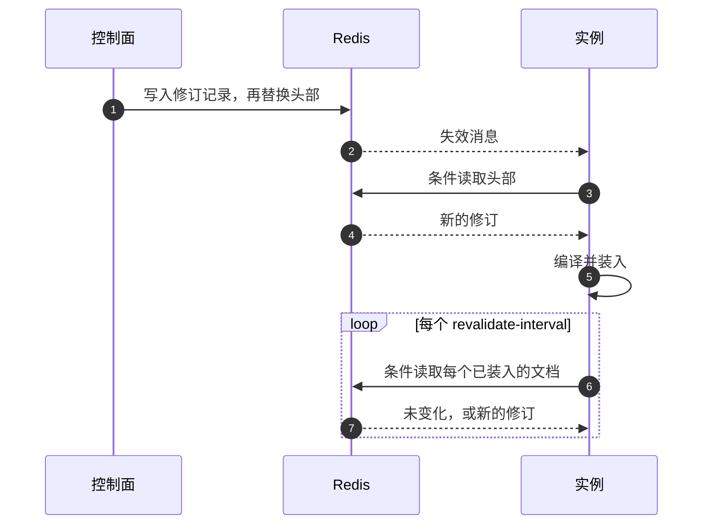

# 存储与缓存 {#storage-and-caching}

面向在生产环境运行 CoSec 的运维人员。本页说明 CoSec 用来做决策的文档存放在哪里、CoSec 使用的每个 Redis key、每个实例
如何读取并缓存文档、Redis 不可用时会发生什么，以及文档如何发布、如何版本化和回滚。这里提到的每个配置项都列在
[配置](./configuration.md#snapshot)中；文档包含什么见[策略语言](../policies/language.md)。

## 选择存储 {#choosing-a-store}

每个决策读取三类文档：每个请求都需要的平台文档，以及请求作用域内的应用文档和租户文档。管道从一个
`SnapshotDocumentStore` 读取它们。

| 存储 | 模块 | 适用场景 |
|---|---|---|
| Redis，通过 [CoCache](https://cocache.ahoo.me) | `cosec-cocache` | 生产环境。多个实例读取同样的文档，控制面在运行时发布变更。本页其余部分讲的都是这种存储。 |
| `InMemorySnapshotDocumentStore` | `cosec-spi` | 测试和本地开发。没有 `cosec-cocache` 时 starter 创建一个空的存储；应用用 `put` 把文档放进去。 |
| 你自己的 `SnapshotDocumentStore` bean，且没有 `cosec-cocache` | 你的代码 | 文档存放在其他系统中。每个方法都必须不阻塞地返回（[扩展](../architecture/extending.md)）。 |

在存入平台文档之前，每个请求都得到 `503` `unavailable`，每个实例都报告自己未就绪（[最初的文档](#the-first-documents)）。

## Redis {#redis}

有 `cosec-cocache` 时，Redis 保存文档以及控制面关于它们的一切记录，还保存已吊销的令牌、影子窗口报告和限流计数器。每个
实例通过 CoCache 保留一份进程内副本。

### Redis 是权威存储 {#redis-is-the-store-of-record}

文档和控制面的记录没有其他副本：背后没有数据库，也没有能在缓存未命中时补上数据的 loader。Redis 里有什么，每个实例就
用什么做决策，因此它们是 CoCache 的 `Store`。由此有三条规则，CoSec 在任何 CoCache 定制器或 `cocache.*` 配置项之上
锁定并约束它们，因此任何配置都无法削弱它们（[优先级](./configuration.md#precedence)）：

- **永不过期。** 文档和控制面记录写入时不带 TTL。过期会悄悄删除一个文档，而删掉的 DENY 会放宽访问。
- **读取失败就是失败。** Redis 读取失败绝不会变成"没有文档"（[Redis 不可用时](#when-redis-is-unavailable)）。
- **CoSec 无法解码的值使读取失败，并留在 Redis 中。** 它永远不会被回收（删除），因为回收会删掉唯一的副本。用普通
  Redis 命令写入的值就属于这种值：只通过控制面或 `cosec-migrate` 写入文档（[发布文档](#publishing-documents)）。

**CoCache 定制器还能改变什么。** CoSec 锁定决定缓存内容的部分：key 前缀、命名空间、key 编码、编解码器、数据来源、key 过滤器和按条目的生存期（[优先级](./configuration.md#precedence)）。无法读取的吊销使读取失败；成员关系总会过期，不带抖动，读取失败时失败即拒绝。影子缓存保持声明的寿命；吊销表的读取等待存储的整个命令超时（`cocache.redis.command-timeout`）：超时的读取是“无法读取”，流水线校验令牌时会接受它，所以任何 `read-timeout` 都不能缩短它。缓存策略的其余部分仍由应用经定制器和 `cocache.*` 配置项决定（[优先级](./configuration.md#precedence)列出 CoSec 锁定的每个字段）：每个缓存的本地缓存大小和 `expireAfterAccess`，以及快照存储以外的 `local-max-age`；除吊销表以外每个缓存的 `read-timeout`，超时后权威存储的读取失败即拒绝；两个吊销表还有 `absent-ttl`；成员关系还有 `ttl`（永不为 forever）、`absent-ttl`、`lease-*`、`load-*` 和 `invalidate-failure`。这些都不会替换缓存的内容，但有些会延长实例依据已读内容行事的时间。吊销表上更长的 `local-max-age` 或 `absent-ttl`，会在吊销的失效消息丢失时让被吊销的令牌多被接受这么久（默认的界是 `cosec.authentication.revocation.cache.local-max-age`，30 秒）；更长的成员关系 `ttl` 会让已移除的角色多生效这么久。

### Redis key {#redis-keys}

`<s>` 是 [`cosec.key-prefix`](./configuration.md#key-prefix)（默认 `cosec`），去掉末尾的 `:`：一个部署写入的每个
key 都在它之下（`SNP-9`）。
`<doc>` 指一个文档：`platform`、`app:<appId>` 或 `tenant:<tenantId>`。应用 id 和租户 id 不含 `:`，所以一个 key
只对应一个文档。

| Key | 写入者 | 内容 |
|---|---|---|
| `<s>:snapshot:<doc>` | 控制面、`cosec-migrate` | 头部：每个实例执行的那个文档修订 |
| `<s>:control:revision:<doc>:<digest>` | 控制面、`cosec-migrate` | 一条修订记录，即完整的文档，按摘要寻址（`SHA-256:` 加 64 位十六进制，与 CoCache 的计算相同） |
| `<s>:control:revisions:<doc>` | 控制面、`cosec-migrate` | 一个文档的修订索引，以及回收已从中移出、尚未确认删除的记录 |
| `<s>:control:refs:<doc>:<policyId>` | 控制面、`cosec-migrate` | 引用 `<doc>` 中某个策略的文档，每个带上它最后一次登记该引用的修订：一个修订只删除它自己或更早的修订登记的引用（`CTL-25`）；对平台的策略 id，还包括自己定义了该 id 策略的租户文档，使平台不能新增这个 id；[`cosec-migrate repair-references`](./upgrading.md#repair-the-back-reference-index) 补上各个头引用而索引缺少的条目，并删除未能写入头的发布登记下的条目 |
| `<s>:control:lease:<name>` | 控制面 | 一个租约（`reclaim:<doc>`、`shadow-windows`）；随每次写入过期，持有者完成后删除它，且只在仍持有时删除（`CTL-26`）；持有者再次获取自己的租约时，从此刻起重新持有完整的时长 |
| `<s>:control:list:documents`、`<s>:control:list:open-changes` | 控制面、`cosec-migrate` | 有修订的文档，以及可能仍未结束的变更请求，供维护任务与 `repair-references` 逐个访问 |
| `<s>:control:apps:all` | 控制面、`cosec-migrate` | app 列表：现有的 app 文档，以及列表是否完整；授出分析在每次租户变更时读取它（[见下文](#publishing-through-the-control-plane)） |
| `<s>:control:change:<changeId>` | 控制面 | 一个变更请求 |
| `<s>:control:stage:<doc>` | 控制面 | 一个文档的暂存槽：哪个变更占用它 |
| `<s>:candidate:<doc>` | 控制面 | 影子窗口打开期间一个文档暂存的候选；由它所属的变更删除，且只在它仍是该变更的候选时删除（`CTL-26`） |
| `<s>:shadow:report:<window>:<instance>` | 仅数据面实例 `<instance>` | 该实例对一个影子窗口的累计报告；每次写入替换上一次的；窗口的候选撤回后实例不再写它；最后一次写入 8 天后过期 |
| `<s>:shadow:reporters:<window>` | 每个数据面实例 | 对 `<window>` 报告过的实例 id；过期时间同上 |
| `<s>:shadow:status:<instance>` | 仅数据面实例 `<instance>` | 该实例已装入的修订及其滞后；一次心跳只写这一个值，与集群规模无关；最后一次写入 2 分钟后过期，超过一分钟的状态被忽略 |
| `<s>:shadow:instances:all` | 每个数据面实例 | 有状态可读的实例，每个带上它登记自己的时间；实例启动时登记，之后每小时再登记一次，写这个列表的实例顺带删掉超过 3 小时的条目；过期时间同报告 |
| `<s>:token:revoked:<tokenId>` | `TokenStore.revoke`（登出） | 已吊销令牌 id 对应 `true`；在刷新令牌有效期之后一秒过期 |
| `<s>:token:subject:revoked:<n>:<tenantId>:<principalId>` | `TokenStore.revokeSubject` | 以 epoch 毫秒表示的 `issuedBefore`；`<n>` 是 `<tenantId>` 的长度；在 `issuedBefore` 之后再过刷新令牌有效期加一秒过期 |
| `<s>:membership:<n>:<tenantId>:<principalId>` | `CoCacheMembershipProvider`，在应用注册了它时 | 一个主体的成员关系；会过期（默认一分钟） |
| `<s>:api-key:<sha256>` | `RedisApiKeyStore` | 一个 API key 的 JSON（`"format":2`），按 key 的 SHA-256 存放；8.0 之前格式的 key 在 `cosec-migrate api-keys` 转换之前都会被拒绝 |
| `<s>:rate-limiter:{<ruleId>:<bucket>}:<window>` | Redis 限流器 | 一条规则一个桶一个窗口的计数器；两个窗口后过期。`{...}` 是 hash tag：一个桶的两个窗口在 Redis Cluster 的同一个 slot 上，读取两者的脚本因此能在集群上运行 |
| `<s>:oauth:state:<state>` | 社交登录 | 进行中的登录的 OAuth `state`，由 JustAuth 保存；3 分钟后过期 |
| `<s>:oauth:binding:<state>` | 社交登录 | 签发该 state 的浏览器的绑定值的 SHA-256；回调以 `GETDEL` 取走，因此一个 state 只能用一次；3 分钟后过期 |

- 多个部署共用一个 Redis 时，给每个部署各自的 `cosec.key-prefix`：前缀不同，就不共享任何 key，一个部署签发的 API key
  不会被另一个接受，限流计数器也互不相干。
- 除限流计数器、API key 和 OAuth 状态以外，每个 key 都是 CoCache 8 的值。CoCache 在条目之前最后一个 `:` 处拆分每个
  key 路径：`<s>:control:revision` 是 key 前缀 `<s>:control:` 加命名空间 `revision`。每一个都有自己的失效通道
  `{key 前缀}inv:{命名空间}`：`<s>:inv:snapshot`、`<s>:inv:candidate`、`<s>:control:inv:revision`、
  `<s>:shadow:inv:report`、`<s>:token:inv:revoked`、`<s>:token:subject:inv:revoked`、`<s>:inv:membership`。通道与它的
  key 在同一个前缀下，所以前缀不同的部署在同一个 Redis 上互不干扰，而针对 `<s>:control:*` 的一条 ACL 规则同时覆盖控制面
  的 key 和通道。

### Redis 要求 {#redis-requirements}

- **每个节点的 `maxmemory-policy` 都是 `noeviction`。** 文档没有 TTL，也没有其他副本。在 `allkeys-*` 策略下 Redis
  可能驱逐一个文档：已经装入它的实例会失败即拒绝，但之后才加载它的实例会把被驱逐的应用文档或租户文档读成不存在，于是
  其中的 DENY 语句悄悄失效。使用 `noeviction`，并按数据量规划 Redis 的容量。
- **启动检查。** 使用 Redis 后端时，每个实例在启动时从 `INFO memory` 读取每个节点的 `maxmemory-policy`；托管 Redis
  通常禁用 `CONFIG`，但允许 `INFO`。有两个检查读取它：
  - CoSec 自己的检查（`SNP-3`），检查创建快照存储的 CoCache 运行时背后的 Redis：某个节点不是 `noeviction`、`INFO`
    失败或被拒绝、或者 CoCache 后端无法被检查看穿（包装过的或自定义的后端），默认都会使启动失败。Redis 拒绝 `INFO` 而你已经自行设置了 `noeviction` 时，需要
    [`cosec.authorization.snapshot.eviction-check=warn`](./configuration.md#snapshot)：实例照常启动，并记录一条以
    `!!!` 开头的 `WARN`（[故障排查](./troubleshooting.md#startup-fails-on-the-eviction-check)）。
  - CoCache 针对其 `Store` 的检查，CoSec 的文档和记录都是 `Store`：`allkeys-*` 策略总是使启动失败，读不到 `INFO`
    同样如此，与 `eviction-check` 无关。Redis 拒绝 `INFO` 时，还要把
    [`cocache.redis.assume-maxmemory-policy`](./configuration.md#cocache-properties-that-affect-cosec) 设为你设置的策略
    （`noeviction`）。吊销表的每个条目各带自己的寿命，`volatile-*` 可能在它到期之前驱逐它，被吊销的令牌于是重新被接受。
    CoCache 要等实例写入或读到过一个这样的条目才计入这种寿命，所以启动时它接受 `volatile-*`：拒绝这种策略的是 CoSec 的检查。
- **运行期间再次检查。** CoSec 的检查每个 `revalidate-interval` 在自己的线程上再次读取每个节点的
  `maxmemory-policy`，因此之后的 `CONFIG SET maxmemory-policy`、切换到另一种配置的节点或重启都会被发现。（CoCache 的检查也会检查
  启动之后创建的 `Store`，设置了 `cocache.redis.store-eviction-check-interval` 时也会重读策略，但只记录日志，并在健康详情中
  报告 `storeEviction`。）只要某个节点可能驱逐，
  `cosecSnapshotEviction` 健康指示器就是 `DOWN`，并在 `eviction` 详情里说明原因，实例在开始时记录一条 `ERROR`；两种
  `eviction-check` 都是如此（[故障排查](./troubleshooting.md#cosecsnapshoteviction-is-down)）。读不到策略时，`fail` 下也是
  `DOWN`；`warn` 在启动时已经接受了这一点，所以是 `UP`，详情为 `eviction: unknown`。请求不会因此被拒绝：已装入的文档保持
  不变，丢失的文档在每个持有它的实例上都失败即拒绝。不要把这个指示器放进就绪组：它是告警。
- **从主节点读。** Redis 是权威存储，副本落后于它：在两者之间交替读取，可能把一个已撤销的 API key、或一份刚被覆盖发布的
  文档当成当前的。CoCache 自己的客户端读取文档、控制面记录和撤销记录，它连接 `spring.data.redis.*` 指定的节点或集群的
  各个主节点，不设置 `ReadFrom`。CoSec 注入的 Redis 模板（唯一的或 `@Primary` 的 `StringRedisTemplate` 与
  `ReactiveStringRedisTemplate`：API key、限流器、OAuth 状态）背后的 Lettuce 客户端也必须从主节点读：某个
  `LettuceConnectionFactory` 从副本读（`spring.data.redis.lettuce.read-from`，或设置了非 upstream
  `ReadFrom` 的 `LettuceClientConfigurationBuilderCustomizer`）时，启动失败
  （[故障排查](./troubleshooting.md#startup-fails-because-redis-is-read-from-replicas)）。其他连接工厂（Jedis，或你
  自己的）的客户端配置 CoSec 读不到：请把它配置为从主节点读。
- **Redis 客户端。** CoCache 根据 `spring.data.redis.*` 构建自己的 Lettuce 客户端；它需要的版本、拓扑和 ACL 命令见
  [CoCache 文档](https://cocache.ahoo.me/operations/#acl)。启动检查和健康指示器需要 `INFO`（`+info`），CoCache 列出的
  命令已包含它。通道跟随 key 前缀：允许 `&<s>:*`，或上面的每个
  `&{key 前缀}inv:*`。使用 `cocache.redis.channel-mode: pubsub` 时，还要允许 CoCache 的探测
  `~cocache:!probe:*` 和 `&cocache:!probe:*`，它不跟随前缀。每个缓存在创建时向自己的通道发布一个空帧，所以缺少通道权限
  会使启动失败，并指出需要允许的模式。

### 谁可以写哪些 key {#who-may-write-which-keys}

只有控制面（以及 `cosec-migrate`）写入文档和控制面记录。数据面实例读取文档和候选，只写影子报告和状态。Redis ACL 可以
让两边各守其位：

- 数据面凭证：对 `<s>:snapshot:*` 和 `<s>:candidate:*` 只读，对 `<s>:shadow:*` 可写，对 `<s>:control:*` 无权访问。
- 控制面凭证：`<s>:` 下的所有 key。
- 要防止一个实例写另一个实例的报告，给每个实例一个独立的用户，只允许它写自己的报告 key
  （`<s>:shadow:report:*:<instance>`），并设置它的
  [`cosec.authorization.shadow.instance-id`](./configuration.md#shadow-windows)，以及它自己的状态 key
  （`<s>:shadow:status:<instance>`）。每个实例仍要写 `<s>:shadow:reporters:*` 和 `<s>:shadow:instances:*`，CoCache
  通过 Lua 脚本写它们，所以 ACL 无法把它们限制为只能添加。

一个窗口的数字是每个实例一份报告之和，每份都是该实例最新的报告。控制面宁可让窗口保持打开（该步骤得到 `503`），也不
计入任何可疑的内容：某个实例 key 下的报告写的是另一个实例或另一个窗口、计数为负、或者列出的实例没有报告。只要有一个
实例报告 `CANDIDATE_ERROR`，无论其他实例报告什么，窗口都被阻塞。实例总能误报自己的流量；ACL 只能把它限制在自己的
key 上。对 `<s>:shadow:reporters:*` 有写权限的实例可以删掉另一个实例的 id：控制面一旦见过那个实例报告，窗口就会保持
打开直到它的报告回来；但在那之前被删掉的 id 不会被发现，直到那个实例再次写入。

以默认前缀下的实例 `pod-a` 为例（Redis 7 ACL 语法；`%R~` 表示只读）。第一行设置 key 并收回所有命令；第二行授予它
需要的命令和通道：

```text
ACL SETUSER cosec-pod-a on >change-me resetkeys resetchannels -@all %R~cosec:snapshot:* %R~cosec:candidate:* ~cosec:shadow:report:*:pod-a ~cosec:shadow:reporters:* ~cosec:shadow:status:pod-a ~cosec:shadow:instances:*
ACL SETUSER cosec-pod-a <CoCache 列出的命令和通道> +info
```

再加上该实例其他功能用到的 key（吊销、API key、限流；见 [Redis key](#redis-keys)）。上生产前用 `ACL DRYRUN` 检查这个
用户：CoCache 通过 Lua 脚本写入，Redis 会逐个 key 检查。

## 实例如何读取文档 {#how-instances-read-documents}

每个实例在内存中持有编译好的文档，做决策时不访问 Redis。平台文档在启动时加载，从不被丢弃；应用文档和租户文档在请求
第一次需要时加载，超过 [`max-apps` 和 `max-tenants`](./configuration.md#snapshot) 后丢弃最久未用的。预热的应用和
租户在启动时、平台文档之后加载。



- **变更立即到达每个实例**，通过 CoCache 的失效消息（第 2 到 5 步）。实例绕过本地副本自己读取 Redis，编译新修订并
  装入。进行中的请求继续使用它开始时的修订：一次求值绝不会混用一个文档的不同修订。
- **丢失的消息由重新确认兜底**（第 6、7 步）：每隔 [`revalidate-interval`](./configuration.md#snapshot)（10 秒）
  开始一轮，用一次对 Redis 的条件读确认每个已装入的文档（从不使用本地副本），未变化时不传输任何内容。失效消息丢失时，
  这些轮次是变化唯一的界：变化可读之后第一个到达该文档的一轮把它装上。因此它不能关闭，间隔最长 5 分钟（`SNP-6`）。
  一轮确认每次读四个文档，同一时间只有一轮：Redis 慢到一轮超过间隔时，下一轮在它结束后立即开始，而不是每个间隔再多
  四个读。一轮 30 秒没有确认任何文档、也没有在途的读时，拖住它的只有编译：下一个 tick 放弃它并开始新的一轮。仍在
  确认文档的慢轮次，或有读在途的轮次，从不被放弃。一轮不会等待编译已超过这 30 秒的文档，无论编译由谁开始：编译结束时
  自会确认该文档，这一轮继续处理它后面的文档。
- **没有文档的 id** 与文档分开记住，每个文档族最多 256 个：声明随机应用 id 的客户端会让实例为每个 id 读一次 Redis，但
  绝不会把已装入的文档挤出去（`SNP-7`）。
- **滞后**是 Redis 上一次确认某个文档以来的时间。只要 Redis 有应答，每一轮都会确认每个文档，所以滞后低于重新确认间隔
  加上一轮的耗时；一轮超过间隔之后，低于两轮的耗时。超过 `lag-warn`（60 秒）
  时实例以 `WARN` 记录 `Snapshot document [<doc>] revision <n> has not been confirmed for <lag>.`，超过
  `lag-escalate`（5 分钟）时以 `ERROR` 记录 `... is stale: not confirmed for <lag>.`，每个文档每分钟最多一次。
- **按滞后失败即拒绝的租户。** 对 [`fail-closed.tenants`](./configuration.md#snapshot) 中列出的租户，当请求读取的
  最旧文档（平台文档、该租户的文档和应用的文档）超过 `fail-closed.max-lag`（30 分钟）未被确认时，请求无法解析：它得到
  `503`，除非有 DENY 匹配。其他租户无论已装入的修订多旧都照常决策，从不检查。
- **本地副本**只服务冷加载。实例第一次需要某个文档时，可能采用 CoCache 的本地副本，它最多
  [`local-max-age`](./configuration.md#snapshot)（30 秒）旧；实例按这个最旧的时间计算它，并立即向 Redis 确认。本地的
  "没有这个文档"从不被信任：只有 Redis 能回答某个文档不存在。
- **冷加载最多等待** [`cold-load-timeout`](./configuration.md#snapshot)（2 秒）；之后对该请求而言文档算作失败。
- **修订只按 Redis 的说法变化。** Redis 故障切换后，由于复制是异步的，Redis 可能返回比已装入的更旧的修订。实例装入
  Redis 中的内容，因为其他实例读到的也一样，并以 `ERROR` 记录
  `Snapshot document [<doc>] regressed from revision <a> to <b>; ...`。请重新发布丢失的变更。

### 重新确认在 Redis 上的开销 {#what-revalidation-costs-redis}

条件读只比较 CoCache 8 保存在值头部的摘要，文档没有变化时不传输任何内容，所以它的开销与文档大小无关：从 1 KiB 到 4 MiB，
每份文档约 7 到 13 µs 的 Redis 时间（[测量](https://github.com/Ahoo-Wang/CoSec/blob/main/docs/perf/conditional-read/README.md)）。
一个节点上的负载约为实例数 × 每个实例持有的文档数 × 该开销 ÷ `revalidate-interval`：100 个实例每 10 秒确认 10 份文档，
约占它的 0.1%。

- 只有当文档数量多到连这一开销都要紧时，才调大 [`revalidate-interval`](./configuration.md#snapshot)，最长 5 分钟且小于
  `lag-warn`（也一起调大）：错过失效消息的实例也晚同样的时间才跟上。
- 仍然让平台文档保持小巧。每个实例都持有它，而变化了的文档要整份读取；租户特有的策略属于租户文档，只有服务该租户的实例才持有。

## Redis 不可用时 {#when-redis-is-unavailable}

| 对象 | 行为 |
|---|---|
| 已经装入的文档 | 保留。决策继续使用已装入的修订；它的滞后增长并被记录（[实例如何读取文档](#how-instances-read-documents)）。 |
| 尚未装入的文档 | 冷加载失败或超时：对该请求而言文档未解析，结果是 **`503`**，除非先匹配到 DENY。不会装入任何内容；下一个请求再试。 |
| 无法解码或编译的文档 | 作为失败装入：需要它的每个请求都是 **`503`**（除非先匹配到 DENY），直到发布一个可读的修订。 |
| 见过之后又从 Redis 消失的文档 | 失败，直到文档回来（以 `ERROR` 记录 `Snapshot document [<doc>] disappeared from the store; failing closed.`）。需要它的请求是 **`503`**，除非先匹配到 DENY。 |
| `fail-closed.tenants` 中的租户，其文档滞后超过 `fail-closed.max-lag` 之后 | **`503`**，除非先有 DENY 匹配（[实例如何读取文档](#how-instances-read-documents)）。 |
| 没有发布平台文档 | 每个请求都是 **`503`**（[最初的文档](#the-first-documents)）。 |
| 已吊销的令牌和主体 | 校验请求的令牌时，流水线 **接受** 它，这样一次故障不会拒绝所有已认证的请求（设置 `cosec.authentication.revocation.fail-closed` 时为 **`503`**）。令牌仍会校验签名，并会自行过期。失败的读取不会被缓存：每次检查都重新访问 Redis，Redis 一恢复应答，吊销就生效。**刷新则失败**（`IDN-14`）：此时签发的令牌会逃过所有吊销。 |
| 基于 Redis 的 `MembershipProvider` 提供的成员关系 | **`503`**。令牌中携带的成员关系不受影响。 |
| Redis 中的 API key（`cosec.api-key.store=redis`） | **`503`**。 |
| 限流计数器 | `strictFailure: true` 的规则得到 **`503`**；其他规则被跳过，请求继续（[限流](../policies/rate-limiting.md)）。 |
| 控制面 | 存储读取失败就是失败，绝不当作"不存在"：控制 API 返回 `503`，不发布任何内容。 |
| 影子报告 | 实例记录写入失败，并在下一个周期重写；在此期间窗口保持打开。 |

**重新连接之后。** 连接断开期间，Lettuce 缓冲交给它的命令，重新连接时在一把每次写命令都要获取的锁下把它们全部写出。
这时发送命令的请求（包括在事件循环上的）要等到缓冲写完，而缓冲默认没有上限。要限制这段等待，用
`LettuceClientConfigurationBuilderCustomizer` 给应用的 Lettuce 客户端设置 `requestQueueSize`，或在断开期间拒绝命令。
CoSec 不改动这个客户端：它由应用共享。

**正在进行的加载按时间而不是按数量受限。** 正在加载的文档在加载结束之前，既不计入 `max-apps`、`max-tenants`，也不计入没有文档的 id：Redis 挂起时，它在存储读取超时（30 秒）之后失败，而等待它的请求在 `cold-load-timeout` 之后回答 `503`。因此在这样的故障期间，一个以很高速率声明新应用 id 的客户端最多能让该速率 × 30 秒的加载及其待发的 Lettuce 命令留在内存中；`requestQueueSize` 限制这些命令。它们都不会挤出已安装的文档。

**没有文档的应用共用 256 个位置。** 实例记住的没有文档的 id 每个族最多 256 个（`SNP-7`），由所有租户共用。为大量没有应用文档的应用签发的凭证会挤出那些确实没有应用文档的真实应用，于是这些应用中的请求会再次读取 Redis（不需要编译），直到它们重新被记住。这仍然失败即拒绝，但对 `fail-closed.tenants` 中的租户，这种应用从本地副本加载的条目按 `local-max-age` 的年龄计：当 `fail-closed.max-lag` 小于 `local-max-age` 时，它的请求回答 `503`，直到 Redis 随即确认它。租户 id 来自凭证，因此租户族不能被这样淹没。

吊销检查和没有 `strictFailure` 的限流规则是失败即拒绝的两个已记录的例外（[安全模型](../guide/security-model.md)）。
`503` 在响应和审计中是什么样子，见[故障排查](./troubleshooting.md#unavailable)。

## 发布文档 {#publishing-documents}

数据面实例从不写入文档。有两个写入者，都经过控制面的存储，因此每个文档的修订链都从它们的第一次写入开始：

- **控制面**（`cosec-control` 加 `cosec-cocache`），在运行时通过变更请求写入；
- **`cosec-migrate`**，用于部署的最初文档以及从 7.x 迁移。

两者都写入实例读取的那个 Redis，并使用同一个 `cosec.key-prefix`。一次发布先写修订记录，再以
基准修订的摘要做比较并设置来替换头部，所以读者看到的要么是旧头部、要么是新头部，绝不会是混合；两个发布者也绝不会互相
覆盖：后一个会被告知基准已经变了。

### 最初的文档 {#the-first-documents}

在空的 Redis 上，每个请求都得到 `503`，控制面自己的检查也一样，因为它们同样需要平台文档；每个实例都报告自己未就绪
（[就绪](./deployment.md#readiness)）。缺失的平台文档从不被当作空文档读取，否则会悄悄丢掉每条平台 DENY。控制面无法
创建它，因为每个控制面请求都要先由它授权；而 `cosec-migrate bootstrap` 只写平台租户的文档（`tenant:(platform)`）。
第一个平台文档总是来自 `cosec-migrate publish`：

1. **发布文档。**
   `cosec-migrate publish --to-redis redis://host:6379 [--key-prefix cosec] --in <dir>` 发布一个目录中的文档，目录格式
   与 `cosec-migrate convert` 写出的相同：`platform.json`（必需）、`apps/<appId>.json`、`tenants/<tenantId>.json`，
   以及记录每个文件 SHA-256 的 `report.json`。它先编译每个文档，用平台文档检查每个应用文档和租户文档的引用，并最先
   发布平台文档。它从不覆盖：只要某个文档已存在就停止（`--resume` 跳过已经以相同内容发布的文档）。含 break-glass
   绑定的文档会被拒绝，什么也不写：切换之后经控制面申请 break-glass。
2. **指定第一个管理员。**
   `cosec-migrate bootstrap --to-redis redis://host:6379 [--key-prefix cosec] --platform-admin <principalId>` 在平台
   租户自己的文档（`tenant:(platform)`）中，把平台租户的这个主体绑定到内置的 `cosec:platform-admin` 策略，作为一个
   类型为 `BOOTSTRAP` 的修订。若该文档已经把某人绑定到 `cosec:platform-admin`，它会拒绝执行；`--force` 用于所有管理员
   都已丢失时的恢复。

`cosec-migrate` 连接一台 Redis 服务器（`--to-redis`），完成时以 `0` 退出，数据被拒绝或发布失败时以 `1` 退出，用法
错误时以 `2` 退出。把 7.x 数据转换为文档见[升级](./upgrading.md)。

`cosec-migrate bootstrap` 让管理员可以操作控制面，但访问控制 API 的 HTTP 请求本身必须先像其他请求一样被文档放行
（[测试变更](../policies/testing.md)）。

### 通过控制面发布 {#publishing-through-the-control-plane}

运行时，每个变更都通过 [`cosec.control.http.base-path`](./configuration.md#control-plane) 下的控制 API 进行：变更基于
一个基准修订提出，经过检查，视需要经过影子窗口和审批，然后发布。到发布时基准已经变化的变更成为 `CONFLICTED`，必须
变基；不会覆盖任何内容。工作流、检查和审批见[测试变更](../policies/testing.md)。控制面把每个发布的修订立即告知同一宿主
上的实例，并通过 CoCache 的失效消息告知其他所有实例。

租户变更的授出分析读取每一份 app 文档，不论变更是否点名该 app：它读 app 列表 `<s>:control:apps:all`，再读列表中每个 app 的头。
这个列表很小（app id 加一个 `complete` 标记），由发布文档的一方维护，即控制面或 `cosec-migrate`：

- app 文档在写入自己的头之前把自己列入，所以不会有列表未列出的 app 头；列表不存在时新建，为不完整；
- 平台文档的第一个修订写入之后，把列表标记为完整，但只在列表列出了 `<s>:control:list:documents` 中的每份 app 文档时才标：在新的存储上，
  它之前没有 app 文档；而丢失后重新发布的平台头，可能遇到重建的列表没有列出的 app 文档。写入冲突的第一个修订什么也不标；
- [`cosec-migrate repair-references`](./upgrading.md#repair-the-back-reference-index) 把 `<s>:control:list:documents`
  列出的每份 app 文档列入，并把列表标记为完整。从 8.0.0-alpha.2 升级的存储需要运行一次；
- 每个控制面实例在启动时、每次回收任务在做别的事之前，发现 `<s>:control:list:documents` 列出的、有头的某份 app 文档不在完整的列表中时，
  把列表标回不完整，并记一条 WARN：这份文档是由不维护列表的实例或 `cosec-migrate` 发布的，发生在滚动升级期间或降级之后。列出了却没有头
  的 app，是首次发布在写头之前就中止了，不算；头读不到的算。平台的第一个修订按同样的方式判断。一个实例上的对账成功之前，它的授出分析会先对账一次再信任列表；对账失败时，列表在下一次成功之前都不被信任。

分析只信任完整的列表。列表不存在、不完整、读不到、含有不指向任何 app 文档的条目（不是合法的 app id，或 `*`），或者变更点名的某个 app
有头而列表没有列出它时，授出者在每个 app 中的权利都未知：覆盖所有 app 的授出（app 为 `*` 的绑定，或附加，包括经条件收窄到变更没有
点名的 app 的授出）以及在读不到的 app 中的授出进入审批（`UNREADABLE`），控制面记一条点名 `repair-references` 的 WARN，每个实例每分钟
至多一次。列表丢失（`FLUSHDB` 或驱逐）后，下一份发布的 app 文档会以不完整的状态重新建立它，所以在再次运行 `repair-references` 之前，
分析一律退回到审批。

有两种情形依赖 Redis 保住已经确认的写入，上面的机制都发现不了：异步复制下的故障切换把列表回滚到一个仍然标着完整、却缺少此后发布的
app 的状态；以及 `repair-references` 读到的 `<s>:control:list:documents` 本身已经丢了条目。从那个列表丢掉的条目不会再被补回，平台第一个修订的完成判定和对账也都依据这份列表，所以条目已经丢了的 app 文档，两者都发现不了。两者都属于控制面处处依赖的存储持久性
（[Redis 要求](#redis-requirements)；[RC 安全评审](https://github.com/Ahoo-Wang/CoSec/blob/main/docs/security/8.0-rc-review.md)中的 RC1-47）。

以其他方式写进 Redis 的文档不在这两个列表中，授出分析、反向引用索引和维护任务都看不到它；只经这两条路径写文档。
`<s>:control:list:documents` 随文档数量增长（10 万个租户时约 5 MB）；授出分析不读它。

### 一次发布比较什么 {#what-a-publish-compares}

一次发布只对一个 key 做比较并交换：它所修改文档的头。它的检查还读了别的头（平台文档的、各 app 文档的，某些检查还有租户文档的），
并记在变更上。这些是不同的 key，分布在 Redis Cluster 的不同槽位，没有一次写入能覆盖它们，所以在发布的最后一次检查与写入之间，
其中某个头可能变化。这个时间窗很短（写入前刚刚又检查过一次），留着也是安全的：限制授出者从不撤销它之前已做的授出，所以期间发布的
限制与这次授出，结果等同于"先授出、后限制"的串行顺序。唯一不能串行化的情形，是两个变更各自移除对方授出所依赖的权利，并在同一个
时间窗内落地。

写入之后，控制面把每个记录的头以及 app 列表的摘要与检查时的摘要比较；只比较摘要，不解码任何文档。发布的客户端断开连接时，
这一步也会在限定时间内跑完；没有按时完成的比较记为 `REVIEW_NEEDED`，升级项原因为 `DETECTION_TIMED_OUT`，与头真的变化区分开。有任一头或 app 列表变化或读不到时，它在当前的头上重新运行
授出分析，并记一个变更事件：分析没有发现发布时
未经审批的东西，是 `HEADS_MOVED`；发现了，或分析无法运行，是 `REVIEW_NEEDED`。事件列出变化的头和分析的结论
（[可观测性](./observability.md#control-plane-change-log)）。不会回滚任何东西。复核 `REVIEW_NEEDED` 时，像审批人那样读它的升级项：
如果这次授出不应保留，提议一个删除它的变更，或回滚该文档。

### 修订、历史与回滚 {#revisions-history-and-rollback}

每次发布都产生一个文档的新修订：编号是基准加一，并记录谁发布、谁审批、影子窗口以及它来自哪个变更。控制 API 可以读取
它们（`<doc>` 是 `platform`、`app:<appId>` 或 `tenant:<tenantId>`）：

| 请求 | 回答 |
|---|---|
| `GET /documents/<doc>` | 头部 |
| `GET /documents/<doc>/revisions?before=&limit=` | 历史，最新的在前（默认 20 条，最多 200 条） |
| `GET /documents/<doc>/revisions/<n>` | 修订 `<n>`；未保留时为 `410` |
| `GET /documents/<doc>/diff?from=&to=` | 两个修订之间的变化 |
| `GET /documents/<doc>/revisions/<n>/propagation` | 最近一分钟内报告过状态的实例中，有多少已经装入修订 `<n>` 或更新的修订（需要实例开启[影子窗口](./configuration.md#shadow-windows)） |
| `POST /documents/<doc>:rollback`，请求体 `{"revision": <n>, "note": "..."}`，恢复 `nomatch` DENY 时带上 `confirmations` | 一个变更（`201`），把文档恢复为修订 `<n>` 时的样子 |

回滚和其他变更一样：按内容需要经过检查、影子窗口和审批，发布后产生一个新修订，所以历史只增不减，并记录了谁做的回滚。
会把 break-glass 绑定带回来的回滚永远无法通过检查。

每个控制面实例在运行期间执行两个维护任务，每个都在一个间隔之后第一次运行：

- **回收修订**，每隔 [`cosec.control.revisions.reclaim-interval`](./configuration.md#control-plane)（1 小时）。对每个
  文档，它删除最近 `max-count`（50）个之外、且早于 `min-age`（7 天）的修订记录，以及从未成为头部、早于 `orphan-age`
  （1 小时）的发布记录。它从不删除头部，也不删除未结束变更所依赖的修订；某个未结束的变更读不到时，这一轮什么都不回收。
  每个文档一个租约（`reclaim:<doc>`），同一时间只有一个实例处理一个文档。
  修订索引先移出一条记录再删除它，并把它留在待删列表中，直到删除成功：删除失败的记录由下一轮重试。
  同时进行的历史修复会略去低于索引下限的修订，所以已回收的修订不会回来。
- **关闭影子窗口**，每隔 [`cosec.control.shadow.check-interval`](./configuration.md#control-plane)（1 分钟），持有
  `shadow-windows` 租约，所以窗口最多晚一个间隔关闭。

两个任务都会读取每个未结束的变更，所以没人完成的变更在提出后
[`cosec.control.changes.expire-after`](./configuration.md#control-plane)（7 天）过期，并离开未结束变更的列表。

失败的一轮会被记录，下一轮照常运行。已被回收的修订得到 `410`。

**下一步：** 查看 CoSec 做了什么决策，见[可观测性](./observability.md)。
