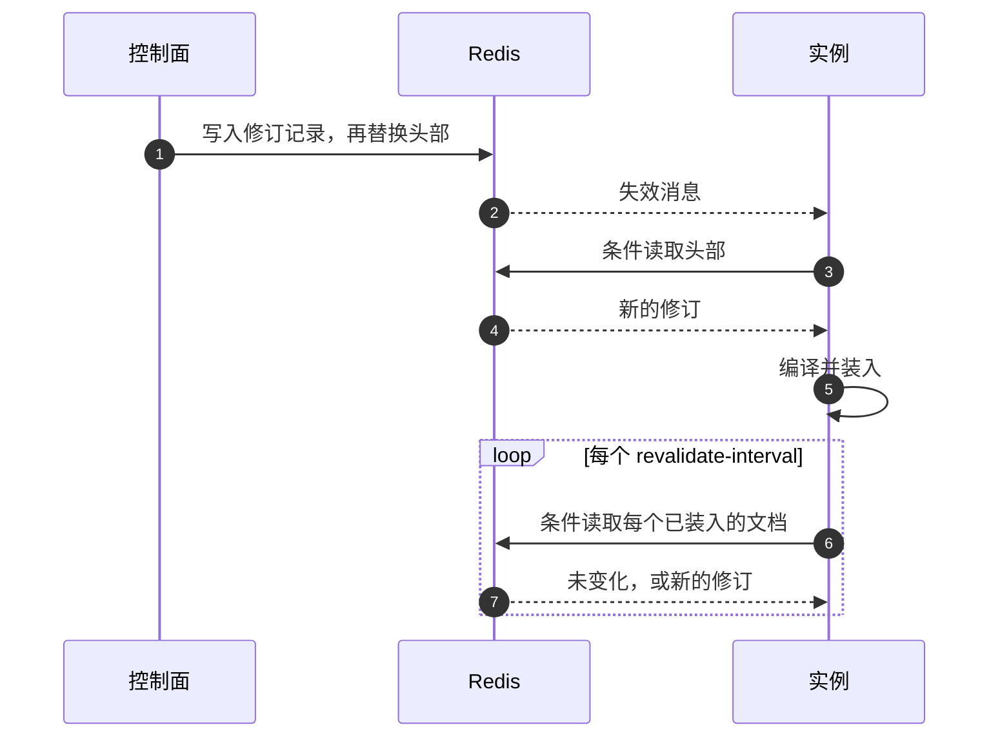

# 存储与缓存 {#storage-and-caching}

面向在生产环境运行 CoSec 的运维人员。本页说明 CoSec 用来做决策的文档存放在哪里、CoSec 使用的每个 Redis key、每个实例
如何读取并缓存文档、Redis 不可用时会发生什么，以及文档如何发布、如何版本化和回滚。这里提到的每个配置项都列在
[配置](./configuration.md#snapshot)中；文档包含什么见[策略语言](../policies/language.md)。

## 选择存储 {#choosing-a-store}

每个决策读取三类文档：每个请求都需要的平台文档，以及请求作用域内的应用文档和租户文档。管道从一个
`SnapshotDocumentStore` 读取它们。

| 存储 | 模块 | 适用场景 |
|---|---|---|
| Redis，通过 [CoCache](https://cocache.ahoo.me) | `cosec-cocache` | 生产环境。多个实例读取同样的文档，控制面在运行时发布变更。本页其余部分讲的都是这种存储。 |
| `InMemorySnapshotDocumentStore` | `cosec-spi` | 测试和本地开发。没有 `cosec-cocache` 时 starter 创建一个空的存储；应用用 `put` 把文档放进去。 |
| 你自己的 `SnapshotDocumentStore` bean，且没有 `cosec-cocache` | 你的代码 | 文档存放在其他系统中。每个方法都必须不阻塞地返回（[扩展](../architecture/extending.md)）。 |

在存入平台文档之前，每个请求都得到 `503` `unavailable`，每个实例都报告自己未就绪（[最初的文档](#the-first-documents)）。

## Redis {#redis}

有 `cosec-cocache` 时，Redis 保存文档以及控制面关于它们的一切记录，还保存已吊销的令牌、影子窗口报告和限流计数器。每个
实例通过 CoCache 保留一份进程内副本。

### Redis 是权威存储 {#redis-is-the-store-of-record}

文档和控制面的记录没有其他副本：背后没有数据库，也没有能在缓存未命中时补上数据的 loader。Redis 里有什么，每个实例就
用什么做决策。由此有三条规则，CoSec 在任何 CoCache 定制器或 `cocache.*` 配置项之后应用它们，因此任何配置都无法削弱
它们（[优先级](./configuration.md#precedence)）：

- **永不过期。** 文档和控制面记录写入时不带 TTL。过期会悄悄删除一个文档，而删掉的 DENY 会放宽访问。
- **读取失败就是失败。** Redis 读取失败绝不会变成"没有文档"（[Redis 不可用时](#when-redis-is-unavailable)）。
- **CoSec 无法解码的值使读取失败，并留在 Redis 中。** 它永远不会被回收（删除），因为回收会删掉唯一的副本。用普通
  Redis 命令写入的值就属于这种值：只通过控制面或 `cosec-migrate` 写入文档（[发布文档](#publishing-documents)）。

### Redis key {#redis-keys}

`<s>` 是 [`cosec.authorization.snapshot.key-prefix`](./configuration.md#snapshot)（默认 `cosec`），去掉末尾的 `:`。
`<doc>` 指一个文档：`platform`、`app:<appId>` 或 `tenant:<tenantId>`。应用 id 和租户 id 不含 `:`，所以一个 key
只对应一个文档。

| Key | 写入者 | 内容 |
|---|---|---|
| `<s>:snapshot:<doc>` | 控制面、`cosec-migrate` | 头部：每个实例执行的那个文档修订 |
| `<s>:control:revision:<doc>:<digest>` | 控制面、`cosec-migrate` | 一条修订记录，即完整的文档，按摘要寻址 |
| `<s>:control:revisions:<doc>` | 控制面、`cosec-migrate` | 一个文档的修订索引 |
| `<s>:control:refs:<doc>:<policyId>` | 控制面、`cosec-migrate` | 引用 `<doc>` 中某个策略的文档 |
| `<s>:control:lease:<name>` | 控制面 | 一个租约（`reclaim:<doc>`、`shadow-windows`）；随每次写入过期，持有者完成后删除它 |
| `<s>:control:list:documents`、`<s>:control:list:open-changes` | 控制面 | 有修订的文档，以及可能仍未结束的变更请求，供维护任务逐个访问 |
| `<s>:control:change:<changeId>` | 控制面 | 一个变更请求 |
| `<s>:control:stage:<doc>` | 控制面 | 一个文档的暂存槽：哪个变更占用它 |
| `<s>:candidate:<doc>` | 控制面 | 影子窗口打开期间一个文档暂存的候选 |
| `<s>:shadow:report:<window>:<instance>` | 仅数据面实例 `<instance>` | 该实例对一个影子窗口的累计报告；每次写入替换上一次的；最后一次写入 8 天后过期 |
| `<s>:shadow:reporters:<window>` | 每个数据面实例 | 对 `<window>` 报告过的实例 id；过期时间同上 |
| `<s>:shadow:status:instances` | 每个数据面实例 | 每个实例已装入的修订及其滞后；最后一次写入 2 分钟后过期，超过一分钟的条目被忽略 |
| `<c>:token:revoked:<tokenId>` | `TokenStore.revoke`（登出） | 已吊销令牌 id 对应 `true`；在刷新令牌有效期之后一秒过期 |
| `<c>:token:subject:revoked:<n>:<tenantId>:<principalId>` | `TokenStore.revokeSubject` | 以 epoch 毫秒表示的 `issuedBefore`；`<n>` 是 `<tenantId>` 的长度；在 `issuedBefore` 之后再过刷新令牌有效期加一秒过期 |
| `<m>:membership:<n>:<tenantId>:<principalId>` | `CoCacheMembershipProvider`，在应用注册了它时 | 一个主体的成员关系；会过期（默认一分钟） |
| `<k>:<sha256>` | `RedisApiKeyStore` | 一个 API key 的 JSON，按 key 的 SHA-256 存放 |
| `cosec:rate-limiter:<ruleId>:<bucket>:<window>` | Redis 限流器 | 一条规则一个桶一个窗口的计数器；两个窗口后过期 |

- `<c>` 是 [`cosec.authorization.cache.key-prefix`](./configuration.md#cache)，`<k>` 是
  [`cosec.api-key.key-prefix`](./configuration.md#api-keys)（`cosec:api-key`），`<m>` 是应用给成员关系缓存的前缀
  （默认 `cosec`），都去掉末尾的 `:`。它们 **不** 跟随 `<s>`。限流器的前缀 `cosec:rate-limiter` 是固定的。多个部署共用
  一个 Redis 时，给每个部署各自的前缀以及各自的限流规则 id。
- 除限流计数器和 API key 以外，每个 key 都是 CoCache 值。每个 CoCache 命名空间有自己的失效通道
  `cocache:inv:<namespace>`（例如 `cocache:inv:cosec:snapshot`），所以前缀不同的部署在同一个 Redis 上互不干扰。

### Redis 要求 {#redis-requirements}

- **每个节点的 `maxmemory-policy` 都是 `noeviction`。** 文档没有 TTL，也没有其他副本。在 `allkeys-*` 策略下 Redis
  可能驱逐一个文档：已经装入它的实例会失败即拒绝，但之后才加载它的实例会把被驱逐的应用文档或租户文档读成不存在，于是
  其中的 DENY 语句悄悄失效。使用 `noeviction`，并按数据量规划 Redis 的容量。
- **启动检查。** 使用 Redis 后端时，每个实例在启动时用 `CONFIG GET` 读取 `maxmemory-policy`。某个节点不是
  `noeviction`、`CONFIG GET` 失败或被拒绝、或者 CoCache 后端无法被检查看穿（包装过的或自定义的后端），默认都会使启动
  失败。托管 Redis 隐藏了 `CONFIG GET` 而你已经自行设置了 `noeviction` 时，需要
  [`cosec.authorization.snapshot.eviction-check=warn`](./configuration.md#snapshot)：实例照常启动，并记录一条以
  `!!!` 开头的 `WARN`（[故障排查](./troubleshooting.md#startup-fails-on-the-eviction-check)）。
- **Redis 客户端。** CoCache 根据 `spring.data.redis.*` 构建自己的 Lettuce 客户端；它需要的版本、拓扑和 ACL 命令见
  [CoCache 文档](https://cocache.ahoo.me/operations/#acl)。数据面还需要 `CONFIG GET` 来做启动检查。

### 谁可以写哪些 key {#who-may-write-which-keys}

只有控制面（以及 `cosec-migrate`）写入文档和控制面记录。数据面实例读取文档和候选，只写影子报告和状态。Redis ACL 可以
让两边各守其位：

- 数据面凭证：对 `<s>:snapshot:*` 和 `<s>:candidate:*` 只读，对 `<s>:shadow:*` 可写，对 `<s>:control:*` 无权访问。
- 控制面凭证：`<s>:` 下的所有 key。
- 要防止一个实例写另一个实例的报告，给每个实例一个独立的用户，只允许它写自己的报告 key
  （`<s>:shadow:report:*:<instance>`），并设置它的
  [`cosec.authorization.shadow.instance-id`](./configuration.md#shadow-windows)。每个实例仍要写
  `<s>:shadow:reporters:*` 和 `<s>:shadow:status:*`，CoCache 通过 Lua 脚本写它们，所以 ACL 无法把它们限制为只能添加。

一个窗口的数字是每个实例一份报告之和，每份都是该实例最新的报告。控制面宁可让窗口保持打开（该步骤得到 `503`），也不
计入任何可疑的内容：某个实例 key 下的报告写的是另一个实例或另一个窗口、计数为负、或者列出的实例没有报告。只要有一个
实例报告 `CANDIDATE_ERROR`，无论其他实例报告什么，窗口都被阻塞。实例总能误报自己的流量；ACL 只能把它限制在自己的
key 上。对 `<s>:shadow:reporters:*` 有写权限的实例可以删掉另一个实例的 id：控制面一旦见过那个实例报告，窗口就会保持
打开直到它的报告回来；但在那之前被删掉的 id 不会被发现，直到那个实例再次写入。

以默认前缀下的实例 `pod-a` 为例（Redis 7 ACL 语法；`%R~` 表示只读）。第一行设置 key 并收回所有命令；第二行授予它
需要的命令和通道：

```text
ACL SETUSER cosec-pod-a on >change-me resetkeys resetchannels -@all %R~cosec:snapshot:* %R~cosec:candidate:* ~cosec:shadow:report:*:pod-a ~cosec:shadow:reporters:* ~cosec:shadow:status:*
ACL SETUSER cosec-pod-a <CoCache 列出的命令和通道> +config|get
```

再加上该实例其他功能用到的 key（吊销、API key、限流；见 [Redis key](#redis-keys)）。上生产前用 `ACL DRYRUN` 检查这个
用户：CoCache 通过 Lua 脚本写入，Redis 会逐个 key 检查。

## 实例如何读取文档 {#how-instances-read-documents}

每个实例在内存中持有编译好的文档，做决策时不访问 Redis。平台文档在启动时加载，从不被丢弃；应用文档和租户文档在请求
第一次需要时加载，超过 [`max-apps` 和 `max-tenants`](./configuration.md#snapshot) 后丢弃最久未用的。预热的应用和
租户在启动时、平台文档之后加载。



- **变更立即到达每个实例**，通过 CoCache 的失效消息（第 2 到 5 步）。实例绕过本地副本自己读取 Redis，编译新修订并
  装入。进行中的请求继续使用它开始时的修订：一次求值绝不会混用一个文档的不同修订。
- **丢失的消息由重新确认兜底**（第 6、7 步）：每隔 [`revalidate-interval`](./configuration.md#snapshot)（10 秒），
  每个已装入的文档用一次条件读确认，未变化时不传输任何内容。
- **滞后**是 Redis 上一次确认某个文档以来的时间。只要 Redis 有应答，它就低于重新确认间隔。超过 `lag-warn`（60 秒）
  时实例以 `WARN` 记录 `Snapshot document [<doc>] revision <n> has not been confirmed for <lag>.`，超过
  `lag-escalate`（5 分钟）时以 `ERROR` 记录 `... is stale: not confirmed for <lag>.`，每个文档每分钟最多一次。
- **按滞后失败即拒绝的租户。** 对 [`fail-closed.tenants`](./configuration.md#snapshot) 中列出的租户，当请求读取的
  最旧文档（平台文档、该租户的文档和应用的文档）超过 `fail-closed.max-lag`（30 分钟）未被确认时，请求无法解析：它得到
  `503`，除非有 DENY 匹配。其他租户无论已装入的修订多旧都照常决策，从不检查。
- **本地副本**只服务冷加载。实例第一次需要某个文档时，可能采用 CoCache 的本地副本，它最多
  [`local-max-age`](./configuration.md#snapshot)（30 秒）旧；实例按这个最旧的时间计算它，并立即向 Redis 确认。本地的
  "没有这个文档"从不被信任：只有 Redis 能回答某个文档不存在。
- **冷加载最多等待** [`cold-load-timeout`](./configuration.md#snapshot)（2 秒）；之后对该请求而言文档算作失败。
- **修订只按 Redis 的说法变化。** Redis 故障切换后，由于复制是异步的，Redis 可能返回比已装入的更旧的修订。实例装入
  Redis 中的内容，因为其他实例读到的也一样，并以 `ERROR` 记录
  `Snapshot document [<doc>] regressed from revision <a> to <b>; ...`。请重新发布丢失的变更。

## Redis 不可用时 {#when-redis-is-unavailable}

| 对象 | 行为 |
|---|---|
| 已经装入的文档 | 保留。决策继续使用已装入的修订；它的滞后增长并被记录（[实例如何读取文档](#how-instances-read-documents)）。 |
| 尚未装入的文档 | 冷加载失败或超时：对该请求而言文档未解析，结果是 **`503`**，除非先匹配到 DENY。不会装入任何内容；下一个请求再试。 |
| 无法解码或编译的文档 | 作为失败装入：需要它的每个请求都是 **`503`**（除非先匹配到 DENY），直到发布一个可读的修订。 |
| 见过之后又从 Redis 消失的文档 | 失败，直到文档回来（以 `ERROR` 记录 `Snapshot document [<doc>] disappeared from the store; failing closed.`）。需要它的请求是 **`503`**，除非先匹配到 DENY。 |
| `fail-closed.tenants` 中的租户，其文档滞后超过 `fail-closed.max-lag` 之后 | **`503`**，除非先有 DENY 匹配（[实例如何读取文档](#how-instances-read-documents)）。 |
| 没有发布平台文档 | 每个请求都是 **`503`**（[最初的文档](#the-first-documents)）。 |
| 已吊销的令牌和主体 | 检查回答"未吊销"，令牌被 **接受**，这样一次故障不会拒绝所有已认证的请求。令牌仍会校验签名，并会自行过期。 |
| 基于 Redis 的 `MembershipProvider` 提供的成员关系 | **`503`**。令牌中携带的成员关系不受影响。 |
| Redis 中的 API key（`cosec.api-key.store=redis`） | **`503`**。 |
| 限流计数器 | `strictFailure: true` 的规则得到 **`503`**；其他规则被跳过，请求继续（[限流](../policies/rate-limiting.md)）。 |
| 控制面 | 存储读取失败就是失败，绝不当作"不存在"：控制 API 返回 `503`，不发布任何内容。 |
| 影子报告 | 实例记录写入失败，并在下一个周期重写；在此期间窗口保持打开。 |

吊销检查和没有 `strictFailure` 的限流规则是失败即拒绝的两个已记录的例外（[安全模型](../guide/security-model.md)）。
`503` 在响应和审计中是什么样子，见[故障排查](./troubleshooting.md#unavailable)。

## 发布文档 {#publishing-documents}

数据面实例从不写入文档。有两个写入者，都经过控制面的存储，因此每个文档的修订链都从它们的第一次写入开始：

- **控制面**（`cosec-control` 加 `cosec-cocache`），在运行时通过变更请求写入；
- **`cosec-migrate`**，用于部署的最初文档以及从 7.x 迁移。

两者都写入实例读取的那个 Redis，并使用同一个 `cosec.authorization.snapshot.key-prefix`。一次发布先写修订记录，再以
基准修订的摘要做比较并设置来替换头部，所以读者看到的要么是旧头部、要么是新头部，绝不会是混合；两个发布者也绝不会互相
覆盖：后一个会被告知基准已经变了。

### 最初的文档 {#the-first-documents}

在空的 Redis 上，每个请求都得到 `503`，控制面自己的检查也一样，因为它们同样需要平台文档；每个实例都报告自己未就绪
（[就绪](./deployment.md#readiness)）。缺失的平台文档从不被当作空文档读取，否则会悄悄丢掉每条平台 DENY。控制面无法
创建它，因为每个控制面请求都要先由它授权；而 `cosec-migrate bootstrap` 只写平台租户的文档（`tenant:(platform)`）。
第一个平台文档总是来自 `cosec-migrate publish`：

1. **发布文档。**
   `cosec-migrate publish --to-redis redis://host:6379 [--key-prefix cosec] --in <dir>` 发布一个目录中的文档，目录格式
   与 `cosec-migrate convert` 写出的相同：`platform.json`（必需）、`apps/<appId>.json`、`tenants/<tenantId>.json`，
   以及记录每个文件 SHA-256 的 `report.json`。它先编译每个文档，用平台文档检查每个应用文档和租户文档的引用，并最先
   发布平台文档。它从不覆盖：只要某个文档已存在就停止（`--resume` 跳过已经以相同内容发布的文档）。过期时间晚于
   `--break-glass-max-duration`（默认 `PT4H`）的 break-glass 绑定会被拒绝。
2. **指定第一个管理员。**
   `cosec-migrate bootstrap --to-redis redis://host:6379 [--key-prefix cosec] --platform-admin <principalId>` 在平台
   租户自己的文档（`tenant:(platform)`）中，把平台租户的这个主体绑定到内置的 `cosec:platform-admin` 策略，作为一个
   类型为 `BOOTSTRAP` 的修订。若该文档已经把某人绑定到 `cosec:platform-admin`，它会拒绝执行；`--force` 用于所有管理员
   都已丢失时的恢复。

`cosec-migrate` 连接一台 Redis 服务器（`--to-redis`），完成时以 `0` 退出，数据被拒绝或发布失败时以 `1` 退出，用法
错误时以 `2` 退出。把 7.x 数据转换为文档见[升级](./upgrading.md)。

`cosec-migrate bootstrap` 让管理员可以操作控制面，但访问控制 API 的 HTTP 请求本身必须先像其他请求一样被文档放行
（[测试变更](../policies/testing.md)）。

### 通过控制面发布 {#publishing-through-the-control-plane}

运行时，每个变更都通过 [`cosec.control.http.base-path`](./configuration.md#control-plane) 下的控制 API 进行：变更基于
一个基准修订提出，经过检查，视需要经过影子窗口和审批，然后发布。到发布时基准已经变化的变更成为 `CONFLICTED`，必须
变基；不会覆盖任何内容。工作流、检查和审批见[测试变更](../policies/testing.md)。控制面把每个发布的修订立即告知同一宿主
上的实例，并通过 CoCache 的失效消息告知其他所有实例。

### 修订、历史与回滚 {#revisions-history-and-rollback}

每次发布都产生一个文档的新修订：编号是基准加一，并记录谁发布、谁审批、影子窗口以及它来自哪个变更。控制 API 可以读取
它们（`<doc>` 是 `platform`、`app:<appId>` 或 `tenant:<tenantId>`）：

| 请求 | 回答 |
|---|---|
| `GET /documents/<doc>` | 头部 |
| `GET /documents/<doc>/revisions?before=&limit=` | 历史，最新的在前（默认 20 条，最多 200 条） |
| `GET /documents/<doc>/revisions/<n>` | 修订 `<n>`；未保留时为 `410` |
| `GET /documents/<doc>/diff?from=&to=` | 两个修订之间的变化 |
| `GET /documents/<doc>/revisions/<n>/propagation` | 最近一分钟内报告过状态的实例中，有多少已经装入修订 `<n>` 或更新的修订（需要实例开启[影子窗口](./configuration.md#shadow-windows)） |
| `POST /documents/<doc>:rollback`，请求体 `{"revision": <n>, "note": "..."}` | 一个变更（`201`），把文档恢复为修订 `<n>` 时的样子 |

回滚和其他变更一样：按内容需要经过检查、影子窗口和审批，发布后产生一个新修订，所以历史只增不减，并记录了谁做的回滚。
会把 break-glass 绑定带回来的回滚永远无法通过检查。

每个控制面实例在运行期间执行两个维护任务，每个都在一个间隔之后第一次运行：

- **回收修订**，每隔 [`cosec.control.revisions.reclaim-interval`](./configuration.md#control-plane)（1 小时）。对每个
  文档，它删除最近 `max-count`（50）个之外、且早于 `min-age`（7 天）的修订记录，以及从未成为头部、早于 `orphan-age`
  （1 小时）的发布记录。它从不删除头部，也不删除未结束变更所依赖的修订；某个未结束的变更读不到时，这一轮什么都不回收。
  每个文档一个租约（`reclaim:<doc>`），同一时间只有一个实例处理一个文档。
- **关闭影子窗口**，每隔 [`cosec.control.shadow.check-interval`](./configuration.md#control-plane)（1 分钟），持有
  `shadow-windows` 租约，所以窗口最多晚一个间隔关闭。

两个任务都会读取每个未结束的变更，所以没人完成的变更在提出后
[`cosec.control.changes.expire-after`](./configuration.md#control-plane)（7 天）过期，并离开未结束变更的列表。

失败的一轮会被记录，下一轮照常运行。已被回收的修订得到 `410`。

**下一步：** 查看 CoSec 做了什么决策，见[可观测性](./observability.md)。
