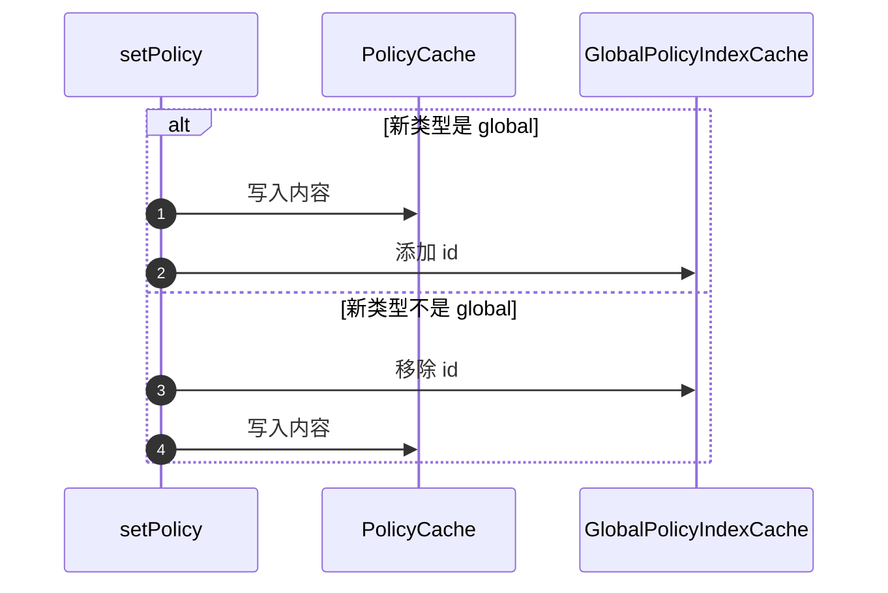

# 存储与缓存 {#storage-and-caching}

面向在生产环境运行 CoSec 的运维人员。本页说明 CoSec 从哪些存储读取数据、对它们有什么保证、它写入的每个 Redis key、
Redis 不可用时会发生什么，以及如何发布和回滚变更。这里提到的每个设置都列在 [配置](./configuration.md#cache) 中；
从 6.x 迁移见 [升级](./upgrading.md)。

## 选择存储 {#choosing-a-store}

授权从 `PolicyRepository` 读取策略，从 `AppRolePermissionRepository` 读取应用权限和角色授权。它从不直接读文件或数据库。

| 存储 | 模块 | 适用场景 |
|---|---|---|
| Redis，通过 [CoCache](https://cocache.ahoo.me) | `cosec-cocache`（`cache-support`） | 多个实例必须看到相同的策略，且管理员会在运行时修改它们。本页其余部分讲的都是这种存储。 |
| 自己的仓库 | 你的代码 | 策略存放在别的系统里。实现这两个仓库（[仓库](../architecture/extending.md#repositories)）。 |

starter 只提供 Redis 仓库：没有 `cache-support` 时，应用需要自己声明这两个仓库 bean。[本地策略文件](#local-policy-files)
不是一种存储：它们在启动时被加载进仓库。

## 本地策略文件 {#local-policy-files}

策略可以作为 JSON 文件随应用发布，并在启动时写入仓库：

| 配置项 | 作用 |
|---|---|
| `cosec.authorization.local-policy.enabled=true` | 从 `cosec.authorization.local-policy.locations`（默认 `classpath:cosec-policy/*-policy.json`）加载文件。 |
| `cosec.authorization.local-policy.init-repository=true` | 启动时把加载的策略写入 `PolicyRepository`。不开启时文件不起作用，因为授权只读仓库。 |
| `cosec.authorization.local-policy.force-refresh=true` | 覆盖仓库中已存在的策略。不开启时，启动会先从仓库读取每个 id，只有 id 不存在时才写入文件。 |

加载是严格的：读不了或构建不了的文件、两个声明同一策略 id 的文件、匹配不到任何文件的配置位置，都会导致启动失败
（[加载策略文件](../policies/language.md#loading-policy-files)）。

::: warning `force-refresh=true` 会覆盖
它会用文件替换 **每一个** 本地策略的存储副本，包括管理员此后通过仓库所做的修改。只在有意为之时用一次，然后关掉
（[故障排查](./troubleshooting.md#startup-fails-reading-a-stored-policy)）。
:::

## Redis {#redis}

使用 `cache-support` 时，Redis 保存策略、全局策略索引、应用权限和角色授权，也保存已吊销的令牌 id。每个实例通过
CoCache 6.6 保留一份进程内副本。

### Redis 是权威存储 {#redis-is-the-store-of-record}

策略、全局策略索引、应用权限和角色授权没有其他副本：背后没有数据库，也没有能填补缓存未命中的加载器。Redis 里有什么，
授权就按什么决策。由此有三条规则：

- **永不过期。** 这些条目写入时不带 TTL。过期会悄悄删除一条策略，而被删除的拒绝会扩大访问范围。
- **读取失败则请求失败。** Redis 读不了且本地副本中没有该值时，读取抛出异常，请求被拒绝
  （[Redis 不可用时](#when-redis-is-unavailable)）。它绝不会降级为"未找到"，那样会丢掉一条拒绝。
- **CoSec 解码不了的值会让读取失败，并保留在 Redis 中。** 它绝不会被回收（删除），因为没有加载器时，回收会删掉唯一的副本。

这些规则由 CoSec 自己在所有 CoCache 定制器和 `cocache.*` 配置项之后应用，因此任何配置都削弱不了它们
（[优先级](./configuration.md#precedence)）。

### CoCache 的保证 {#what-cocache-guarantees}

- **遇到外来格式时失败即拒绝。** 读取遇到另一种格式的值（CoSec 6.x 写的 CoCache 5 值，或任何用原生 Redis 命令写入的值）
  时，以 `CacheReadException`（原因为 `ForeignFormatException`）失败，并把该值留在 Redis 中。所有 CoSec 缓存（包括已吊销
  令牌）都使用这种模式（`foreign-format: fail`），即使设置了 `cocache.defaults.foreign-format=reclaim` 也一样。集合（如全局
  策略索引）也不会被覆盖：在外来值上做更新会以 `CacheWriteException`（原因为 `ForeignFormatException`）失败，并保持原样。
  普通值（如策略或应用权限）则会被写入替换（[迁移前的写入](./upgrading.md#writes-before-the-migration)）。
- **变更到达每个实例。** 写入先到 Redis，然后每个实例通过失效消息丢弃自己的本地副本。
- **陈旧时间有上界。** 即使失效消息丢失，本地副本最多也只存活 `localMaxAge`（默认 5 分钟，用
  [`expire-after-write`](./configuration.md#local-cache-settings) 设置），之后重新从 Redis 读取。CoCache 没有"无限"这个选项。
- **读取不阻塞事件循环。** 本地副本中的值在调用方线程上直接返回；未命中时以非阻塞方式读 Redis，然后在 `boundedElastic` 上继续。
- **全局索引的更新是原子的。** 添加或移除一个 id 是原子的元素更新，所以不同实例上的并发写入者不会丢失条目。

### 缓存一览 {#the-caches}

| 缓存 | 保存 | 权威存储 | Redis TTL | Redis 读取失败时 | 本地副本设置 |
|---|---|---|---|---|---|
| `PolicyCache` | 按 id 的策略 | 是 | 无 | 请求被拒绝 | `cosec.authorization.cache.policy.*` |
| `GlobalPolicyIndexCache` | 全局策略的 id，一个集合 | 是 | 无 | 请求被拒绝 | 只能用 `cocache.caches.GlobalPolicyIndexCache.*` |
| `AppPermissionCache` | 按应用 id 的应用权限 | 是 | 无 | 请求被拒绝 | 只能用 `cocache.caches.AppPermissionCache.*` |
| `RolePermissionCache` | 某个角色在一个应用、一个空间中的权限 id | 是 | 无 | 请求被拒绝 | `cosec.authorization.cache.role.*` |
| `RevokedTokenCache` | 已吊销的令牌 id（开启令牌吊销时） | 否 | 令牌的刷新令牌剩余寿命，再加 1 秒 | 令牌被接受 | `cosec.authorization.cache.token.*`（30 秒，100,000 条） |
| `RevokedSubjectCache` | [全部令牌被吊销](../integration/authentication.md#revoking-every-token-of-a-principal)的主体（开启令牌吊销时） | 否 | `issuedBefore` 之后一个刷新令牌有效期，再加 1 秒 | 令牌被接受 | `cosec.authorization.cache.token.*`，与 `RevokedTokenCache` 相同 |

每个缓存遇到解码不了的值都会失败，两个吊销缓存也不例外：删除一条读不懂的吊销记录会让对应令牌重新有效。

已吊销令牌不是权威存储。每条吊销记录带有自己的寿命，令牌也会自行过期，所以读取失败时有意降级。"未吊销"的结果在本地缓存
30 秒，这限定了失效消息丢失时，其他实例最多多久察觉不到一次新的吊销。

### Redis key {#redis-keys}

`<p>` 是 [`cosec.authorization.cache.key-prefix`](./configuration.md#cache)（默认 `cosec`），去掉末尾的 `:`。CoSec 的缓存
不使用 CoCache 自己的 key 前缀：CoCache 默认的 `cocache:` 对它们不适用。

| Key | 写入方 | 内容 |
|---|---|---|
| `<p>:policy:<policyId>` | `PolicyRepository.setPolicy` | 一个策略（CoCache 值） |
| `<p>:global:policy` | `PolicyRepository.setPolicy` | 全局策略的 id（CoCache 集合） |
| `<p>:app:permission:<appId>` | `AppPermissionCache` | 一个应用权限（CoCache 值） |
| `<p>:app:role:permission:<appId>:<roleId>` | `RolePermissionCache` | 某角色在默认空间的权限 id（CoCache 值） |
| `<p>:app:role:permission:<appId>:<roleId>@<spaceId>` | `RolePermissionCache` | 某角色在空间 `<spaceId>` 的权限 id（CoCache 值） |
| `<p>:token:revoked:<tokenId>` | `TokenStore.revoke`（登出） | 已吊销令牌 id（`jti`）对应 `true`，带 TTL（CoCache 值） |
| `<p>:token:subject:revoked:<n>:<tenantId>:<principalId>` | `TokenStore.revokeSubject` | 以 epoch 毫秒计的 `issuedBefore`，带 TTL（CoCache 值）；`<n>` 是 `<tenantId>` 的长度 |
| `<p>:meta:schema` | schema 检查、迁移 | `7`：数据是 7.0 布局（[Schema 标记](#schema-marker)） |
| `<h>:<policyId>` | 策略历史 | 修订列表，JSON，最新的在前，最多 `max-revisions` 条 |
| `<h>:<policyId>:seq` | 策略历史 | 计数器：该策略最后一个修订号 |
| `<api-key-prefix>:<sha256>` | `RedisApiKeyStore` | 一个 API key，JSON，按 key 的 SHA-256 存放 |
| `<rate-limit-prefix>:<ruleId>:<bucket>:<window>` | `RedisRateLimiter` | 某条规则某个桶在一个窗口内的计数器；两个窗口后过期 |

- `<h>` 是 `<key-prefix>:policy:history`，用 **原样配置** 的 key 前缀拼成：这里不去掉末尾的 `:`，所以 `myapp:` 得到
  `myapp::policy:history:<policyId>`。只有开启 [历史](#policy-history-and-rollback) 时才有历史 key；它们是普通 Redis 数据，
  不是 CoCache 值。
- `<api-key-prefix>` 是 [`cosec.api-key.key-prefix`](./configuration.md#api-keys)（`cosec:api-key`），`<rate-limit-prefix>` 是
  [`cosec.limiter.key-prefix`](./configuration.md#rate-limiting)（`cosec:rate-limiter`），都去掉末尾的 `:`。它们 **不** 跟随
  `cosec.authorization.cache.key-prefix`：多个部署共用一个 Redis 时，也要一起修改它们。
- 应用 id 不能包含 `:`，角色 id 不能包含 `@`，所以角色授权的 key 总能被读回成写入时的那个应用、角色和空间。
  `AppSpacedRoleId` 拒绝其他写法，授权也不会给这样的应用或角色任何授权（[角色授权范围](../policies/role-permissions.md#role-grant-scope)）。
- 读取一个尚不存在的值，可能会在它的 key 上留下一个短暂的 lease 标记（CoCache 的 `lease-ttl`，默认 10 秒）。它不含值，会自行过期。

从 6.x 升级期间，还会有两类 key：

| Key | 内容 |
|---|---|
| `<legacy>:role:permission:<roleId>[@<spaceId>]` | 6.x 的角色授权，不含应用。授权从不读取它们；`RolePermissionKeyMigration` 复制它们，`deleteLegacy()` 删除它们。 |
| `<backup-prefix><key>` | 迁移原地转换的每个 key 的 6.x 值，用于回滚。`dropBackups()` 删除它们。 |

`<legacy>` 是 [`cosec.authorization.cache.migration.legacy-key-prefix`](./configuration.md#cache)，不去掉末尾的 `:`；
`<backup-prefix>` 是 `cosec.authorization.cache.migration.backup-prefix`（`cocache5-backup:`）
（[迁移数据](./upgrading.md#migrating-the-data)）。

每个 CoSec 缓存有自己的失效通道：`cocache:inv:<p>:policy`、`cocache:inv:<p>:global`、`cocache:inv:<p>:app:permission`、
`cocache:inv:<p>:app:role:permission`、`cocache:inv:<p>:token:revoked` 和 `cocache:inv:<p>:token:subject:revoked`，所以 key 前缀不同的部署在同一个 Redis 上互不干扰。

### Schema 标记 {#schema-marker}

7.0 并不总能在 6.x 存放数据的地方找到 6.x 的数据。key 前缀以 `:` 结尾时（6.x 存在 `myapp::policy:*`，7.0 读
`myapp:policy:*`）、key 前缀改过之后、或回滚这类迁移之后，7.0 会看不到任何策略、任何全局 `DENY`、任何吊销记录。这不是会让
读取失败的外来数据：它根本不存在，而不存在的拒绝不会拒绝任何请求。

因此 starter 在创建任何 CoSec 缓存之前，先检查 `<p>:meta:schema`：

| 标记 | Redis 中的 CoSec 数据 | 启动 |
|---|---|---|
| `7` | 任意 | 继续 |
| 其他值 | 任意 | 以 `CoSecSchemaException` 失败：数据是更新版本的 CoSec 写的 |
| 缺失 | 在 6.x key 前缀或当前前缀下存在 | 以 `CoSecSchemaException` 失败，并给出找到的一个 key |
| 缺失 | 没有 | 新部署：写入标记，继续启动 |

CoSec 数据指 `<prefix>:policy:`、`<prefix>:global:policy`、`<prefix>:app:permission:`、`<prefix>:app:role:permission:`、
`<prefix>:role:permission:` 或 `<prefix>:token:revoked:` 下的任意 key，6.x key 前缀（`legacy-key-prefix`，不去掉末尾的 `:`）
和当前前缀都会检查。迁移在最后一步写入标记；回滚第一步就删除它。

- 只有 Redis 后端才做这项检查：`cocache.backend=memory` 时跳过，因为它不可能有 6.x 数据。
- `cosec.authorization.cache.migration.check-schema=false` 关闭检查。只有一次性的迁移任务可以这样设置，因为检查会阻止那个
  任务启动（[迁移数据](./upgrading.md#migrating-the-data)）。
- 检查只在告诉它的前缀下寻找 6.x 数据。key 前缀改变时，把 `cosec.authorization.cache.migration.legacy-key-prefix` 设为 6.x 的前缀。
- 可能还有 6.x 数据时，不要手工写入标记。

### Redis 要求 {#redis-requirements}

- Redis 7.0 或更高，或 Valkey 7.2 或更高。
- CoCache 根据 `spring.data.redis.*` 自建 Lettuce 客户端。不支持 Jedis，静态主从（master-replica）配置会在启动时失败。
- Redis ACL 必须授予 [CoCache 列出的权限](https://cocache.ahoo.me/operations/#acl)，自 CoCache 6.3 起包括 `+hkeys +hget`。
  保留 `+hgetall`。
- 不要让 Redis 驱逐 CoSec 的 key。权威存储的 key 没有 TTL、也没有其他副本，所以 `allkeys-*` 的 `maxmemory-policy` 可能删掉
  策略和授权；`volatile-*` 策略可能删掉吊销记录，让对应令牌重新被接受。使用 `noeviction` 并按数据量规划实例容量。因为有
  全局策略索引，CoCache 会在启动时检查该策略（`cocache.redis.set-cache-eviction-check`，默认 `warn`）。

## Redis 不可用时 {#when-redis-is-unavailable}

| 数据 | 行为 |
|---|---|
| 策略、全局策略索引、应用权限、角色授权 | 本地副本中的值继续可用。其他读取失败，请求以 `500` **被拒绝**。 |
| 已吊销的令牌和主体 | 检查 **接受** 该令牌，避免一次故障拒绝所有已认证的请求。令牌仍会校验签名，也会自行过期。 |
| Redis 中的 API key（`cosec.api-key.store=redis`） | 查询失败，请求以 `500` **被拒绝**。 |
| 限流计数器 | 跳过该规则，请求继续；规则设置了 `strictFailure: true` 时返回 `429`（[失败时的行为](../policies/rate-limiting.md#failure-behavior)）。 |

吊销检查和未设置 `strictFailure` 的限流规则，是失败即拒绝的两个已写明的例外（[失败即拒绝](../guide/security-model.md#fail-closed)）。

## 发布变更 {#publishing-changes}

### 通过 CoSec 写入 {#write-through-cosec}

每个 CoCache 6 值都以 CoCache 会检查的二进制头开头，所以用 `SET`、`SADD` 或其他 Redis 命令写入的值不会被读取：它们会被
当作外来数据而失败。应当这样写入：

- 策略用 `PolicyRepository.setPolicy`，它在存储前会校验策略；
- 应用权限和角色授权通过 `AppPermissionCache` 和 `RolePermissionCache` bean
  （[存储权限目录与授权](../policies/role-permissions.md#storing-catalogs-and-grants)）。

每次写入都会通过失效消息立即到达其他实例。

### 全局策略索引 {#the-global-policy-index}

全局策略索引和策略内容是两个独立的 Redis key，先后写入：CoCache 没有跨缓存的事务。`RedisPolicyRepository` 用三条规则保证安全。

**读取方只采用类型为 `global` 的策略。** 读取方从索引取出 id，读取它们的内容，只保留类型为 `global` 的内容。在一次重新发布
的两次写入之间，某个 id 可能还在索引里，而它的内容已经是别的类型；这样的内容会被忽略，而不是对所有人生效。

**索引中有 id 但没有内容时失败即拒绝。** 如果索引列出的 id 没有内容（丢失了，或者 6.x 的缓存未命中被迁移成了未命中），
读取会以 `MissingPolicyException` 失败，每个请求都以 `500` 被拒绝。日志会写
`the global policy index lists policies [...] that have no content.`。跳过它会悄悄丢掉一条可能是全局拒绝的策略。重新写入该
策略，或把它保存为 `global` 以外的类型，使它离开索引（[故障排查](./troubleshooting.md#every-request-fails-with-500)）。

**写入有顺序，失败时绝不扩大访问范围。**



- 全局（步骤 1 和 2）：先写内容，再添加 id。如果索引更新失败，新内容只对列出该策略的主体生效，就像任何非全局策略一样；旧内容
  绝不会变成全局的。
- 非全局（步骤 3 和 4）：先移除 id，再写内容。如果内容写入失败，旧内容只对列出该策略的主体生效；新内容绝不会对所有人生效。

发布失败时会返回错误。重试即可：重复发布是幂等的。

## 策略历史与回滚 {#policy-history-and-rollback}

Redis 只保存每个策略的当前版本。开启 `cosec.authorization.cache.history.enabled=true` 后，每次通过仓库保存还会记录一个修订：
递增的编号、时间、作者、备注和完整策略，最新的在前，每个策略最多 `cosec.authorization.cache.history.max-revisions`（50）条。
通过 Reactor 上下文传入作者：

```kotlin
policyRepository.setPolicy(policy)
    .contextWrite(PolicyRevisions.author("alice", "TICKET-42: allow exports"))
```

`PolicyHistory` bean 读取和恢复修订。回滚会把旧内容保存为一个新修订，所以历史只增不减，并记录是谁回滚的：

```kotlin
policyHistory.history("orders")                 // newest first
policyHistory.rollback("orders", revision = 3, author = "bob")
```

- 没有作者的保存记为 `unknown`。
- 先写策略再写修订，所以历史中不会出现没有生效过的版本。
- 修订号由 Redis 计数器分配，任何实例上的并发写入者都会拿到不同的编号。

**下一步：** 查看 CoSec 做了什么决策，见[可观测性](./observability.md)。
