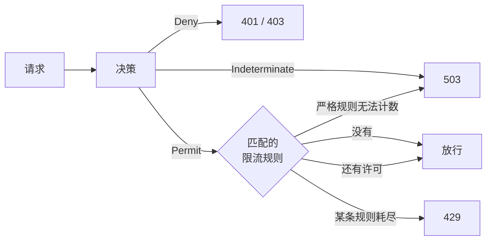

# 限流 {#rate-limiting}

面向需要防止 API 被滥用的策略作者和运维人员。限流规则保存在策略文档中，只在请求被允许之后运行；本页介绍如何编写规则、如何选择计数后端，以及触发限制时客户端看到什么。

策略决定请求是否被允许；限流规则决定被允许的请求能以多高的频率通过。规则是 Permit 的*义务*：被拒绝或无法决策的请求不消耗任何许可，因此永远不会占用正常调用方的配额。[代码中的检查](../integration/checks.md)、`simulate`、`explain` 和影子求值同样不消耗许可。



## 规则 {#rules}

每个文档都可以在 `rateLimits` 中包含规则（[字段](./language.md#rate-limit-rules)）：

```json
{
  "schema": 2,
  "revision": 7,
  "publishedAt": "2026-11-01T08:00:00Z",
  "policies": [],
  "bindings": [],
  "rateLimits": [
    {
      "id": "login-per-ip",
      "action": "http:POST",
      "resource": "http:path:/auth/login",
      "key": "environment.ip",
      "permitsPerSecond": 0.1,
      "windowSeconds": 60,
      "strictFailure": true
    },
    {
      "id": "export-free-tier",
      "action": "http:GET",
      "resource": "http:path:/export/**",
      "condition": { "in": ["free", "scope.roles"] },
      "key": "subject.id",
      "permitsPerSecond": 0.2,
      "windowSeconds": 60
    }
  ]
}
```

规则按 DENY 语句的方式匹配被允许的请求：某个动作模式、某个资源模式，以及它的条件。一个窗口允许 `permitsPerSecond × windowSeconds` 个请求，且至少一个。

请求受哪些规则约束：

- 平台文档的规则，对每个被允许的请求；
- 应用文档的规则，当请求读取了该文档时：请求有应用，且主体在请求空间中拥有角色（[角色权限](./role-permissions.md#app-documents)）；
- 租户文档的规则，对该租户的请求。

它们按这个顺序运行，同一文档内按文档中的顺序。每条匹配的规则消耗一个许可。第一条桶已耗尽的规则返回 `429`；它之后的规则不消耗，之前的规则保留已消耗的许可。规则是叠加的：租户或应用规则永远不会替换或放宽平台规则，即使 id 相同；只有请求匹配的每条规则都还有许可时，请求才能通过。

## 键 {#keys}

`key` 指定用哪个属性的值来选择桶：[属性目录](./language.md#attributes)中的 String 或 Ip 属性，例如 `environment.ip`、`subject.id`、`scope.tenant`、`subject.attributes.plan` 或 `resource.var.orderId`。`resource.var.<name>` 键必须被规则的每个资源模式捕获。

| `key` | 桶 |
|---|---|
| 未写 | 规则匹配的所有请求共享一个桶。 |
| 已写 | 每个值一个桶。该值缺失的请求共享它们自己的一个桶。 |

不同文档的规则永远不共享桶：平台规则按自己的 id 计数，应用规则按 `app:<appId>/<id>`，租户规则按 `tenant:<tenantId>/<id>`（[`CompiledRateLimit.counterId`](https://github.com/Ahoo-Wang/CoSec/blob/main/engine/src/main/kotlin/me/ahoo/cosec/engine/flat/RateLimits.kt)）。规则 id 不能包含 `:` 或 `/`，所以任何规则都无法指向其他文档的计数器：租户无法消耗或重置平台的配额。

读取 `subject.id` 的键让所有匿名调用方共享一个桶；请用另一条按 `environment.ip` 计数的规则约束他们。键或条件读取了无法获取的[外部属性](./language.md#external-attributes-and-onmissing)时，规则没有桶：若写了 `onMissing: "nomatch"`（仅平台规则）则跳过，否则按[限流器失败](#failure-behavior)的方式由 `strictFailure` 决定。

## 计数与后端 {#counting-and-backends}

两种限流器使用同一个滑动窗口计数：估计值为上一个窗口的计数乘以其仍重叠的比例，再加上当前窗口的计数。估计值低于限制时请求被允许；被拒绝的请求不计数。

| 限流器 | 何时使用 | 范围 |
|---|---|---|
| `ReactiveRedisRateLimiter` | classpath 中有 `cosec-cocache`，且存在 `ReactiveStringRedisTemplate` bean | 整个集群，由 Lua 脚本原子地检查并计数，不阻塞调用线程。计数器位于 `cosec:rate-limiter:<rule>:<bucket>:<window>`，两个窗口后过期。 |
| `LocalRateLimiter` | 其他情况 | 每个 JVM 独立：有 N 个实例时，实际限制是 N 倍。最多保留 100,000 个桶，空闲一小时的桶会被丢弃；被丢弃的桶从零重新计数。 |

自定义的 `RateLimiter` bean 会替换两者（[扩展](../architecture/extending.md)）。每次调用受 `cosec.authorization.rate-limit.timeout`（默认 `500ms`，[配置](../operations/configuration.md)）约束；超时视为失败。

## 响应与响应头 {#responses-and-headers}

被规则拦下的请求返回 `429 Too Many Requests`，problem 类型为 `too-many-requests`（[状态码](../integration/web.md)）。至少消耗了一个许可的被允许请求，带有剩余许可最少的那条规则的响应头；`429` 带有耗尽的那条规则的响应头：

| 响应头 | 值 |
|---|---|
| `RateLimit-Limit` | 该规则每个窗口的许可数，向上取整。 |
| `RateLimit-Remaining` | 当前窗口剩余的许可数。 |
| `RateLimit-Reset` | 距当前窗口结束的秒数，至少为 `1`。 |
| `Retry-After` | 仅在 `429` 上：与 `RateLimit-Reset` 相同。 |

没有匹配任何规则，或匹配的规则全部被跳过的请求，不带这些响应头。

## 失败行为 {#failure-behavior}

限流器失败（Redis 不可达、脚本错误）、超时、未配置，或无法读取规则的桶时，该规则无法计数。由它的 `strictFailure` 决定：

| `strictFailure` | 请求 |
|---|---|
| `false`（默认） | 跳过该规则，继续执行下一条规则。以 `WARN` 记录日志。 |
| `true` | 以 `503 Service Unavailable` 拒绝（problem 类型 `unavailable`，无 `Retry-After`）。以 `ERROR` 记录日志。 |

除外部属性不可用以外，因任何其他原因无法读取桶时，即使没有 `strictFailure` 也会拒绝请求。失败日志每十秒最多记录一次。跳过宽松规则是[失败即拒绝](../guide/security-model.md)的文档化例外之一；对防范滥用的规则（例如登录尝试）设置 `strictFailure`，只用于平滑负载的规则则不要设置。

## 发布规则 {#publishing-rules}

规则是所属文档的一部分，因此随文档一起检查和编译：无效的 id、同一文档内重复的 id、`permitsPerSecond` 不大于 `0`、`windowSeconds` 小于 `1`、不是 String 或 Ip 属性的 `key`，或模式没有捕获的变量，都会让整个文档失败（[测试策略](./testing.md#validating-policies)）。

像其他条目一样通过控制面修改规则（[变更](./testing.md#changes)）：

- `putRateLimit`（`rateLimit`，可选 `ifMatch`）添加一条规则，或在原位置替换同 id 的规则；`removeRateLimit`（`id`，可选 `ifMatch`）删除一条规则；
- `POST /documents/{key}:apply` 从整份文档提出这些操作：`MERGE` 写入新增和改动的规则，`REPLACE` 还会删除文档中没有的规则。顺序是规则的一部分（由第一条耗尽的规则返回），所以位置不对的规则会先删除再重新写入；回滚以同样的方式恢复该修订的规则。

每个操作需要对条目 `doc/<document>/rateLimit/<id>` 拥有 `cosec:write`，例如 `doc/tenant/acme/rateLimit/export-per-user`。租户修改自己的规则，无论收紧还是放宽，都不需要第二个人：它的规则在自己的桶中计数，平台和应用的每条规则仍然作用于它的请求。对平台或应用文档的规则修改（包括删除）与那里的其他变更一样需要[审批](./testing.md#approval)。

影子窗口比较的是决策，而规则从不改变决策，所以只涉及限流规则的变更在窗口中显示不出任何差异：窗口无法反映配额的情况。

**下一步：** 在错误进入生产环境之前发现它们，见[测试策略](./testing.md)。
