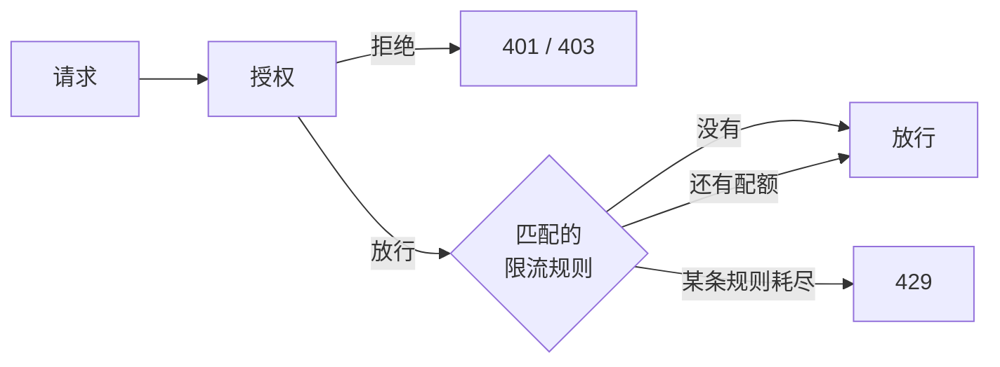

# 限流 {#rate-limiting}

面向需要防止 API 被过度调用的策略作者和运维人员。限流在授权之后进行，只为已放行的请求消耗配额；本页介绍如何编写规则、选择计数后端，以及触发限流时客户端看到什么。

策略决定请求是否被允许；限流规则决定被允许的请求可以多频繁地通过。被拒绝的请求已经被拒绝，不会占用合法调用方的配额；
[代码中的检查](../integration/checks.md)也从不消耗配额。



## 规则 {#rules}

规则是 JSON 文件，默认是所有 `classpath:cosec-rate-limit/*-rate-limit.json`
（[`cosec.limiter.*`](../operations/configuration.md#rate-limiting)）。一个文件包含一条规则或一个规则数组。

```json
[
  {
    "id": "login-by-ip",
    "action": { "path": { "pattern": "/auth/login", "method": "POST" } },
    "key": "request.remoteIp",
    "permitsPerSecond": 0.1,
    "windowSeconds": 60,
    "strictFailure": true
  },
  {
    "id": "export-free-tier",
    "action": "/export/**",
    "condition": { "inRole": { "value": "free" } },
    "key": "context.principal.id",
    "permitsPerSecond": 0.2,
    "windowSeconds": 60
  }
]
```

| 字段 | 必填 | 默认值 | 含义 |
|---|---|---|---|
| `id` | 是 | | 配额的名字：字母、数字、`_`、`.` 和 `-`。计数器属于 id，而不属于配置，所以两条规则不会意外共享配额。在所有规则中唯一。 |
| `action` | 是 | | 规则作用于哪些请求，写法同语句的[动作](./language.md#actions)。 |
| `condition` | 否 | 总是匹配 | 进一步收窄规则，写法同语句的[条件](./language.md#conditions)。 |
| `key` | 否 | 共用一个桶 | 配额按什么计数（[键](#keys)）。 |
| `permitsPerSecond` | 是 | | 速率，大于 `0`。 |
| `windowSeconds` | 否 | `1` | 窗口长度，至少为 `1` 的整数。一个窗口允许 `permitsPerSecond × windowSeconds` 个请求，至少一个。 |
| `strictFailure` | 否 | `false` | 后端故障意味着什么（[故障时的行为](#failure-behavior)）。 |

低速率要用更长的窗口：`0.1` 每秒、窗口 `60` 秒就是每分钟 6 个请求；而在默认的 1 秒窗口下，限额（`0.1`）不到一个请求，计数会很粗糙。

对一个被放行的请求，每条匹配的规则按文件顺序各消耗一个配额。第一条耗尽的规则以 `429` 拒绝请求；它之后的规则不再消耗，它之前的规则已经消耗了。

[`schema/rate-limit-rule.schema.json`](https://github.com/Ahoo-Wang/CoSec/blob/main/schema/rate-limit-rule.schema.json)
为编辑器描述了文件结构（[JSON Schema](./language.md#json-schema)）。

## 键 {#keys}

`key` 是一个 [part](./language.md#parts)，把配额按取值拆成一个个桶：

| `key` | 每个桶对应 |
|---|---|
| 无 | 规则：所有匹配的请求共用一个桶 |
| `request.remoteIp` | 客户端 IP |
| `context.principal.id` | 主体（匿名调用方共用一个） |
| `context.tenantId` | 租户 |
| `request.header.X-Api-Client` | 请求头的值 |
| `request.path.var.<name>` | 规则自己的 `path` 动作捕获的变量的值 |

part 为空的请求共用一个桶，所以省略请求头绕不过限流。键在加载规则时检查：空白的键或不在[列表](./language.md#parts)中的 part 都会失败。

规则在键或条件中读取 `request.path.var.<name>` 时，只读取它自己的 `path` 动作捕获的变量，永远不会读到匹配同一请求的策略或其他规则的变量。
动作不是 `path` 动作、却读取路径变量的规则会以 `PathVariableScopeException` 加载失败（[路径变量](./language.md#path-variables)）：

```json
{
  "id": "orders-per-order",
  "action": { "path": { "pattern": "/orders/{orderId}/**", "method": "POST" } },
  "key": "request.path.var.orderId",
  "permitsPerSecond": 1,
  "windowSeconds": 10
}
```

## 计数与后端 {#counting-and-backends}

两种后端都用同样的滑动窗口计数：估计值是上一个窗口的计数乘以它仍然重叠的比例，再加上当前窗口的计数。估计值低于限额时请求被允许；被拒绝的请求不计数。

| 后端 | 何时使用 | 范围 |
|---|---|---|
| `RedisRateLimiter` | classpath 中有 `cosec-cocache`，并且存在 `StringRedisTemplate` Bean | 集群范围，由 Lua 脚本原子地检查并计数，不在事件循环线程上执行。计数器存放在 `<key-prefix>:<id>:<bucket>:<window>`（`cosec.limiter.key-prefix`，默认 `cosec:rate-limiter`），两个窗口后过期。 |
| `LocalRateLimiter` | 其他情况 | 单个 JVM：有 N 个实例时，实际限额是 N 倍。最多保留 100,000 个桶，空闲一小时的桶会被丢弃；被丢弃的桶从零重新开始。 |

自定义的 `RateLimiter` Bean 会替代这两者（[扩展](../architecture/extending.md)）。

## 响应与响应头 {#responses-and-headers}

超出规则的请求以 `429 Too Many Requests` 响应（[状态码](../integration/web.md#responses-and-status-codes)）。
只要有至少一条规则匹配，无论请求被允许还是被拒绝，响应都带有以下响应头：

| 响应头 | 值 |
|---|---|
| `RateLimit-Limit` | 剩余配额最少的那条规则（`429` 时是拒绝请求的规则）每个窗口的配额，向上取整。 |
| `RateLimit-Remaining` | 该规则当前窗口剩余的配额。 |
| `RateLimit-Reset` | 距该规则当前窗口结束的秒数，至少为 `1`。 |
| `Retry-After` | 仅在 `429` 时出现：与 `RateLimit-Reset` 相同。 |

拒绝会以决策 `TOO_MANY_REQUESTS` 写入审计和链路追踪，同时记录放行该请求的策略或权限（[可观测性](../operations/observability.md)）。

## 故障时的行为 {#failure-behavior}

后端故障时（Redis 不可达、脚本出错），由 `strictFailure` 决定：

| `strictFailure` | 请求 |
|---|---|
| `false`（默认） | 跳过这条规则，请求继续交给下一条规则。以 `WARN` 记录日志。 |
| `true` | 以 `429` 和 `Retry-After` 拒绝。以 `ERROR` 记录日志。 |

故障日志每十秒最多记录一条。跳过宽松规则是[失败即拒绝](../guide/security-model.md#fail-closed)的已记录例外之一；
防止滥用的规则（例如登录尝试）设置 `strictFailure`，只用于平滑负载的规则不设置。

## 规则的加载 {#loading-rules}

规则文件和[策略文件](./language.md#loading-policy-files)一样严格加载，因为被悄悄丢掉的规则会在没人注意的情况下撤掉一道防护。以下情况应用无法启动：

- 文件无法读取或规则无法构建（无效 JSON、缺少字段、无效 id、`permitsPerSecond` 不大于 `0`、`windowSeconds` 小于 `1`、不支持的 `key`、在作用域之外读取路径变量）；
- 同一个规则 id 声明了两次，无论在同一个文件还是两个文件中；
- 配置的位置不存在或匹配不到任何文件。只有默认位置 `classpath:cosec-rate-limit/*-rate-limit.json` 允许什么都匹配不到，所以没有规则的应用不需要任何配置。

被两个位置同时匹配的文件只加载一次。要从别处加载规则，例如数据库，声明一个 `RateLimitRuleProvider` Bean。每个被放行的请求都会调用它，所以它必须从内存中返回；
`RateLimitRuleProvider.of(rules)` 会拒绝重复的 id。

**下一步：** 在错误进入生产环境之前发现它们，见[测试策略](./testing.md)。
