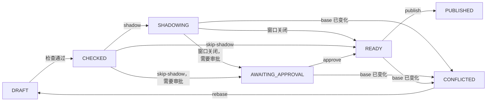

# 测试策略 {#testing-policies}

面向在生产环境修改文档的策略作者和评审者。每个文档变更都经过控制面：控制面检查并编译变更，可以在影子窗口中用线上流量试运行，在无法证明变更安全时要求第二个人审批，然后才发布。本页介绍这一流程及其周边工具。字段本身见[策略语言](./language.md)。

## 用测试证明 {#prove-it-with-a-test}

文档到达控制面之前，你自己构建里的测试就可以用每个实例都在运行的引擎证明它会做出什么决策。`cosec-testkit` 有三个层次，从文档到你的应用：

| 你想证明 | 使用 | 位置 |
|---|---|---|
| 文档应当放行的请求被放行，应当拒绝的请求没有被放行：放在文档旁边的场景文件 | `PolicyTestKit` | [测试决策](#testing-decisions) |
| 决策周围的代码行为正确：CoSec 回答的状态和 problem，读取调用方的处理器 | `PipelineFixture` | [用真实管道测试代码](#testing-your-code-against-a-real-pipeline) |
| 读取调用方的处理器或函数，在管道生成的 `SecurityContext` 下工作正常 | `PermittedRequest` | [测试你的应用](#testing-your-application) |

不写测试也可以用编译器检查同样的文档（[CI 中的策略](#policies-in-ci)）。本页其余部分讲的是修改已经上线的文档。

## 控制面 {#the-control-plane}

控制面随 `cosec-control` 模块提供（它需要 `cosec-cocache`，因为文档保存在 Redis 中）。它在 `{cosec.control.http.base-path}/v1`（默认 `/cosec/control/v1`）下提供 HTTP API；其设置为 `cosec.control.*`（[配置](../operations/configuration.md)），文档如何存储以及如何首次发布见[存储](../operations/storage.md)。

控制请求首先是一个普通请求：宿主管道对它认证，并且必须允许它，因此文档必须允许运维人员访问该 API 路径。之后每一步都以该主体的身份再次授权，所在应用为 `cosec.control.app-id`（默认 `cosec-control`），动作为针对所涉及文档（`doc/platform`、`doc/app/<appId>`、`doc/tenant/<tenantId>`）或条目的 `cosec:<verb>`。条目的 id 是其资源中的一段，所以变更不能写入含 `/` 的 id；唯一的例外是权限策略的 `perm:<app>/<id>`，规则要用 `**` 才能匹配到它。在任何策略之前，先执行一条硬性规则：租户的主体只能操作自己租户的文档；平台文档和应用文档属于 `(platform)` 租户的主体。

| 步骤 | 需要 |
|---|---|
| 读取文档、历史、差异 | `cosec:read` |
| 提议、`apply`、rebase | 对写入或删除的每个条目需要 `cosec:write`，对写入的每个绑定的作用域、以及因此派生出新绑定的每个角色的作用域需要 `cosec:grant`；`apply` 和回滚还需要 `cosec:read` |
| 开启影子窗口、发布 | `cosec:publish`；break-glass 的申请和吊销改为需要 `cosec:breakglass` |
| 跳过影子窗口 | `cosec:skip-shadow` |
| 审批、驳回 | `cosec:approve` |
| `simulate`、`explain`、`analyze` | 在决定该请求的租户文档上分别需要 `cosec:simulate`、`cosec:explain`（没有主体的请求是 `(0)` 的文档）；在所查询租户的文档上需要 `cosec:analyze` |

`cosec:grant` 在每条绑定的作用域 `scope/<tenant>/<app>/<space>` 上检查：绑定任意 app 或任意空间时那一段为 `*`，默认空间为 `(default)`，所以限制在默认空间中授出的策略写 `scope/acme/order/(default)`。以 `(` 开头的空间 id 归 CoSec 所有，`(default)` 因而不会是你的空间。

可以把三个内置策略绑定给运维人员：`cosec:platform-admin`（对所有文档的所有动作）、`cosec:tenant-admin`（对自己租户文档的 `read`、`write`、`grant`、`publish`、`simulate`、`explain`、`analyze`、`shadow-read` 和 `skip-shadow`）和 `cosec:tenant-viewer`（同上，但没有 `write`、`grant`、`publish` 和 `skip-shadow`）。

| 方法和路径 | 作用 |
|---|---|
| `GET /documents?kind=tenant\|app&after=&limit=` | 有哪些租户或 app 文档，按页给出（[列出文档](#listing-documents)）。 |
| `GET /documents/{key}` | 当前修订。`{key}` 为 `platform`、`app:<appId>` 或 `tenant:<tenantId>`。 |
| `GET /documents/{key}/revisions?before=&limit=` | 修订历史，最新的在前（`limit` 为 1 到 200，默认 20）。 |
| `GET /documents/{key}/revisions/{revision}` | 某个保留的修订；已不再保留时返回 `410`。 |
| `GET /documents/{key}/diff?from=&to=` | 两个修订之间（[展开后](./role-permissions.md#roles)的文档）新增、删除和修改的策略与绑定，按原样的 `roles`，以及 `sections`：其余部分中不同的那些的名称，取自 `catalog`、`boundary`、`limits`、`attributes` 和 `rateLimits`，按此顺序，每个按其完整内容比较（都相同时为 `[]`）。 |
| `GET /documents/{key}/revisions/{revision}/propagation` | 该修订传播到了哪里（[传播](#propagation)）。 |
| `POST /documents/{key}:apply`、`POST /documents/{key}:rollback` | 从整份文档提议变更，或提议回到旧修订。 |
| `POST /changes`、`GET /changes/{id}` | 提议变更；读取变更。 |
| `POST /changes:check`、`POST /documents/{key}:check` | 不真正提议，得到一次提议或 `:apply` 会发现的结果（[只检查不提议](#checking-without-proposing)）。 |
| `GET /changes?document=&state=&after=&limit=` | 一个文档、一个状态或两者共同限定的未完成变更（[查找未完成的变更](#finding-open-changes)）。 |
| `POST /changes/{id}:rebase`、`:shadow`、`:skip-shadow`、`:approve`、`:reject`、`:abandon`、`:publish` | 推进变更。 |
| `POST /break-glass`、`POST /break-glass/{change}:approve`、`DELETE /break-glass/{bindingId}?reason=` | 申请 break-glass、审批申请、吊销绑定（[安全模型](../guide/security-model.md#break-glass)）。吊销只在该绑定不再生效之后才返回 `200`，平台文档中没有该 id 的绑定时返回 `404`，其他情况（包括该 id 是普通绑定）返回 `409`（[抢占被占用的暂存槽](#taking-a-busy-slot)）。 |
| `POST /simulate`、`POST /explain`、`POST /analyze` | 不做任何修改地决策或分析。 |

路径参数（`{key}`、`{id}`、`{revision}`、`{bindingId}`）在路径划分为段之后做一次百分号解码：`tenant:acme%20west` 是租户 `acme west`，`tenant%3Aacme` 是 `tenant:acme`，编码的 `/`（`%2F`）是值的一部分，从不成为另一个段，`+` 仍是 `+`，编码两次的 `%25`（`%2520`）解码为 `%20` 而不是空格。畸形的转义（`%zz`、孤立的 `%`、不是 UTF-8 的字节）是 `400`。路由自己的词（`documents`、`revisions`、`:apply`）按原样匹配。

错误为 `application/problem+json`。`409` 还在 `conflict` 中说明是哪一种冲突（`CTL-80`）：`BASE_MOVED`（重新读取文档头，再重新提出或 rebase）、`SLOT_HELD`（另一个变更占着文档的暂存位，凡是 `detail` 点名它的地方，`heldBy` 也给出它：等待，或放弃它）、`STATE`（变更的状态不允许这一步）、`CANDIDATE_MOVED`、`WINDOW_OPEN`（等待窗口关闭）、`WINDOW_BLOCKED`（该变更永远不会发布）、`CONTENDED`（同样的调用再发一次可能成功）或 `EXISTS`（该 id 处已有别的东西，而这一步需要的不是它）；请读它，而不是措辞可能变化的 `detail`。冲突的成员见 `contract/control/conflict.json`。`400`、`409`、`410`、`412`、`422` 或 `428` 在 `detail` 中解释你自己的请求；`401`、`403`、`404`、`500` 或 `503` 不带详情，因此拒绝永远不会透露某个文档或变更是否存在。`400` 的 `detail` 是控制面自己的某项检查，或者点名解析不了的字段（`[mode] is not one of MERGE, REPLACE.`），从不带异常消息。路径、查询或请求体中任何位置的字符串带有落单 UTF-16 代理项（如 JSON 转义 `"\uD800"`）的请求，在路由读取它之前就是 `400`（`IDN-10`）：Redis key 会把它写成 `?`，指向另一个 id。存储的文档或记录解码失败（例如滚动升级期间较新版本写入的）是 `500`。背后没有主体的请求（包括管道匿名放行的请求），在读取请求体之前就是 `401`。只服务路由的确切路径：末尾带 `/` 的路径是 `404`，含空段的路径在到达之前就被管道以 `400` 拒绝。记录解码失败的变更（包括属于不能作为应用 id 的应用的变更），对每个调用方都是不带详情的 `503`（`SCP-10`）。原因由控制面所在的主机以 `INFO` 记入日志，带有问题响应中的 `requestId`（[故障排查](../operations/troubleshooting.md#control-plane-errors)）。

## 校验策略 {#validating-policies}

每个提议在存为已检查之前，都会针对其文档的当前修订进行检查。检查结果列在变更的 `findings` 中，每项包含 `check`、候选中的 JSON `path`、`message`、对应的 HTTP `status` 和 `severity`：

| 检查 | 状态码 | 发现 |
|---|---|---|
| `V1` | 400 | 候选无法读回为文档。 |
| `V2` | 400、422、503 | 文档超过 8 MB；某个计数会超出平台的[条目预算](./language.md#entry-budgets)且超过它所替换的头部修订的计数（`$.policies` 或 `$.bindings` 上的 `422`，写明预算、计数和限制值；变更没有提高的、已超出预算的计数是警告，`CTL-40`）；id 使用了保留前缀（`cosec:`、`g:`、`r:`）；变更写入的 id 含 `/`（`422`；权限策略的 `perm:<app>/<id>` 可以含，文档中已有这种 id 的条目可以保留或删除）；租户策略复用了平台策略的 id 但不是它的完全相同的副本（完全相同的副本是[分区流程](../operations/upgrading.md#partition-plan)的第一步）；平台策略使用了某个租户文档已经定义或绑定的 id，或在某个租户文档持有它的副本时被修改，发现中列出这些文档（这类租户的文档读不到时为 `503`）；候选中任何位置的绑定所在的应用不能作为应用 id（空白、`*`、含 `:`、`/`、控制字符或落单的代理项、超过 128 个字符；位于 `$.bindings[i].app` 的 `400`：仍含有这种绑定的文档必须移除它，只移除它的变更是合法的）。 |
| `COMPILE` | 422 | 某个策略、条件、模式、绑定或规则无法用平台的限制、平台声明的属性以及控制面主机的属性提供者声明的属性编译。 |
| `REFERENCES` | 422 | 绑定指向的策略无处可解析，或指向平台边界（边界不能被绑定）；平台或应用变更删除了其他文档引用的策略（应用的简写形式派生出的策略也算），或把被引用的策略改成边界、把被引用的边界改成策略（`CTL-30`；自己定义了同 id 策略的租户不算）；租户的 `boundary` 不是平台边界。 |
| `OPERATION` | 422 | 操作删除了不存在的内容，或设置了该文档没有的字段。 |
| `IF_MATCH` | 412 | 条目已不再是操作的 `ifMatch` 所说的样子。 |
| `V3`（警告） | | 平台的 `limits` 或 `attributes` 有变化：其他文档会在每个实例上重新编译，不再能编译的文档失败即拒绝。 |
| `REFERENCES`（警告） | | 角色的含义可能比看上去更多：租户角色的 id 与其应用的某个系统角色相同（持有它的成员得到两者）；应用的系统角色的 id 也被另一个应用定义（角色不按应用签发的成员在两个应用中都持有它，`ROL-12`）；指定了空间的角色列出只在默认空间生效的权限（[角色](./role-permissions.md#roles)）。 |
| `ROUTES`（警告） | | 候选中含有被各服务已映射路由绕开的 `http:` DENY 语句或限流规则：这些路由的请求按其 `service:verb` 判定，不会遇到它们（[路由映射](../scenarios/route-maps.md)）。一个检查结果，给出数量和前五条。只有设置了 [`cosec.control.analysis.route-maps`](../operations/configuration.md#control-plane) 才会比较；未设置时，含有这类语句的候选会说明没有给出路由映射。 |

有任何错误的变更停留在 `DRAFT`，不能暂存或发布；请提议一个新变更来修正。干净的变更为 `CHECKED`。变更在发布之前不会影响执行，而发布时会针对当时的文档重新编译候选。

### 只检查不提议 {#checking-without-proposing}

`POST /changes:check` 接受 `POST /changes` 的请求体，`POST /documents/{key}:check` 接受 `:apply` 的请求体，应答提议会得到的结果（`CTL-78`）：它的 `state`（`CHECKED` 或 `DRAFT`）、`findings`、`escalations`（需要等人审批的内容）和 `base`（`contract/control/change-check.json`）。它不应答 `candidate`：提议将要发布的文档中会写明确认某条失效 DENY 的变更，而检查并不产生变更。它执行提议自己的步骤，除最后一步外全部执行。它不存储任何东西，不占用暂存槽位，不使用变更 id，也不写变更事件。在你存储自己的某样东西（例如 IAM 的事件）之前，用它来校验之后的提议会带上的内容。

检查需要的权限与提议完全相同，被拒绝的方式也相同：不能提议的调用方也不能检查，因此检查不会比提议透露更多关于文档的信息；过期的 `base` 同样是 `409 BASE_MOVED`。服务端口和控制面门面为租户文档提供它（`ControlService.check`、`checkApply`；`ControlClient.check`、`checkApply`）。请求本身仍像控制 API 的任何调用一样被决策和记录。检查不是承诺：在你提议之前文档头可能已经移动。

## 模拟请求 {#simulating-a-request}

`simulate` 按执行时的方式，在当前文档上对一个描述出来的请求做决策，还可以同时在某个变更的候选上决策：

```json
{
  "request": {
    "tenant": "acme",
    "principal": "bob",
    "roles": ["clerk@team-a"],
    "app": "order",
    "space": "team-a",
    "action": "order:ship",
    "resource": "order/42",
    "time": "2026-11-01T09:30:00Z"
  },
  "candidate": "<change id>"
}
```

| 字段 | 含义 |
|---|---|
| `tenant` | 必填：主体的租户，即请求在其中决策的租户。匿名请求为 `(0)`。 |
| `principal` | 主体 id；匿名请求时省略，执法在租户 `(0)` 上决策它。 |
| `roles`、`policies` | 成员关系，按令牌声明的写法：`role` 或 `role@space`，以及附加策略的 id。 |
| `app`、`space` | 声明的作用域；空间按数据面的方式与角色核对。 |
| `action` | 必填，`service:verb`（未映射的 HTTP 请求为 `http:GET`）。`http` 动作按请求方法的方式读取：`http:HEAD` 按 `http:GET` 判定和分析，含小写字母的动词是 `400`（`PIP-18`）。 |
| `resource` | 必填：`type/id`，或以 `/` 开头的 `http` 资源路径。`http` 路径与请求路径经同一个规范化：执法拒绝的路径（点号段、格式错误的转义、超过 2,048 个字符或每个 `/` 段 256 个）是 `400`，路径参数（`;v=2`）被去掉。类型化 id 受同样的长度限制。 |
| `remoteIp`、`time` | 客户端地址，以及 ISO 时刻（默认：当前）。 |
| `principalBindings`、`breakGlass` | 凭证能用到什么，默认都为 `true`（CoSec 自己的令牌）。模拟 API key 时把 `breakGlass` 设为 `false`；带角色上限的 key 还要把 `principalBindings` 设为 `false`：此时附加的策略和主体绑定不授予任何东西，它们的 DENY 照样生效。只接受布尔值。 |

响应包含 `enforced`、要求时的 `candidate`，以及 `differs`。每个决策为 `Permit`、`Deny`、`Indeterminate`（带 `cause`，即失败的种类）或 `Rejected`（作用域被拒绝，带 `reason`：`APP_MISMATCH` 或 `SPACE_NOT_MEMBER`），并给出做出决策的语句（`by`）和完整的候选追踪。其策略定义在你无权读取的文档中的语句会被省略并计入 `redacted`，即使应用它的绑定在你可以读取的文档里。`differs` 比较两个决策的内容，失败按其类型和消息比较，所以两侧相同的编译失败不算不同。

模拟读取执行时读取的文档：平台文档、租户文档，以及在请求在其应用中有角色、或租户文档把该应用的某个权限策略绑定给 `Anyone` 或某个主体时的应用文档（[策略语言](./language.md)）。对租户文档的变更，由候选决定这一点：添加了这种绑定的变更会读取应用文档，移除了最后一个这种绑定的变更则不再读取。无法编译的租户文档按未解析处理，因此与数据面一样，它的绑定不会让请求读取应用文档；对请求没有读取的文档给出 `candidate` 时为 `400`。

模拟在请求作用域实际解析到的租户上授权并决策，也就是决定它的那份文档的租户：主体的租户，匿名请求则与数据面一样是 `(0)`。
匿名请求指定其他任何 `tenant` 都是 `400`，这在检查 `(0)` 上的 `cosec:simulate` 之后；因此 `acme` 的管理员无法用匿名请求
读取 `(0)` 文档上的决策。

以不同的值两次发送它所读文档（条件、边界或限流 key 中）读取的某个头的请求是 `400`，与执法在决策前拒绝它一样（`PIP-12`）；
相同的重复算一个值。回答不点名是哪个头。执法会拒绝的 `resource` 也是 `400`，`analyze` 的资源也一样处理。

模拟没有令牌属性，也不获取外部属性：读取 `ext.*` 的语句会发现它不可用并按其 `onMissing` 处理，因此在这里通常为 Indeterminate。

控制面对每份存储的文档按其内容只解码、编译一次：在同样的头上重复 `simulate`、`explain` 或 `analyze` 不会再次编译，头
移动之后，在下次读到时编译。`candidate` 每次调用编译一次，explain 在保留修订上的文档也是。保留的内容按估计的堆限定在快照文档那四分之一堆的三分之一（2 GiB 时约 170 MB），每个宿主一个缓存，由 `simulate`、`explain`、`analyze` 与锁死检查共用（DR1-F-5）：一份文档解码后计其存储大小的
4 倍，每个编译形态（按编译时的平台文档，至多两个）再计 8 倍，所以存储为 1 MB 的租户文档计 12 MB。估计超过其一半的文档（2 GiB 时存储超过约 7 MB）从不保留：每次读它的调用都解码、编译一次，与候选一样，
因此它永远不会把其他文档挤出去。按租户限制控制 API，以限定这种文档的开销。要限制一个调用者的调用开销，请按租户限制控制 API
（[限流](./rate-limiting.md#the-control-api)）。

## 用 explain 调试决策 {#debugging-a-decision-with-explain}

`explain` 接受同样的 `request`（与 `simulate` 一样授权和检查），以及可选的 `at`：某个决策所用的文档修订，取自其审计事件的记录（`{"platform": 12, "app": 3, "tenant": 4}`）。只要这些修订仍被保留，它就在这些修订上求值，并返回决策及其追踪，让你看到过去的请求为什么被这样决策。是否读取了应用文档，按执行时的方式、用所记录修订的租户文档来决定；它回答的修订就是它读取的修订：没有读取应用文档时没有 `app` 成员，绝不是 `null`。`explain` 回答的 `version` 可以原样作为 `at` 再发回去。其字段以及如何找到该请求，见[代码中的检查](../integration/checks.md)。

## 变更 {#changes}

变更是对一个文档的一组条目操作，基于你看到的修订（`base`）：

```json
{
  "document": "tenant:acme",
  "base": 4,
  "note": "Let auditors read orders",
  "operations": [
    {
      "op": "putBinding",
      "binding": {
        "id": "auditor-reads-orders",
        "subject": { "role": "auditor" },
        "app": "order",
        "space": "",
        "policy": "perm:order/read"
      }
    }
  ]
}
```

| 操作 | 字段 | 作用 |
|---|---|---|
| `putPolicy` | `policy`，可选 `ifMatch` | 新增策略，或替换同 id 的策略。 |
| `removePolicy` | `id`，可选 `ifMatch` | 删除策略。 |
| `putBinding` | `binding`，可选 `ifMatch` | 新增绑定，或替换同 id 的绑定。 |
| `removeBinding` | `id`，可选 `ifMatch` | 删除绑定。 |
| `putRole` | `role`，可选 `ifMatch` | 新增角色，或整体替换同 id 的角色。适用于应用和租户文档。 |
| `removeRole` | `id`，可选 `ifMatch` | 删除角色。 |
| `putRateLimit` | `rateLimit`，可选 `ifMatch` | 添加限流规则，或在原位置替换同 id 的规则。 |
| `removeRateLimit` | `id`，可选 `ifMatch` | 删除限流规则。 |
| `putCatalog` | `catalog` | 设置应用文档的目录；没有 `catalog` 时删除目录。 |
| `setLimits` | 包含全部六个条件限制的 `limits`，每个都是与文档中相同的正整数，以及任意[条目预算](./language.md#entry-budgets) | 整体设置平台的限制：未写出的预算取默认值；没有 `limits` 时恢复默认值。其他类型的值返回 `400`。 |
| `setAttributes` | `attributes`，与文档中相同的数组 | 设置平台声明的属性；没有 `attributes` 时删除该字段。不是属性数组时返回 `400`。 |

一个变更最多带平台 `maxChangeOperations` 个操作（默认 20,000），控制 API 读取的请求体最多为 10 MB（文档上限再加 2 MB）：更大的变更在任何操作被检查之前即返回 `400`，请拆成几个变更提议（`CTL-41`，[条目预算](./language.md#entry-budgets)）。

`ifMatch` 是条目按文档写法的 SHA-256：只有条目仍是这个样子时操作才生效。不想手写操作时，`POST /documents/{key}:apply` 接受整份文档（`{"document", "mode", "note"}`），并提议把当前修订变成该文档所需的操作：`MERGE` 只新增和修改，`REPLACE` 还会删除文档中没有的内容。

- **`MERGE` 保留文件里没有的内容。** 从文件中删掉的条目（例如收回的授权）仍然处于发布状态。变更会说明这一点：每个保留了条目的部分给出一个 `WARNING` 检查结果（检查 `OPERATION`），位于 `$.policies`、`$.bindings`、`$.roles` 或 `$.rateLimits`，并点名保留的 id。要删除它们，请用 `REPLACE` 应用。
- **`REPLACE` 在文件读取时的修订上提议**，即文件头的 `revision`，而不是到达时的头修订。在修订 12 上读取、在修订 13 发布之后才应用的文件，会删掉修订 13 的条目，所以返回 `409`：读取头修订（`GET /documents/{key}`），把变化合并进文件，把它的 `revision` 设为头修订，再应用一次。从 git 应用的作业要发送它上次读取的修订。尚未发布的文档不比较文件头。`REPLACE` 删除的内容就是它的操作。

设置租户的 `boundary` 或平台的默认边界请使用 `apply`。租户的边界属于平台：租户主体的 `REPLACE` 或回滚如果会删除或改变平台设定的边界，返回 `403`。限流规则变更如何授权和审批见[限流](./rate-limiting.md#publishing-rules)。

`base` 已不是当前修订时返回 `409`。`onMissing: "nomatch"` 的 DENY 需要在 `confirmations` 中提供确认（`{"policy", "statement", "digest", "kind": "deny-nomatch"}`）；没有确认的变更无法发布。



一个文档至多有一个暂存的变更（`SHADOWING`、`AWAITING_APPROVAL` 或 `READY`）；在它发布、放弃、驳回或过期之前，暂存另一个变更返回 `409`。变更在占用暂存槽之前就已进入暂存状态，所以仍在写候选的调用也占着暂存槽；写不成或被取消的调用会归还暂存槽，变更回到 `CHECKED`。窗口开始一分钟后候选已不在的 `SHADOWING` 变更（两次写入之间崩溃，或候选之后丢失）也一样：维护任务释放它的暂存槽，记一条 `FAILED` 变更事件，由作者重新暂存。窗口不会接着进行，因为候选不在期间实例没有采样。未完成的变更在提议后 `cosec.control.changes.expire-after`（默认 7 天）过期：此后第一次被读取时即为 `EXPIRED`：控制面每隔一小时读取一次每个文档的未完成变更，每隔 `cosec.control.shadow.min-duration` 的十五分之一（默认 1 分钟）读取一次 `SHADOWING` 的变更。作者可以对 `CONFLICTED`、`DRAFT` 或 `CHECKED` 的变更执行 `:rebase`，把它放到当前修订上，这会重新运行所有检查，并丢弃之前的审批和影子证据。作者或持有 `cosec:publish` 的人可以 `:abandon` 它；设置租户边界的变更只有平台主体能驳回或放弃，吊销仍在生效的 break-glass 绑定的变更只有其作者能放弃（`BRK-10`）。每次放弃都记一条 `ABANDONED` 变更事件，备注写明变更的作者；放弃 break-glass 变更需要一个 REQUIRED 变更监听器，由它先记下（没有时返回 `503`）。

### 变更的应答 {#what-a-change-answers}

每个应答一个变更的路由（`POST /changes`、`GET /changes/{id}`、推进变更的每一步、`:apply`、`:rollback`，以及 break-glass
的申请与审批）应答相同的成员：`id`、`key`（它的文档）、`base`（`revision` 和 `digest`）、`operations`（与你发送的一致）、
`author`、`note`、`kind`、`state`、`findings`、`candidate`（审批所针对的候选的摘要）、`createdAt`、`updatedAt`；有了之后还有
`skipShadow`（原因）、`publishedRevision`、`escalations`、`approval`（`approver`、`at`、`candidate`、`covers`）、`shadow`
（`window`，即发布者确认的窗口 id，`startedAt`，关闭后还有 `closed`）和 `confirmations`。窗口未关闭时，`GET /changes/{id}` 在 `shadow` 中加上确认该窗口的存活实例数（`acknowledged`）以及尚未确认的实例（`waitingFor`：`instances`，最多 20 个 id，已排序，`more` 为其余的数目），读自各实例的状态（[在影子模式下试运行变更](#trying-changes-in-shadow-mode)）。存储为自身工作保留的内容不出现在
任何应答中：候选检查时所依据的各文档头、在其窗口上报过的实例，以及审批人持有的内容（`CTL-61`）。

由请求创建的变更还应答 `origin`，即其作者是如何被识别的（`CTL-70`）：
- **变更的每个读者**都得到 `asserted` 和 `via.method`。`asserted` 为 true 表示主机相信了调用方声明的身份（`CoSec-Identity` 头），而不是自己验证凭证；`via.method` 是凭证的种类（`jwt`、`api-key`；服务以自己的主体经网络调用时为 `service`，经控制面门面的调用为 `in-process`）。
- **对变更的文档持有 `cosec:approve`、或对平台文档持有 `cosec:read` 的读者**，还得到 `via.credential`（凭证的 id，从不是它的值）、`via.request`（请求的 id）和 `peer`（请求到达时连接的地址）。它们说明是哪个密钥或令牌、从哪里写了这个变更：这是为变更负责的人衡量它的依据。
- **其他读者**（包括作者本人）完全得不到这些成员，连空成员也没有。无法作出决策的读者同样得不到：只有允许才算数。

`GET /changes` 的列表不含来源。

成员、类型以及哪些始终存在，见 [`contract/control/`](https://github.com/Ahoo-Wang/CoSec/tree/main/contract/control)，
连同应答写出的封闭取值集合：`state`、`kind`、`severity`、升级项的 `reason`、窗口统计的结果，以及决策的 `decision`、
`cause`、`reason` 和追踪项的 `effect`、`outcome`。应答与文件不一致时 CoSec 的测试会失败，所以取值只会在声明了变化的版本中改变。

### 列出文档 {#listing-documents}

`GET /documents?kind=tenant`（或 `kind=app`）列出该类型有哪些文档：`{"documents": [{"key": "tenant:acme"}, ...], "next": "ZG9jdW1lbnRzfHRlbmFudDphY21l", "asOf": "..."}`，按 key 排序。`limit` 为 1 到 200（默认 20），`after` 是上一页的 `next`，最后一页没有 `next`：它是一个令牌（[列表游标](#listing-cursors)）。它读取控制存储所索引的文档清单，从不读取文档本身，所以首次发布未完成的文档也可能被列出，读取它则返回 `404`。只看到自己文档的租户主体无需读取该清单：只读取一次存储是否为该文档的修订建立了索引。该清单是存储的整个成员集合（5 万个租户时约 2 MB），所以控制面主机至多每 5 秒读取一次，所有调用方共用这一次读取，并从中分页：`asOf` 说明读取的时间，此后创建的文档在下次读取前可能缺失。

谁可以列出（`CTL-68`）：
- **该类型的全部文档：** 对该层持有 `cosec:read` 的调用方，`kind=tenant` 为 `doc/tenant`，`kind=app` 为 `doc/app`。
  - 这项读取权限只让你知道有哪些文档，不涉及任何文档的内容。它不授予任何文档的读取（包括平台文档），任何文档的读取也不授予它。
  - `cosec:platform-admin` 通过 `doc/**` 授予它。针对 `doc/tenant/**` 的策略同样授予它（该模式的 `**` 覆盖该层）：能读取每个租户文档的人，列出它们也无妨。
  - 只给服务主体列出权限：在 app `cosec-control` 中给它绑定一条带有 `{"effect": "allow", "action": "cosec:read", "resource": "doc/tenant"}` 语句的策略。
- **只看到自己的文档：** 请求 `kind=tenant` 且可以读取自己租户文档的租户主体（`cosec:tenant-admin`、`cosec:tenant-viewer`）。
- **其他调用方**得到不带详情的 `403`，与任何路由拒绝策略不允许的调用方一样：对每个这样的调用方答案相同，不透露存在哪些文档。

其他 `kind` 返回 `400`，存储无法应答时返回 `503`。服务端口同样提供它，控制面门面也是（[`ControlService.documents`](../integration/checks.md#changing-policies-from-your-code)）。

### 查找未完成的变更 {#finding-open-changes}

`GET /changes` 列出尚未结束的变更：`document=<key>` 列出一个文档的，`state=<STATE>` 列出处于某个非终态（`DRAFT`、`CHECKED`、`SHADOWING`、`AWAITING_APPROVAL`、`READY`、`CONFLICTED`）的，也可以两者都给。两者至少要给一个；`limit` 为 1 到 200（默认 50），`after` 是上一页的 `next`，最后一页没有 `next`：它是一个令牌（[列表游标](#listing-cursors)）。

```json
{
  "changes": [
    {
      "id": "0SVoMJp7Q4G00",
      "key": "tenant:acme",
      "state": "CHECKED",
      "kind": "PUBLISH",
      "author": { "tenant": "acme", "principal": "alice" },
      "note": "Let auditors read orders",
      "createdAt": "2026-11-20T09:00:00Z",
      "updatedAt": "2026-11-20T09:00:02Z"
    }
  ],
  "next": null
}
```

每一项是摘要：变更本身用 `GET /changes/{id}` 读取。存储的记录无法读取的变更以它的 `id`、`key` 和状态 `UNREADABLE` 列出，从不省略。每一项的成员就是[变更应答](#what-a-change-answers)中同名的成员。只有 `GET /changes/{id}` 会向你展示的变更才会出现在列表中：你自己租户的文档（平台主体为任意文档）中，你写的或你可以读取其文档（`cosec:read`）的变更。列表不透露它省略了什么：一页只含你可见的变更（`CTL-55`）。

按状态列出在读取任何内容之前就作出决定，与[列出文档](#listing-documents)一样：
- **租户主体**列出它自己租户文档的变更。
- **平台主体**列出它对其作为层持有 `cosec:read` 的那些层：`doc/tenant` 对应租户文档的变更，`doc/app` 对应应用的，`doc/platform`（平台文档本身的读取）对应平台文档的变更。`cosec:platform-admin` 三者都持有。层的读取只允许列表去查看：每个变更仍然只在 `GET /changes/{id}` 会向你展示时才出现。
- **其他调用方**得到不带详情的 `403`，什么也不读取。

无论你能看到什么，每个请求至多读取四页变更。先达到这个上限时，它应答已找到的变更（一页较短或为空），并给出 `next`，从停下的位置继续。所以带 `next` 的空页不是结尾：一直沿着 `next` 走到它为 `null`。这个 `next` 可能指向你看不到的变更。它只告诉你，某个你可以列出的层中的某个文档在该状态下有一个未完成的变更，而按 id 读取该变更仍然是 `404`。按文档列出只读取该文档的未完成变更，它的 `next` 总是你能看到的变更。

### 列表游标 {#listing-cursors}

每个列表的 `next` 都是一个令牌：在任何控制面主机上，把它原样作为 `after` 传回。它不含服务端状态，不会过期，在查询中无需转义（`A-Z a-z 0-9 - _`）。它的内容不是契约：不要从中读出任何东西。它只是编码而非加密，对解码它的人什么也不隐藏。无法解码的令牌，或属于另一个列表的令牌（对 `GET /documents` 而言，还包括另一种类型的令牌），返回 `400`，从不从头开始列出。约定见 [`contract/control/cursor.json`](https://github.com/Ahoo-Wang/CoSec/tree/main/contract/control/cursor.json)。

未完成的变更保存在它们自己的集合中（[存储](../operations/storage.md#redis-keys)）。对更早预览版写入的存储，在 `cosec-migrate repair-references` 转换它之前，列表返回 `503`（`CTL-54`）。

## 在影子模式中试运行变更 {#trying-changes-in-shadow-mode}

`POST /changes/{id}:shadow` 暂存一个 `CHECKED` 的变更并开启影子窗口。数据面实例用候选替换当前文档，对一部分线上请求再求值一次，并上报每个请求的结果；候选永远不会影响真实决策。候选只在读取了它所属文档的请求上比较（租户的候选在该租户的请求上，应用的候选在读取了该应用文档的请求上，平台的候选在所有请求上），并且只由已安装候选的基础修订的实例比较。租户的候选在请求于它发布后会读取的文档上比较：把某个应用的权限策略绑定给 `Anyone` 或某个主体的候选，会在请求原本没有读取应用文档时带入该应用已安装的文档；移除了最后一个这种绑定的候选则不带入。文档的失败也随之进出：候选不再读取的文档，其失败也不再计入，因此丢掉一个无法读取或无法编译的应用文档的候选，在请求当前为 503 时报告 `WIDENED`；候选开始读取的文档则带入它的失败。无法编译的文档的候选会连同失败一起替换它；某个实例读不到的文档的候选不在该实例上比较（`BASE_MISMATCH`：实例不知道它要替换的修订），因此请在存储恢复应答后再读取该窗口。

| 结果 | 含义 |
|---|---|
| `SAME` | 相同的决策，由相同的语句做出。 |
| `BY_CHANGED` | 相同的决策，由另一条语句做出。 |
| `OBLIGATIONS_CHANGED` | 相同的放行，由相同的语句做出，但适用的限流规则不同。 |
| `BECAME_DENIED` | 执行时无法决定，候选拒绝。 |
| `WIDENED` | 执行时没有允许，候选允许。 |
| `NARROWED` | 执行时允许，候选不允许。 |
| `BECAME_INDETERMINATE` | 执行时不是 Indeterminate，候选是，原因不是属性不可用。 |
| `CANDIDATE_INDETERMINATE` | 候选读取了请求没有获取的外部属性（影子求值不获取任何属性）。 |
| `CANDIDATE_ERROR` | 某个实例无法编译或求值候选，或无法读取候选让请求读取的应用文档。 |
| `BASE_MISMATCH` | 实例安装的是该文档的另一个修订：不比较，不算样本。 |

窗口在以下情况关闭：

- 任何实例上报 `CANDIDATE_ERROR` 时立即关闭，状态为*阻塞*：该变更永远不能发布；请放弃它；
- 经过 `cosec.control.shadow.min-duration`（15 分钟），实例上报的非 `BASE_MISMATCH` 样本达到 `cosec.control.shadow.min-samples`（1,000），且每个存活实例都确认了该窗口（见下文）时；
- 到达 `cosec.control.shadow.max-duration`（24 小时）而样本不足时，状态为*证据不足*。

**窗口通过之前，每个存活实例都要确认它**（`CTL-10`）。实例在暂存列表中读到窗口并编译了它的候选（或报告了 `CANDIDATE_ERROR`）之后，就在每隔一个报告间隔（默认 10 秒）写一次的状态中确认该窗口。只要还有最近一分钟内写过状态、且参与影子比较的实例没有确认，窗口就不会通过（关闭了影子比较的宿主不写状态；`CandidateSource` 是你自己的实现的宿主声明它不参与，不会被等待），并记录 `Shadow window <w> of change <c> is waiting for the acknowledgement of [<instances>]`，`GET /changes/{id}` 在 `shadow.waitingFor` 中点名这些实例。确认不是样本：样本仍只来自报告。两种不同的等待，以及各自的处理：

- **在等待某个实例**（`waitingFor` 非空）：该实例运行的版本不发送确认（完成升级），或者它读不到暂存列表：它的日志写着 `The staged list cannot be read`，它的 `cosec.shadow.staged.age` 持续上升（[可观测性](../operations/observability.md#metrics)）。窗口期间启动的实例会在几个上报间隔内确认。
- **在等待样本**（`waitingFor` 为空，样本低于最小值）：窗口所属文档的流量太少。等到 `max-duration`，或者给出原因跳过窗口。

到达 `max-duration` 时，无论确认情况如何，窗口都以*证据不足*关闭，与样本不足时一样。

**“存活”的含义。** 存活实例是最近一分钟内写过状态的实例。与 Redis 断开超过这一时长的实例不写状态，所以既不被等待，也不算作确认；它重新连上后装入已发布的修订，而它什么都没有比较过。关闭了影子的主机根本不写状态。状态已存储却无法解码的实例（反复崩溃的版本、损坏的值，或滚动升级期间这台控制面主机读不了的格式）在其状态能读取或在最后一次写入两分钟后过期之前是存活的，且什么都不确认：窗口等待它，`shadow.waitingFor` 点名它，而其他每个状态照常读取，`propagation` 把它算作最近的实例，不持有任何文档（`CTL-73`）。

在窗口上报告过的实例必须一直报告到窗口关闭。报告不见了的实例（它停止服务，或它的报告在 Redis 故障切换中丢失）是缺失的证据，而不是零个决策：看到收窄请求的可能正是它。窗口会等待它，记录 `Shadow window <w> of change <c> is waiting for [<instances>]`，无论其他实例报告了什么；实例每隔一个报告间隔重写一次累计报告，所以仍在服务的实例会回来。到达 `max-duration` 时窗口以*证据不足*关闭，摘要的 `vanished` 点名消失的实例，绝不会通过（`CTL-56`）。

控制面每隔 `cosec.control.shadow.min-duration` 的十五分之一（默认 1 分钟）检查一次未关闭的窗口，同一时间只由一个控制面实例执行，从最久未检查的窗口开始：被间隔截断的一轮记录 `looked at <k> of <n> windows`，下一轮从截断处之后开始。记录无法读取的影子中变更会被跳过，每小时至多以一条 `WARN` 点名一次，其他窗口照常检查。窗口关闭后，变更变为 `READY`，需要[审批](#approval)时变为 `AWAITING_APPROVAL`。如果期间文档修订发生变化，变更变为 `CONFLICTED`。数据面在启用 `cosec-cocache` 和 `cosec.authorization.shadow.*`（默认开启，采样读取了暂存文档的请求中的 10%）时参与。

每个实例在暂存列表中看到某个窗口后，就编译该窗口的候选，无论它的流量是否读取该文档（`CTL-12`）。无法编译它的实例此时就报告 `CANDIDATE_ERROR`，窗口随即以阻塞状态关闭，不必等到该文档的某个请求。编译在请求路径之外进行，一次一个候选，从不拖住实例所执行的文档。每个报告间隔周期中，它最多花一个间隔编译，暂存最久的窗口优先，因此一次暂存上千个窗口的变更不会推迟任何上报：候选在暂存后的几个上报间隔内被编译，不一定在第一个间隔内。

属性提供者及其声明的类型，在每个数据面实例和控制面主机上必须相同。控制面按自己的提供者检查候选；缺少其中某个提供者的实例无法编译读取其属性的候选，会报告 `CANDIDATE_ERROR`，窗口随即以阻塞状态关闭，该变更永远不会发布。跳过窗口的变更也跳过了这项检查：无法编译已发布文档的实例会对该文档失败即拒绝。

窗口比较的是决策，所以只涉及[限流规则](./rate-limiting.md#publishing-rules)的变更在窗口中显示不出差异。

窗口的候选暂存期间，实例每隔一个报告间隔（默认 10 秒：状态存活期的六分之一，[由计算得出](../operations/configuration.md#computed-not-configured)）写一次它对该窗口的报告。候选撤回之后（窗口关闭，或变更被放弃、驳回、发布或抢占），实例再写一次报告，然后忘掉这个窗口；报告在这最后一次写入 8 天后过期。变更只撤回自己的候选：期间另一个变更已占用暂存槽并暂存了自己的候选时，那个候选保留（`CTL-26`）。

`POST /changes/{id}:skip-shadow` 带上 `reason`，可以不经窗口暂存一个 `CHECKED` 的变更；它需要 `cosec:skip-shadow`，修订会记录窗口被跳过。`cosec:tenant-admin` 只在自己租户的文档上持有它（`CTL-27`）。跳过窗口不改变审批：分析无法证明操作者已持有的授出仍要等待审批。只创建或吊销 break-glass 绑定的变更没有窗口。

### 抢占被占用的暂存槽 {#taking-a-busy-slot}

一个文档的暂存槽同一时间只由一个变更持有：它在影子窗口中、等待审批或已就绪时都占着槽；同一文档的其他变更要等待（`409`）。紧急情况不能排队：有两类变更可以抢占槽。

- **吊销 break-glass**，只要该绑定尚未到期，总是可以。吊销仍在生效的绑定的变更持槽时，只有另一个这样的吊销能抢走它的暂存槽，也只有其作者能放弃它（`BRK-10`），所以被吊销的主体无法用自己的变更拖住它。吊销已过期的绑定并不紧急，因为该绑定已不授予任何权限：这样的吊销像普通变更一样等待暂存槽、持有暂存槽，吊销仍在生效的绑定的变更或只收窄的变更能抢走它，其他变更仍要等待。发布中途停住的吊销（其 REQUIRED 监听器的存储不可用）以 `READY` 留在槽中：再吊销一次该绑定会把它发布出去，其 `REVOKED` 事件写明是你、出于什么原因；看不到它的吊销人用自己的吊销变更抢走它的槽；`POST /changes/{id}:publish` 也能清掉它。两个吊销同时进行时可能互相抢占：以 `CONFLICTED` 结束的吊销（被抢占，或遇到已变化的头），或在提议、暂存之前头就变化了的吊销，只要其绑定仍在生效，就在新的头上再吊销一次，至多再试三次。`DELETE /break-glass/{bindingId}` 只在该绑定不再生效之后才返回 `200`，无论是谁删除的；平台文档中没有该 id 的绑定时（输错了 id，或已被删除）返回 `404`；该 id 的绑定不是 break-glass 绑定时（无论是否到期）返回 `409`（普通绑定请用变更删除）；其他情况返回 `409`，`detail` 写明你的变更所处的状态。返回 `404` 或遇到普通绑定时都不提议任何变更。没有生效的吊销永远不会看起来像已生效；反过来的情况可能出现一次：另一个调用恰在你的吊销提议时删除了同一个绑定，你的调用返回 `409`，重试则返回 `404`（`BRK-11`）。吊销只有经一个记录它的 REQUIRED 变更监听器才能发布；该监听器的存储不可用时，改为吊销该主体的令牌（`TokenRevoker.revokeSubject`），这不需要监听器。
- **只收窄的变更**，由在该文档上持有 `cosec:skip-shadow` 的人暂存或跳过影子。每个操作都必须属于下列之一：删除一条绑定，被绑定的策略只含 ALLOW；把一条只含 ALLOW 的可附加策略改为不可附加，语句不变；新增一条只含 DENY 的策略，或新增一条指向这种策略的绑定。删除 DENY、把含 DENY 的策略改为不可附加、替换任何已有条目，或对租户与平台都定义的策略 id 所做的操作，都会放宽或可能放宽，与其他变更一样等待。

拉黑一个主体、设备或地址不是文档变更：黑名单在请求时读取（[安全模型](../guide/security-model.md#blacklist)），不需要等待暂存槽。

原先持有槽的变更在槽转手之前就被标为 `CONFLICTED`，无论它此时处于哪个状态（其间可能已被审批或窗口已关闭），影子候选被撤回，并以 `FAILED` 记录，备注为 `preempted by <change>`；变基后可以再试。持有者因存储故障无法被标记时，它保留暂存槽，想抢占的变更被拒绝（`503`）；放弃了的抢占把持有者的失败记为 `conflicted by <change>, which did not take the slot`。修订链上已能看到其修订的 `READY` 持有者（写入成功但答复丢失的发布），由来取这个暂存槽的变更结算为 `PUBLISHED`，并以它的发布人身份记录，之后暂存槽空出：普通的暂存也能取得它。

发布只在其变更仍持有暂存槽时继续：在写 `PUBLISHING` 记录之前检查一次，写头之前再检查一次；槽已不在时，记一条失败，写明 `another change took the staging slot before the head write`；那次检查之后头变化了时（取走槽的变更先发布了，或 bootstrap、迁移、旧实例写了头），写明 `the document moved before the head write`。最后一次读取与写头之间还隔着一次存储往返，再加上发布实例在这两步之间的任何停顿（例如 GC），被抢占的变更在这段时间里仍会发布；取走其暂存槽的变更随后在已变化的基准上冲突，它的失败记录写明先到的是哪个修订、由谁发布。写头时遇到的若是本变更自己的修订（同一变更的另一次发布刚刚写下），则不记失败，按变更当前的样子作答，由写下这个修订的那次发布来结算它。

## 审批 {#approval}

任何人都不能授予超出自己权限的东西。变更被检查时，控制面以作者身份分析它授予了什么，凡是无法证明包含在作者自身权限之内的，都成为一项*升级*：

| 原因 | 含义 |
|---|---|
| `NOT_COVERED` | 没有作者的任何一条 ALLOW 被证明包含该变更授予的内容。 |
| `DENY_OVERLAP` | 约束作者的某条 DENY 可能与之重叠。 |
| `CROSS_TENANT` | 作者不在该文档的租户中。 |
| `UNRESOLVED` | 新增或修改的绑定指向一条没有任何文档定义的策略，它授予什么无从判断。 |
| `ANONYMOUS` | 授给默认租户 `(0)` 中的 `Anyone`：未认证的调用方都在这个租户中，授出也会作用于它们。 |
| `UNREADABLE` | 授出触及的某个 app 文档读不到，作者在那里持有什么无从得知；或 app 列表不可信，而授出触及所有 app（[存储](../operations/storage.md#publishing-through-the-control-plane)）。 |
| `TOO_LARGE` | 分析在走到这项授出之前，已用完一次分析允许的全部比较（四百万次；一份包含十二个应用全部系统角色的租户文档约需六万次），没比较到的内容无从得知（`CTL-49`）；走不到的所有授出合为一项。授出超过 80,000 个片段（每条被授出的 ALLOW 的每个动作乘每个资源，再乘到达它的每条绑定）的变更也只得到这一项：这样的变更在拆分之前就被计数，任何部分都不分析。请把变更拆小；只是重复策略原有语句的变更几乎不花成本，因为未变的策略或语句会被认出（`CTL-50`）。 |
| `NOT_ANALYZED` | 由非信任根所做：放入任何内容、或删除一条 DENY 的平台或应用文档变更（`CTL-31`，每条策略或绑定一项，见下文），或租户边界变更。 |
| `TENANT_BINDINGS` | 与应用文档的 `NOT_ANALYZED` 一起出现：变更新增或放宽了某条权限策略的 ALLOW 时，该策略触及的租户，每条策略一项（`tenants binding [<policy>] in app <app>`），写出语句、在该应用中绑定它的租户文档数，并列出前 20 个。它由反向引用索引计数，不读取任何租户文档，所以是上限（已删除绑定的文档，在其发布移除它之前仍可能被计入）。仅供参考：审批针对的是 `NOT_ANALYZED`，这一项从不代替它（`CTL-48`）；只有这一项变化时，已审批的变更不会退回 `AWAITING_APPROVAL`。 |
| `BREAK_GLASS` | 新增或修改的 break-glass 绑定：总是需要第二个人。 |
| `ROLE_CLASS` | 记在[角色类](#the-role-class)所解除的升级处：谁持有该授予，解除了什么。仅供参考：变更不因它而需要审批。 |

作者的权限是本次请求所带凭证的权限。带角色上限的凭证（带 `roles` 的 API key）不计入点名作者或作者附加的 ALLOW，只计入上限内的角色和 `Anyone` 绑定，与数据面一致；点名作者或作者附加的 DENY 仍然限制它可以授予的范围。break-glass 绑定从不计入任何人可以授予的范围。

分析读取作者权限的方式与执行时相同：

- **任意类型的 token 属性。** `subject.attributes.*` 上的条件把布尔值和数字当作它们的文本（`true`、`3`），数据面与分析都是如此。token 中写着 `"suspended": true` 的作者并不持有带条件 `not(eq(subject.attributes.suspended, "true"))` 的 ALLOW，因此不能去掉条件把它授出。
- **会到期的绑定。** 作者经带 `expiresAt` 的绑定持有的权限只持有到那时，所以它只包含自身绑定不晚于它到期的授出。没有 `expiresAt` 的授出、到期更晚的授出、把策略设为可附加，都是升级；最接近的 ALLOW 以短缺 `EXPIRY` 报告。
- **租户与平台都定义的 id。** 执行时，两条策略内容不同，这样的绑定或附加才因二义而被拒绝。分析不比较内容，把每个这样的 id 都当作二义，这只会减少权利：作者经它什么也不持有；它绑定到作者的地方，按拒绝一切的 DENY 计。
- **每一份 app 文档。** app 文档绑定角色，所以无论变更是否点名该 app，它都可能在该 app 中拒绝作者某些东西。分析读取 app 列表列出的每一份 app 文档；读不到的那份，使触及它所在 app 的每个授出成为 `UNREADABLE`。app 列表完整之前（升级后，在 [`cosec-migrate repair-references`](../operations/upgrading.md#repair-the-back-reference-index) 运行之前），覆盖所有 app 的每个授出（app 为 `*` 的绑定或附加）都是 `UNREADABLE`，经条件收窄到变更没有点名的 app 的授出也是：分析从绑定的作用域取 app，不从条件中取。

删除条目和收窄 ALLOW 不授予任何东西，只有一个例外：删除租户自己的一条策略，而平台也定义了同一个 id 时，租户中指向这个 id 的绑定，以及平台的策略可附加时对它的附加，都改为指向平台的策略。这按把平台的策略授给它们来分析。

租户可以独自删除自己的 DENY：平台和各应用的 DENY 以及它的边界仍然约束着它。平台文档和应用文档之上没有这样的约束，所以删除其中一条 DENY 的变更需要第二个人（`CTL-31`）：每条含 DENY 的 `policy <id> of <document>`、每条所绑策略含 DENY 或找不到的 `binding <id> of <document>`，各是一项 `NOT_ANALYZED` 升级。两份文档按[展开后](./role-permissions.md#roles)的形式读取：删除角色，或用 `putRole` 去掉一项权限，按角色不再派生的每条绑定计。吊销 break-glass 绑定不算这样的删除：它结束的是一次应急，一个人即可（[break-glass](../guide/security-model.md#break-glass)）。

对文档持有 `cosec:approve` 的平台主体是信任根：其自己的变更不做分析，除非开启了 `cosec.control.approval.four-eyes`，这时它们会像其他人的变更一样被分析。平台授予了其租户文档上 `cosec:approve` 的租户主体，审批别人的变更，它自己的变更要经分析。开启 four-eyes 时，信任根的变更需要审批的部分必须由另一位平台主体审批。租户的边界属于平台：只有平台主体能设置它（否则 `403`），也只有平台主体能审批、驳回或放弃设置边界的变更。

工作负载的凭证无论其主体持有什么，都不是信任根，也从不审批（`IDN-34`）：API key，或服务自己的身份（`ControlCaller.service`），其凭证名为 `service`。CoSec 按校验来源识别自己的 API key，任何名为 `api-key` 或 `service` 的凭证（包括网关转发的身份所带的）也算作工作负载的凭证。你自己的认证器认可的凭证，除非它把凭证命名为 `service`，在 CoSec 看来都是人的凭证：不要给面向工作负载的认证器授予 `cosec:approve` 或 `cosec:platform-admin`，或者让它把凭证命名为 `service`。

分析看不到的东西：

- **受保护的条目。** 租户文档目前还不能把条目标为 `protected`，所以租户管理员可以先删除平台放进该租户文档的 DENY，再授出它拒绝的东西。对租户管理员的限制请放在平台或 app 的文档中。
- **针对个人的限制。** 绑定到 `Anyone`、带 `subject.id` 条件的 DENY 限制的是该主体能做什么，而不是它能授出什么：分析把 `Anyone` 的 DENY 读作对每个被授予者同样生效。请把这条 DENY 绑定到该主体。
- **信任根。** 不开启 four-eyes 时，它的变更完全不经分析；这时 break-glass 的两个人和时间上限也都约束不了它（[安全模型](../guide/security-model.md#break-glass)）。

有升级的变更在窗口关闭或被跳过后停留在 `AWAITING_APPROVAL`。另一位持有 `cosec:approve` 的人通过 `POST /changes/{id}:approve` 审批，并带上他们评审过的 `candidate` 摘要（来自 `GET /changes/{id}`）；摘要不同返回 `409`，作者不能审批自己的变更。审批是人的行为：以工作负载的凭证（API key、服务自己的身份）认证的主体不能审批（`403`），凭证不带 id 的主体也不能（`403`），因为发布时不会计入它的审批。审批记录审批人的令牌（`jti` 与 `iat`）；变更发布之前，如果这个令牌，或审批人截至当时签发的全部令牌被吊销，审批就不再算数。没有记下凭证 id 的审批也不算数：升级到本版本之前做的、旧版本实例接受的，或用不带 id 的凭证给出的审批；请重新审批。凭证不说明签发时间时（你的认证器没有设置 `issuedAt`），该主体的令牌只要有一次吊销，其审批就作废。审批人的访问令牌过期之后，`TokenRevoker.revoke` 不再接受它，只有 `revokeSubject` 能收回其审批。吊销按数据面管道的方式判断，但这里无法读取的存储不算"未吊销"：与其他读取失败一样返回 `503`（[认证](../integration/authentication.md#logout-and-revocation)），变更保留其审批，等存储恢复后再发布。吊销保留 `cosec.jwt.token-validity.refresh` 这么久，它不能短于 `cosec.control.approval.expire-after`，否则 starter 不会启动。成员关系来自成员关系提供者的审批人，发布时判定两次：一次按审批时持有且现在仍持有的角色，一次按提供者现在答复的全部内容；两次都必须放行，所以绑定在其后新获得角色上的 DENY 会让审批作废。`:reject` 带上 `reason` 结束该变更。审批在 `cosec.control.approval.expire-after`（72 小时）内有效，且只对该候选有效。`GET /changes/{id}` 显示谁审批、何时、为何审批，不显示审批人的凭证、成员关系、属性，以及其凭证能触及什么；这些只保存在存储中的变更记录里，任何变更事件都不带它们。break-glass 的审批先由 REQUIRED 变更监听器记录，再存入变更：之后存入失败时，记录中会有一条变更上没有的审批，由审批人重新审批。

### 角色类 {#the-role-class}

把自己拥有的角色投影进租户文档的服务（例如 IAM），每次写入背后都没有人。租户文档上的 `cosec:manage-roles` 使这样的变更不因“由谁授予”而需要第二个人（`CTL-79`）：

- **只有角色，只有租户文档。** 变更只写入或删除角色（`putRole`、`removeRole`），不含其他任何操作；写入其他内容的变更会被整体分析。应用文档和平台文档从不属于这个类。
- **从不包括控制面自身应用的角色**（`cosec.control.app-id`），也不包括没有应用的角色。这种角色的成员持有对本租户文档的控制调用，而由谁治理租户的策略应由人来任命：写入或删除这种角色的变更像任何人的变更一样被分析，并等人审批。`putRole` 会替换文档中同 id 的角色，所以写入的角色和被替换的角色都适用这一条。规则看的是角色的应用，而不是其动作的名字，这就足够了：角色的绑定限定在它的应用内，控制请求在控制应用中决策，所以其他应用的角色无论目录里的动作写成什么，都不允许任何控制调用。
- **只解除关于由谁授予的疑问。** 这个类解除 `CROSS_TENANT`、`NOT_COVERED` 和 `DENY_OVERLAP`，并在它们的位置记下一条 `ROLE_CLASS`。`CROSS_TENANT` 是租户之外的服务投影它的角色；`NOT_COVERED` 是持有者分发它自己并不持有的目录权限，这正是管理角色的含义；`DENY_OVERLAP` 是约束作者的 DENY，它在请求被决策时仍约束它所约束的人，所以解除它不会授予任何 DENY 所禁止的东西。分析无法判断的内容（`UNREADABLE`、`UNRESOLVED`、`TOO_LARGE`）仍然要等人审批。
- **其余一切照旧。** 对每个角色的 `cosec:write`、对角色派生的每个绑定的 `cosec:grant`，与任何人一样被决策。这个类看到变更的每一条升级，它不解除的升级（例如 break-glass 绑定的）会让整个变更继续等待。
- **发布时再次决策。** 发布会以发布者的身份、在当前的各文档头上重新运行授予分析，这个类也随之重新决策：检查之后被撤回的授予会让变更回到 `AWAITING_APPROVAL`，即使它在此期间已经暂存。

这样的变更能授予什么，由格式而不是作者限定。租户的角色只派生本租户成员在其应用中、绑定到该应用文档所定义的权限策略的绑定，而这些策略由人在应用文档中审批。租户自己不能写 `perm:` 策略，角色也不能是 `"*"`。硬规则让这些成员只能触及本租户的文档，无论应用目录授予什么；租户的[边界](./language.md)限定他们被允许的范围。[检查](#checking-without-proposing)的应答相同：持有者得知写入不会等待，其他人得知它会等待什么。

## 发布与回滚 {#publishing-and-rolling-back}

`POST /changes/{id}:publish` 发布一个 `READY` 的变更。如果它的窗口出现了 `WIDENED`、`NARROWED`、`BECAME_INDETERMINATE`、`BECAME_DENIED` 或 `OBLIGATIONS_CHANGED` 的请求，或以证据不足关闭，发布者必须确认这些数字，否则返回 `428`：

```json
{ "ack": { "window": "<window id>", "counts": { "SAME": 4180, "NARROWED": 3 } } }
```

窗口 id 和计数在变更的 `shadow` 中；为零的计数可以省略。

对平台文档、平台租户的文档（`tenant:(platform)`）或控制应用的文档的变更，还会检查它发布之后，其操作者是否仍能到达控制面（检查 `V4`）。引擎在候选就位的情况下，判定操作者正在进行的请求（按管道判定它的方式：路径、主体、成员关系、请求头与时间），以及控制应用中对该文档的 `cosec:publish`。会把操作者挡在外面的变更，在提议时带有 `V4` `WARNING`；发布时针对发布者检查，除非发布者在发布请求体里以 `"lockout": true` 确认，否则返回 `422`；确认之后，变更会记录这一确认以及确认者。把控制 API 移到另一条路径、角色或策略是正当的交接：确认它，或者分两次变更完成（先加入新的入口并发布，再删除旧的）。被锁在外面之后的出路是 [`cosec-migrate restore`](../operations/storage.md#recovering-from-a-lock-out)。这项检查的局限：

- 只检查发布者自己的回路，使用正在进行的请求的事实。其他操作者可能被锁在外面。
- 看不到之后发生的事：到期的绑定或令牌、去掉某个角色的成员关系提供者、窗口之外的 `time` 条件、换了的地址。
- 不获取外部属性（`ext.*`）：读取它的语句按其 `onMissing` 判定。
- 不检查租户自己的文档；平台的操作者可以修复它。

随后发布会以发布者身份在当前文档上重新检查一切：发布者对每个条目的权限、授权分析，以及审批。审批必须覆盖此时发现的升级、未过期、针对此候选、既不来自作者也不来自发布者，且审批人仍持有 `cosec:approve`。审批人按其审批时所用的凭证重新检查：用带上限的 key 给出的审批，在发布时不计入审批人自己绑定中的 ALLOW；不是用 CoSec 自己的令牌给出的审批，不计入其 break-glass 绑定。审批不再成立时，变更回到 `AWAITING_APPROVAL`，不发布任何内容。文档已变化，或其间另一个变更取走了该文档的暂存槽时，变更为 `CONFLICTED`；候选无法针对当前文档编译时，变更为带有检查结果的 `DRAFT`。修订已写入但答复丢失的发布，重试时为 `PUBLISHED`：控制面在修订链上找到这个变更自己的修订（即使其上已有后来的修订），补做写入之后的步骤，并以修订记录的发布人身份记录事件。写入头之后无法完成后续步骤的发布（存储失败或超时）返回 `503`：修订已经生效，再发布一次这个变更即可结算，不会增加修订。变更已经是 `PUBLISHED` 时也是如此：只有释放暂存槽失败时，再发布一次会释放暂存槽并记录这次发布，只记一次。

写入时只比较该文档自己的头。检查读过的其他文档（例如同一时刻落地的平台变更）可能在发布的最后一次检查与写入之间变化；这时控制面重新分析这次变更，记 `HEADS_MOVED`，分析发现了无人审批的升级项时记 `REVIEW_NEEDED`。变更保持已发布：为什么这是安全的、如何复核这类事件，见[一次发布比较什么](../operations/storage.md#what-a-publish-compares)。

要吊销某个修订，用 `{"revision": 11, "note": "..."}` 调用 `POST /documents/{key}:rollback`，它会提议一个 `ROLLBACK` 变更，把文档恢复为该修订时的样子。它和其他变更一样经过检查、窗口、审批和发布，所以恢复带 `onMissing: "nomatch"` 的 DENY 时要像提议一样带上 `confirmations`：旧修订中的确认是为另一个变更给出的。保留哪些修订、保留多久，见[存储](../operations/storage.md)。

### 传播 {#propagation}

`GET /documents/{key}/revisions/{revision}/propagation` 根据实例每隔几秒写入的状态（需开启
[影子窗口](../operations/configuration.md#shadow-windows)），说明一个已发布修订到达了哪些实例。发布从不等待它。

```json
{ "revision": 5, "installed": 3, "holding": 3, "recent": 50, "unknown": 0, "asOf": "2026-11-20T09:00:04Z" }
```

`recent` 统计最近一分钟内写过状态的实例，`holding` 是其中持有该文档（任意修订）的实例，`installed` 是其中已装入
`revision` 或更新修订的实例，`unknown` 是其中常驻记录（实例持有的文档，与它很小的状态分开存放的独立记录，`CTL-75`）缺失
或无法解码的实例。实例只常驻它所服务的租户，所以 `installed` 等于 `holding`（而不是 `recent`）且 `unknown` 为 0 时没有任何
实例落后；`holding: 0` 且没有 unknown 时表示没有实例持有该文档，第一个需要它的请求会按已发布的修订装入它。平台文档和某个
app 的文档由服务它们的每个实例持有。实例持有的内容变化时，会在下一次写状态之前重写常驻记录，所以应答最多落后实例一个上报
间隔。控制面主机对状态和常驻记录各自至多每 5 秒读一次，所以应答最多可能是 5 秒前的：`asOf` 说明读取的时间。读取失败时应答
`503`，从不返回更早的结果（`CTL-62`）。判断影子窗口能否通过只读取很小的状态，从不读取常驻记录（`CTL-74`）。

## 访问审查 {#access-reviews}

`POST /analyze` 列出在某租户中谁可能被允许或拒绝对某资源执行某动作：

```json
{ "query": { "tenant": "acme", "app": "order", "space": "team-a", "action": "order:read", "resource": "order/42" } }
```

响应列出 `allows` 和 `denies`：平台文档、租户文档以及（给出 `app` 时）应用文档中，能在所查询租户生效、作用域符合查询、且其策略有语句匹配该动作和资源的每个绑定，包括其文档、主体、应用、空间、策略和语句序号。`conditional` 标记带有条件的语句或策略，或带有时间窗口（`expiresAt`）的绑定，条件和窗口都不会被求值。`breakGlass` 标记 break-glass 绑定，即最强的授权，它作为 `cosec:root` 的放行列出，并带上其 `expiresAt`：它属于平台主体，所以出现在平台租户的审查中。省略 `app` 和 `space` 时匹配任意应用或空间的绑定。你无权读取（`cosec:read`）的文档计入 `hidden`，所查询的租户文档也一样，指向这些文档中策略的绑定计入 `opaque`：`cosec:analyze` 让你能提出这个问题，不让你读取回答它的绑定（`CTL-51`）。作用域为所查询应用的租户绑定，在你可以读取该应用文档时，会解析到该应用的权限策略，与执行时一样。内置控制面策略（`cosec:platform-admin`、`cosec:tenant-admin`、`cosec:tenant-viewer`）的绑定按 CoSec 为它们定义的语句列出，从不计入 `opaque`；租户的两个为 `conditional`，因为它们只对调用者自己的租户授权。附加策略不会列出：它们取决于每个主体的成员关系。绑定是否在该租户生效，按引擎查找它的方式判断：主体绑定只对该租户的主体生效，指定了租户的角色绑定只在该租户生效，未指定租户的角色绑定和 `Anyone` 在每个租户生效。所以平台中给 `principal:globex/bob` 的绑定不会列在 `acme` 下。

## CI 中的策略 {#policies-in-ci}

用 [JSON Schema](./language.md#json-schema) 校验文档文件，然后用 `cosec-document` 中控制面和每个实例所用的读取器和编译器编译它们：

```kotlin
import me.ahoo.cosec.model.decision.DocumentKind
import me.ahoo.cosec.document.PolicyDocumentCodec
import me.ahoo.cosec.document.PolicyDocumentCompiler
import java.io.File

val platform = PolicyDocumentCodec.decode(DocumentKind.PLATFORM, "", File("platform.json").readBytes())
val acme = PolicyDocumentCodec.decode(DocumentKind.TENANT, "acme", File("tenant-acme.json").readBytes())
// 平台的 limits 和声明的属性，与控制面检查候选文档时一致。
val compiler = PolicyDocumentCompiler.forPlatform(platform)
compiler.validate(platform)
compiler.validate(acme)
compiler.checkReferences(acme, platform)
```

`decode` 抛出 `SnapshotFormatException`，`validate` 抛出 `DocumentCompileException`，其中包含每个错误及其 JSON 路径。

### 测试决策 {#testing-decisions}

`cosec-testkit` 在单元测试中断言文档的决策，使用的就是每个实例运行的引擎：

```kotlin
dependencies {
    testImplementation("me.ahoo.cosec:cosec-testkit")
}
```

按 `cosec-migrate convert` 写出的布局存放文档，每个场景一个 JSON 文件：

```text
src/test/resources/policies/
  documents/
    platform.json
    apps/order.json
    tenants/acme.json             id 经过 URL 编码：acme-west 为 tenants/acme%2Dwest.json
  scenarios/
    a-reader-reads-an-order.json
    nobody-deletes-an-order.json
```

```kotlin
import me.ahoo.cosec.testkit.PolicyTestKit
import org.junit.jupiter.api.DynamicTest
import org.junit.jupiter.api.TestFactory
import java.nio.file.Path

class PolicyTest {
    private val kit = PolicyTestKit.load(Path.of("src/test/resources/policies/documents"))

    @TestFactory
    fun policies(): List<DynamicTest> = kit.tests(Path.of("src/test/resources/policies/scenarios"))
}
```

`tenants/acme.json` 把角色 `reader` 绑定到 `order:read` 上的 ALLOW，并把每个主体绑定到 `order:delete` 上名为 `orders are never deleted` 的 DENY 时，下面两个场景通过：

```json
{
  "description": "A reader of acme reads an order",
  "credential": { "tenant": "acme", "id": "alice", "roles": ["reader"] },
  "request": { "action": "order:read", "resource": { "type": "order", "id": "1" } },
  "expect": { "decision": "Permit" }
}
```

```json
{
  "description": "The deny wins over the reader's role",
  "credential": { "tenant": "acme", "id": "alice", "roles": ["reader"] },
  "request": { "action": "order:delete", "resource": { "type": "order", "id": "1" } },
  "expect": {
    "decision": "Deny",
    "by": {
      "policy": "no-delete",
      "statement": 0,
      "name": "orders are never deleted",
      "via": { "binding": "g:no-delete", "document": "tenant" }
    }
  }
}
```

一次运行不会因为错误的原因通过。文档无法编译时 `load` 失败；目录里没有 `platform.json` 时也失败（每个请求都读它；要在没有它的情况下测试，就在那里写一份空文档）；目录里有测试工具不会读取的内容时同样失败：`platform.json`、`apps/`、`tenants/` 与 `report.json` 之外的 `.json` 文件或目录，或者 `apps/`、`tenants/` 中不是 `.json` 的文件。目录里有租户文档时，在没有文档的租户中判定的场景（例如租户 `acme` 的文件写成了 `Acme.json`）会失败；有应用文档时，在没有文档的应用中判定的场景也会失败；有意如此的场景要写明 `"withoutDocument": ["tenant"]` 或 `["app"]`。默认租户 `(0)`（匿名请求的租户）可以没有文档；不含任何租户文档的目录，像只有平台文档的部署那样，在没有租户文档的情况下判定每个请求。`tests` 为目录下每个 `.json` 文件生成一个以其路径命名的测试，一个都没有时失败。`convert` 缩短过文件名的文件（id 长于文件名的上限：截断、`~`、id 的 SHA-256）所装的 id，以其旁边 `report.json` 记录的为准；缺少该报告时 `load` 失败。`check(file)` 和 `check(name, json)` 检查单个场景，`evaluate(json)` 只返回决策而不检查，其 `describe()` 按 `expect` 的写法给出结果；`PolicyTestKit.of(platform, apps, tenants)` 接受 JSON 文本形式的文档。

| 场景字段 | 含义 |
|---|---|
| `description` | 自由文本。 |
| `credential` | 必填。主体：`tenant` 与 `id`（都必填）、`roles`（`role` 或 `role@space`）、`policies`（附加策略）、`attributes`；匿名调用方用 `"anonymous": true`。 |
| `membershipProvider` | `MembershipProvider` 返回的成员关系，按管道的方式与凭证中的合并：按空间分组的 `roles`（`{"": ["reader"]}`）和 `attachments`；或 `{"fails": "message"}`。 |
| `request` | 必填：`action` 与 `resource`（`type`、`id`；`attributes` 会被拒绝，因为没有宿主给资源设置属性：`DOC-10`）、`space`、`hostApp`、`time`（ISO 时刻）、`ip`、`device`、`blocked`、`headers`、`attributes`（`request.attributes.*`）。 |
| `withoutDocument` | `["tenant"]`、`["app"]` 或两者：场景有意在没有文档的租户或应用中判定，而目录中有其他该类文档。 |
| `expect` | `decision`：`Permit`、`Deny`、`Indeterminate`、`Rejected` 或 `InvalidRequest`，以及 `by`（作出决策的语句；隐式拒绝为 `null`）、`cause`、`reason` 或 `refused`（`action`：含小写字母的 `http` 方法；`resource`：管道拒绝的路径，或超出请求路径上限的类型化 id；`header`：文档读取的请求头以不同的值发送）。必填：没有 `decision` 的 `expect` 是错误，因为它无论决策如何都会通过。 |

`http.origin.host` 和 `http.referer.host` 读取 `headers` 的方式与实例一致：取 `Origin` 或 `Referer` URL 的主机并折叠为 ASCII 小写，`https://EXAMPLE.com` 即 `example.com`。`cosec-testkit` 会带上其 API 用到的依赖（引擎和 JUnit 的 `DynamicTest`）：应用只需声明上面那一条依赖。场景和文档以文本或文件传入，测试工具的 API 不含任何 Jackson 类型。

只比较 `expect` 写出的字段：`{"decision": "Permit"}` 不论哪条语句允许都通过，写上 `by` 则固定为某条语句，并整体比较。拼错的字段是错误，不会被忽略。

测试工具只评估决策。文档的编译方式与实例相同：使用平台文档的 `limits` 和它声明的 `ext.*` 属性。只由宿主的 `AttributeProvider` 声明的属性在测试工具中无法编译，而且不运行任何提供者，所以读取 `ext.*` 的语句会发现它不可用并按其 `onMissing` 处理。限流规则不运行；请求直接给出动作和资源，不经过路由映射。测试工具按执行读取请求的方式读取它们（`PIP-15`、`PIP-18`）：`http:HEAD` 按 `http:GET` 判定，所以 `http:HEAD` 上的语句什么也匹配不到；`http` 路径会被规范化；管道回答 `400` 的（含小写字母的方法、带点段的路径、文档读取的请求头以不同的值发送：`PIP-12`；只在大小写上不同的请求头名是同一个请求头）是 `{"decision": "InvalidRequest"}`。依赖外部属性值的决策可用 [`simulate`](#simulating-a-request) 试验，它按控制面主机的提供者编译。

### 用真实管道测试代码 {#testing-your-code-against-a-real-pipeline}

`PolicyTestKit` 断言文档的决策，`PipelineFixture` 则运行决策前后的其余部分：用你的文档，构建基于每个实例运行的编译器、快照源和引擎的真实 `Pipeline`。当被测代码读取已放行请求的 `SecurityContext`，或处理函数的结果取决于 CoSec 回答的状态码和 problem 时使用它。它是 `@ExperimentalCoSecApi`，与测试工具的其余部分相同。

```kotlin
@file:OptIn(ExperimentalCoSecApi::class)

import kotlinx.coroutines.runBlocking
import me.ahoo.cosec.annotations.ExperimentalCoSecApi
import me.ahoo.cosec.runtime.AuthorizationChecker
import me.ahoo.cosec.testkit.PipelineFixture
import org.junit.jupiter.api.Test
import java.nio.file.Path

class OrderPermissionsTest {
    private val reader = PipelineFixture.Principal("alice", tenant = "acme", roles = setOf("reader"))

    @Test
    fun `a reader may read`() = runBlocking<Unit> {
        PipelineFixture.load(Path.of("src/test/resources/policies/documents")).use { fixture ->
            val request = fixture.request("GET", "/orders/1", reader)
            check(fixture.evaluate(request).status == 200)
            // 处理函数为已放行的请求读取到的上下文；进一步的检查经过同一个管道。
            val context = fixture.securityContext(request)
            check(AuthorizationChecker(fixture.pipeline).check(context, "http:DELETE", "/orders/1").not())
        }
    }
}
```

这里的 `runBlocking<Unit>` 是有意写的。JUnit 不会运行返回值的测试方法，也不报告任何东西：如果代码块的最后一次调用返回了值（断言库的调用通常如此），方法就会返回它，构建保持绿色，测试却被跳过。每个写成 `runBlocking` 表达式的测试都应这样写。

`PipelineFixture.of(platform, apps, tenants)` 接受 JSON 文本形式的文档。文档无法编译时，构建夹具就会失败。`Principal` 说明请求是谁，如同令牌一样：`tenant`、`roles`（`role` 或 `role@space`）、`policies`、`app` 和 `attributes`；不提供时请求是匿名的。它只替换凭证检查：状态码、`SecurityContext` 和决策都来自管道。用完关闭夹具，通常一个测试类一个。

`of` 和 `load` 还接受 `routes`、`listeners` 与 `rateLimiter`。限流规则默认在夹具自己的 `LocalRateLimiter` 中计数，与 starter 一样，所以超出限制的请求为 `429`；在测试中传入 `LocalRateLimiter(clock = { now })` 可以跨越窗口。`securityContext` 给出的上下文在 `end(context)` 结束它之前一直处于进行中，就像主机在响应完成时结束它那样；测试在响应之后检查的代码时，先结束它（[代码中的权限检查](../integration/checks.md#how-a-check-relates-to-the-request-pipeline)）。有路由映射（`RouteMapCodec.load`）时，请求带有你的服务的动作和资源，与配置了 `cosec.authorization.routes.location` 的宿主一样；没有时，它的动作是其路径上的 `http:<METHOD>`。监听器收到管道产生的事件：`REQUIRED` 监听器在 `evaluate` 返回前收到，`BEST_EFFORT` 监听器在夹具关闭时收到。你自己的 `DecisionListener` 就这样测试（[决策监听器](../architecture/extending.md#decision-listeners)）。

`PipelineFixture.unreadable(routes, listeners)` 是一个无法读取文档的宿主：对存储的每次读取都失败，因此每个请求都是 `503 unavailable`，没有请求被允许。让你的路由在它上面运行，证明存储不可用时它们失败关闭。

`IdentityHeader` 写出网关转发的 `CoSec-Identity` 头，用于在前面没有网关的情况下测试运行在网关之后的服务（`cosec.pipeline.mode=gateway`）。它可以为一个主体、任意一个 `Identity`，或网关为一个真实令牌转发的内容写出头。

**每个请求生成一个头。**头在某一时刻生成，只在很短的时间内有效：当它比 `cosec.pipeline.identity.max-age`（默认 `60s`）加 `cosec.authentication.revocation.skew`（`5s`）更旧时，服务会以 `401` `token-expired` 拒绝它，不论里面的凭证还能有效多久（`forSubject` 的 `validFor` 默认是一小时；它是凭证的有效期，不是头的）。保存在字段或常量里的头，对几秒内结束的测试能用，对要等待的测试就会失败，而这个 `401` 看起来像是服务的缺陷。生成头很便宜：每个请求生成一个。`forSubject` 接受 `clock`，用来测试头的年龄本身（[网关之后的服务](../integration/web.md#services-behind-the-gateway)）。

`PipelineFixture.Principal(id, tenant, roles, policies, app, attributes)` 说明请求是以谁的身份认证的：令牌会携带的那些事实。`tenant` 是主体的租户（省略时为默认租户 `(0)`）；`roles` 对默认空间写 `role`，对某个空间写 `role@space`；`policies` 是附加给它的策略；`app` 是它的凭证声明的应用（省略时没有）；`attributes` 是签名的主体属性，在条件里读作 `subject.attributes.<name>`。它等价于令牌，不是 API key，所以 key 的角色上限和 break-glass 都不适用。

`PermittedRequest.withToken(token, verifier, revocations)` 的 `revocations` 没有默认值：在没有任何东西被吊销的测试里传 `RevocationReader.NONE`。要测试被吊销的令牌，传一个报告它已被吊销的读取器：`withToken` 会抛出 `IllegalArgumentException`，和对无效或已过期的令牌一样，所以测试不会带着一个它没有要求的匿名上下文继续下去。

**下一步：** 把测试过的策略发布到存储中，见[存储](../operations/storage.md)。

### 测试你的应用 {#testing-your-application}

测试处理器或读取调用方的函数，需要一个由 CoSec 管道构造的 `SecurityContext`：自 `PIP-27` 起，读取入口只返回这种上下文，手工构造的上下文读作根本没有上下文。工具包提供三种，都是 `@ExperimentalCoSecApi`：

| 形式 | 用途 | 上下文携带什么 |
|---|---|---|
| `PermittedRequest.forSubject(subject, tenant, app, space, roles)` | 用策略做决定的主机（`enforce`）上已登录的调用方 | 与 `PipelineFixture.securityContext` 对同一主体给出的上下文相同：没有凭证（`subject.method` 为 `testkit`），没有会话，`forwardedIdentity` 为 null |
| `PermittedRequest.withIdentity(header)` | 网关后面的服务（`gateway` 模式），使用 `IdentityHeader` 生成的头 | 身份网关从该头构造的内容：`forwardedIdentity` 是转发的身份 |
| `PermittedRequest.withToken(token, verifier, revocations)` | 需要真实令牌会话的代码（租户切换） | `TokenAuthenticator` 从该令牌构造的内容 |

工具包用 `CoSecTestBindings` 把上下文放到你的代码读取的地方，每个栈一个：`me.ahoo.cosec.testkit.webflux` 和 `me.ahoo.cosec.testkit.webmvc`。它们只用于测试，在 `cosec-testkit` 中：在生产中，每个上下文都由适配器绑定，别的东西都不绑定。每个绑定方法都拒绝管道没有构造的上下文，所以测试永远不会在不声明的情况下以匿名身份运行；请求已结束的上下文在那里同样被拒绝（`PIP-29`）。绑定需要测试的 classpath 上有你的 Web 栈的适配器，测试这种处理器时本来就有；工具包不带来任何适配器：

```kotlin
dependencies {
    testImplementation(platform("me.ahoo.cosec:cosec-bom:<version>"))   // 或者你的构建已经导入的 BOM
    testImplementation("me.ahoo.cosec:cosec-testkit")
}
// 不用 BOM 时：testImplementation("me.ahoo.cosec:cosec-testkit:<version>")
```

**在 CoSec 自己的过滤器后面测试处理器。** `filter(gate)` 就是 starter 注册的过滤器，运行在测试管道之上。切片测试不需要 CoSec 的自动配置：它需要的是过滤器。在 `@WebFluxTest` 或 `@WebMvcTest` 的测试配置中把它声明为 Bean（Spring MVC 上为 `SecurityContext` 参数加上 `SecurityContextArgumentResolver`），或者像下面这样把它交给 `WebTestClient` 和 `MockMvc`。这些示例就是工具包的测试 `TestingYourWebFluxApplicationTest` 和 `TestingYourWebMvcApplicationTest`：

```kotlin
@file:OptIn(ExperimentalCoSecApi::class)

import me.ahoo.cosec.annotations.ExperimentalCoSecApi
import me.ahoo.cosec.testkit.IdentityHeader
import me.ahoo.cosec.testkit.PermittedRequest
import me.ahoo.cosec.testkit.PipelineFixture
import me.ahoo.cosec.testkit.webflux.CoSecTestBindings   // Spring MVC 上为 me.ahoo.cosec.testkit.webmvc.CoSecTestBindings

// WebFlux：工具包的文档和主体，位于真实的过滤器之后
PipelineFixture.of(tenants = mapOf("acme" to documents)).use { fixture ->
    val client = WebTestClient.bindToRouterFunction(routes)
        .webFilter<WebTestClient.RouterFunctionSpec>(CoSecTestBindings.filter(fixture.pipeline))
        .build()
    val alice = PipelineFixture.Principal("alice", tenant = "acme", roles = setOf("reader"))
    client.get().uri("/orders/1").header("Authorization", fixture.authorization(alice)).exchange()
        .expectStatus().isOk
    client.get().uri("/orders/1").exchange().expectStatus().isUnauthorized
}

// Spring MVC，网关后面的服务：身份网关，以及网关转发的头
val mvc = MockMvcBuilders.standaloneSetup(Orders())
    .addFilters<StandaloneMockMvcBuilder>(CoSecTestBindings.filter(Pipeline.behindGateway()))
    .setCustomArgumentResolvers(SecurityContextArgumentResolver())
    .build()
mvc.get("/orders/1") { header(IdentityHeader.NAME, IdentityHeader.forSubject("alice", "acme")) }
    .andExpect { status { isOk() } }
```

**`gateway` 模式服务的 Spring Boot 测试要声明边界。** 这样的服务在 `cosec.pipeline.identity.only-gateway-can-reach=true`
声明除网关外没有任何东西能访问它之前不会启动（`STA-7`），测试的上下文也不例外。在测试中这个声明是真的：只有测试自己的客户端访问服务。
`IdentityHeader.ONLY_GATEWAY_CAN_REACH` 就是这条属性赋值，只用于测试：

```kotlin
@SpringBootTest(properties = [IdentityHeader.ONLY_GATEWAY_CAN_REACH])   // 或 @TestPropertySource(properties = [...])
class OrdersServiceTest
```

自己启动应用的测试用同样的方式声明：

```kotlin
SpringApplicationBuilder(OrdersApplication::class.java).properties(IdentityHeader.ONLY_GATEWAY_CAN_REACH)  // builder
runApplication<OrdersApplication>("--" + IdentityHeader.ONLY_GATEWAY_CAN_REACH)                          // `--` 参数
mapOf(IdentityHeader.ONLY_GATEWAY_CAN_REACH_KEY to "true")                                                // 属性映射：单独的键
```

在部署中，这个声明由运维人员在网络使它成真之后做出（[网关之后的服务](../integration/web.md#services-behind-the-gateway)）；
永远不要从测试里照抄。像上面那样只运行 CoSec 过滤器的测试，不启动 CoSec 的任何自动配置，也就不需要它。

**读取调用方的函数**，手工绑定：

```kotlin
val alice = PermittedRequest.forSubject("alice", tenant = "acme", roles = setOf("reader"))
// WebFlux：Reactor 上下文，或者 exchange
StepVerifier.create(CoSecTestBindings.withSecurityContext(currentUser(), alice)).expectNext("alice").verifyComplete()
CoSecTestBindings.bind(exchange, alice)
// WebFlux，协程代码：上下文在协程的 Reactor 上下文中，所以它等待的 Mono 能读到
val user = CoSecTestBindings.withSecurityContext(alice) { currentUser().awaitSingle() }
// Spring MVC：CoSecSecurityContextHolder，之后恢复原样；或者请求
CoSecTestBindings.withSecurityContext(alice) { currentUser() }
CoSecTestBindings.bind(request, alice)
```

已经有自己凭证的测试套件（自己的令牌约定，或请求里带的真实令牌）可以保留它们：`PipelineFixture.of(..., authenticator = yours)`（以及 `load`）用你的认证器而不是夹具的令牌来决定请求是谁。这样的夹具不签发令牌，所以 `fixture.authorization(principal)` 和 `fixture.request(..., principal)` 会抛出异常。
