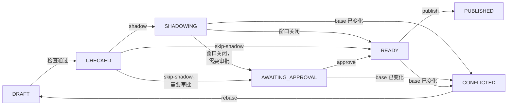

# 测试策略 {#testing-policies}

面向在生产环境修改文档的策略作者和评审者。每个文档变更都经过控制面：控制面检查并编译变更，可以在影子窗口中用线上流量试运行，在无法证明变更安全时要求第二个人审批，然后才发布。本页介绍这一流程及其周边工具。字段本身见[策略语言](./language.md)。

## 控制面 {#the-control-plane}

控制面随 `cosec-control` 模块提供（它需要 `cosec-cocache`，因为文档保存在 Redis 中）。它在 `{cosec.control.http.base-path}/v1`（默认 `/cosec/control/v1`）下提供 HTTP API；其设置为 `cosec.control.*`（[配置](../operations/configuration.md)），文档如何存储以及如何首次发布见[存储](../operations/storage.md)。

控制请求首先是一个普通请求：宿主管道对它认证，并且必须允许它，因此文档必须允许运维人员访问该 API 路径。之后每一步都以该主体的身份再次授权，所在应用为 `cosec.control.app-id`（默认 `cosec-control`），动作为针对所涉及文档（`doc/platform`、`doc/app/<appId>`、`doc/tenant/<tenantId>`）或条目的 `cosec:<verb>`。在任何策略之前，先执行一条硬性规则：租户的主体只能操作自己租户的文档；平台文档和应用文档属于 `(platform)` 租户的主体。

| 步骤 | 需要 |
|---|---|
| 读取文档、历史、差异 | `cosec:read` |
| 提议、`apply`、rebase | 对写入或删除的每个条目需要 `cosec:write`，对写入的每个绑定的作用域需要 `cosec:grant`；`apply` 和回滚还需要 `cosec:read` |
| 开启影子窗口、发布 | `cosec:publish` |
| 跳过影子窗口 | `cosec:skip-shadow` |
| 审批、驳回 | `cosec:approve` |
| `simulate`、`explain`、`analyze` | 针对所查询租户的文档分别需要 `cosec:simulate`、`cosec:explain`、`cosec:analyze` |

可以把三个内置策略绑定给运维人员：`cosec:platform-admin`（对所有文档的所有动作）、`cosec:tenant-admin`（对自己租户文档的 `read`、`write`、`grant`、`publish`、`simulate`、`explain`、`analyze`、`shadow-read`）和 `cosec:tenant-viewer`（同上，但没有 `write`、`grant` 和 `publish`）。

| 方法和路径 | 作用 |
|---|---|
| `GET /documents/{key}` | 当前修订。`{key}` 为 `platform`、`app:<appId>` 或 `tenant:<tenantId>`。 |
| `GET /documents/{key}/revisions?before=&limit=` | 修订历史，最新的在前（`limit` 为 1 到 200，默认 20）。 |
| `GET /documents/{key}/revisions/{revision}` | 某个保留的修订；已不再保留时返回 `410`。 |
| `GET /documents/{key}/diff?from=&to=` | 两个修订之间新增、删除和修改的策略与绑定。 |
| `GET /documents/{key}/revisions/{revision}/propagation` | 最近上报的实例中有多少已安装该修订。 |
| `POST /documents/{key}:apply`、`POST /documents/{key}:rollback` | 从整份文档提议变更，或提议回到旧修订。 |
| `POST /changes`、`GET /changes/{id}` | 提议变更；读取变更。 |
| `POST /changes/{id}:rebase`、`:shadow`、`:skip-shadow`、`:approve`、`:reject`、`:abandon`、`:publish` | 推进变更。 |
| `POST /simulate`、`POST /explain`、`POST /analyze` | 不做任何修改地决策或分析。 |

错误为 `application/problem+json`。`400`、`409`、`410`、`412`、`422` 或 `428` 在 `detail` 中解释你自己的请求；`401`、`403`、`404`、`500` 或 `503` 不带详情，因此拒绝永远不会透露某个文档或变更是否存在。

## 校验策略 {#validating-policies}

每个提议在存为已检查之前，都会针对其文档的当前修订进行检查。检查结果列在变更的 `findings` 中，每项包含 `check`、候选中的 JSON `path`、`message`、对应的 HTTP `status` 和 `severity`：

| 检查 | 状态码 | 发现 |
|---|---|---|
| `V1` | 400 | 候选无法读回为文档。 |
| `V2` | 400、422 | 文档超过 8 MB；id 使用了保留前缀（`cosec:`、`g:`、`r:`）；租户策略复用了平台策略的 id。 |
| `COMPILE` | 422 | 某个策略、条件、模式、绑定或规则无法用平台的限制、平台声明的属性以及控制面主机的属性提供者声明的属性编译。 |
| `REFERENCES` | 422 | 绑定指向的策略无处可解析；平台变更删除了其他文档引用的策略；租户的 `boundary` 不是平台边界。 |
| `OPERATION` | 422 | 操作删除了不存在的内容，或设置了该文档没有的字段。 |
| `IF_MATCH` | 412 | 条目已不再是操作的 `ifMatch` 所说的样子。 |
| `V3`（警告） | | 平台的 `limits` 或 `attributes` 有变化：其他文档会在每个实例上重新编译，不再能编译的文档失败即拒绝。 |

有任何错误的变更停留在 `DRAFT`，不能暂存或发布；请提议一个新变更来修正。干净的变更为 `CHECKED`。变更在发布之前不会影响执行，而发布时会针对当时的文档重新编译候选。

## 模拟请求 {#simulating-a-request}

`simulate` 按执行时的方式，在当前文档上对一个描述出来的请求做决策，还可以同时在某个变更的候选上决策：

```json
{
  "request": {
    "tenant": "acme",
    "principal": "bob",
    "roles": ["clerk@team-a"],
    "app": "order",
    "space": "team-a",
    "action": "order:ship",
    "resource": "order/42",
    "time": "2026-11-01T09:30:00Z"
  },
  "candidate": "<change id>"
}
```

| 字段 | 含义 |
|---|---|
| `tenant` | 必填。 |
| `principal` | 主体 id；匿名请求时省略。 |
| `roles`、`policies` | 成员关系，按令牌声明的写法：`role` 或 `role@space`，以及附加策略的 id。 |
| `app`、`space` | 声明的作用域；空间按数据面的方式与角色核对。 |
| `action` | 必填，`service:verb`（未映射的 HTTP 请求为 `http:GET`）。 |
| `resource` | 必填：`type/id`，或以 `/` 开头的 `http` 资源路径。 |
| `remoteIp`、`time` | 客户端地址，以及 ISO 时刻（默认：当前）。 |
| `principalBindings`、`breakGlass` | 凭证能用到什么，默认都为 `true`（CoSec 自己的令牌）。模拟 API key 时把 `breakGlass` 设为 `false`；带角色上限的 key 还要把 `principalBindings` 设为 `false`：此时附加的策略和主体绑定不授予任何东西，它们的 DENY 照样生效。只接受布尔值。 |

响应包含 `enforced`、要求时的 `candidate`，以及 `differs`。每个决策为 `Permit`、`Deny`、`Indeterminate`（带 `cause`）或 `Rejected`（作用域被拒绝），并给出做出决策的语句（`by`）和完整的候选追踪。来自你无权读取的文档的语句会被省略，并计入 `redacted`。

模拟没有令牌属性，也不获取外部属性：读取 `ext.*` 的语句会发现它不可用并按其 `onMissing` 处理，因此在这里通常为 Indeterminate。

## 用 explain 调试决策 {#debugging-a-decision-with-explain}

`explain` 接受同样的 `request`，以及可选的 `at`：某个决策所用的文档修订，取自其审计事件的记录（`{"platform": 12, "app": 3, "tenant": 4}`）。只要这些修订仍被保留，它就在这些修订上求值，并返回决策及其追踪，让你看到过去的请求为什么被这样决策。其字段以及如何找到该请求，见[代码中的检查](../integration/checks.md)。

## 变更 {#changes}

变更是对一个文档的一组条目操作，基于你看到的修订（`base`）：

```json
{
  "document": "tenant:acme",
  "base": 4,
  "note": "Let auditors read orders",
  "operations": [
    {
      "op": "putBinding",
      "binding": {
        "id": "auditor-reads-orders",
        "subject": { "role": "auditor" },
        "app": "order",
        "space": "",
        "policy": "perm:order/read"
      }
    }
  ]
}
```

| 操作 | 字段 | 作用 |
|---|---|---|
| `putPolicy` | `policy`，可选 `ifMatch` | 新增策略，或替换同 id 的策略。 |
| `removePolicy` | `id`，可选 `ifMatch` | 删除策略。 |
| `putBinding` | `binding`，可选 `ifMatch` | 新增绑定，或替换同 id 的绑定。 |
| `removeBinding` | `id`，可选 `ifMatch` | 删除绑定。 |
| `putRateLimit` | `rateLimit`，可选 `ifMatch` | 添加限流规则，或在原位置替换同 id 的规则。 |
| `removeRateLimit` | `id`，可选 `ifMatch` | 删除限流规则。 |
| `putCatalog` | `catalog` | 设置应用文档的目录；没有 `catalog` 时删除目录。 |
| `setLimits` | 包含全部六个限制的 `limits` | 设置平台的限制；没有 `limits` 时恢复默认值。 |
| `setAttributes` | `attributes` | 设置平台声明的属性；没有 `attributes` 时删除该字段。 |

`ifMatch` 是条目按文档写法的 SHA-256：只有条目仍是这个样子时操作才生效。不想手写操作时，`POST /documents/{key}:apply` 接受整份文档（`{"document", "mode", "note"}`），并提议把当前修订变成该文档所需的操作：`MERGE` 只新增和修改，`REPLACE` 还会删除文档中没有的内容。设置租户的 `boundary` 或平台的默认边界请使用 `apply`。限流规则变更如何授权和审批见[限流](./rate-limiting.md#publishing-rules)。

`base` 已不是当前修订时返回 `409`。`onMissing: "nomatch"` 的 DENY 需要在 `confirmations` 中提供确认（`{"policy", "statement", "digest", "kind": "deny-nomatch"}`）；没有确认的变更无法发布。



一个文档至多有一个暂存的变更（`SHADOWING`、`AWAITING_APPROVAL` 或 `READY`）；在它发布、放弃、驳回或过期之前，暂存另一个变更返回 `409`。未完成的变更在提议后 `cosec.control.changes.expire-after`（默认 7 天）过期：此后第一次被读取时即为 `EXPIRED`，而控制面的维护任务每隔 `cosec.control.shadow.check-interval`（默认 1 分钟）读取一次所有未完成的变更。作者可以对 `CONFLICTED`、`DRAFT` 或 `CHECKED` 的变更执行 `:rebase`，把它放到当前修订上，这会重新运行所有检查，并丢弃之前的审批和影子证据。作者或持有 `cosec:publish` 的人可以 `:abandon` 它。

## 在影子模式中试运行变更 {#trying-changes-in-shadow-mode}

`POST /changes/{id}:shadow` 暂存一个 `CHECKED` 的变更并开启影子窗口。数据面实例用候选替换当前文档，对一部分线上请求再求值一次，并上报每个请求的结果；候选永远不会影响真实决策。候选只在读取了它所属文档的请求上比较（租户的候选在该租户的请求上，应用的候选在读取了该应用文档的请求上，平台的候选在所有请求上），并且只由已安装候选的基础修订的实例比较。

| 结果 | 含义 |
|---|---|
| `SAME` | 相同的决策，由相同的语句做出。 |
| `BY_CHANGED` | 相同的决策，由另一条语句做出。 |
| `WIDENED` | 执行时没有允许，候选允许。 |
| `NARROWED` | 执行时允许，候选不允许。 |
| `BECAME_INDETERMINATE` | 执行时不是 Indeterminate，候选是，原因不是属性不可用。 |
| `CANDIDATE_INDETERMINATE` | 候选读取了请求没有获取的外部属性（影子求值不获取任何属性）。 |
| `CANDIDATE_ERROR` | 某个实例无法编译或求值候选。 |
| `BASE_MISMATCH` | 实例安装的是该文档的另一个修订：不比较，不算样本。 |

窗口在以下情况关闭：

- 任何实例上报 `CANDIDATE_ERROR` 时立即关闭，状态为*阻塞*：该变更永远不能发布；请放弃它；
- 经过 `cosec.control.shadow.min-duration`（15 分钟），且实例上报的非 `BASE_MISMATCH` 样本达到 `cosec.control.shadow.min-samples`（1,000）时；
- 到达 `cosec.control.shadow.max-duration`（24 小时）而样本不足时，状态为*证据不足*。

控制面每隔 `cosec.control.shadow.check-interval`（默认 1 分钟）检查一次所有未关闭的窗口，同一时间只由一个控制面实例执行。窗口关闭后，变更变为 `READY`，需要[审批](#approval)时变为 `AWAITING_APPROVAL`。如果期间文档修订发生变化，变更变为 `CONFLICTED`。数据面在启用 `cosec-cocache` 和 `cosec.authorization.shadow.*`（默认开启，采样 10% 的请求）时参与。

属性提供者及其声明的类型，在每个数据面实例和控制面主机上必须相同。控制面按自己的提供者检查候选；缺少其中某个提供者的实例无法编译读取其属性的候选，会报告 `CANDIDATE_ERROR`，窗口随即以阻塞状态关闭，该变更永远不会发布。跳过窗口的变更也跳过了这项检查：无法编译已发布文档的实例会对该文档失败即拒绝。

窗口比较的是决策，所以只涉及[限流规则](./rate-limiting.md#publishing-rules)的变更在窗口中显示不出差异。

`POST /changes/{id}:skip-shadow` 带上 `reason`，可以不经窗口暂存一个 `CHECKED` 的变更；它需要 `cosec:skip-shadow`，修订会记录窗口被跳过。只创建或吊销 break-glass 绑定的变更没有窗口。

## 审批 {#approval}

任何人都不能授予超出自己权限的东西。变更被检查时，控制面以作者身份分析它授予了什么，凡是无法证明包含在作者自身权限之内的，都成为一项*升级*：

| 原因 | 含义 |
|---|---|
| `NOT_COVERED` | 没有作者的任何一条 ALLOW 被证明包含该变更授予的内容。 |
| `DENY_OVERLAP` | 约束作者的某条 DENY 可能与之重叠。 |
| `CROSS_TENANT` | 作者不在该文档的租户中。 |
| `UNRESOLVED` | 新增或修改的绑定指向一条没有任何文档定义的策略，它授予什么无从判断。 |
| `NOT_ANALYZED` | 非信任根所做的平台或应用文档变更，或租户边界变更。 |
| `TENANT_BINDING` | 与应用文档的 `NOT_ANALYZED` 一起出现：变更新增或放宽了某条权限策略的 ALLOW，租户文档中每条绑定该策略的绑定各是一项升级，审批人由此看到变更影响到谁。 |
| `BREAK_GLASS` | 新增或修改的 break-glass 绑定：总是需要第二个人。 |

作者的权限是本次请求所带凭证的权限。带角色上限的凭证（带 `roles` 的 API key）不计入点名作者或作者附加的 ALLOW，只计入上限内的角色和 `Anyone` 绑定，与数据面一致；点名作者或作者附加的 DENY 仍然限制它可以授予的范围。break-glass 绑定从不计入任何人可以授予的范围。

分析读取作者权限的方式与执行时相同：

- **任意类型的 token 属性。** `subject.attributes.*` 上的条件把布尔值和数字当作它们的文本（`true`、`3`），数据面与分析都是如此。token 中写着 `"suspended": true` 的作者并不持有带条件 `not(eq(subject.attributes.suspended, "true"))` 的 ALLOW，因此不能去掉条件把它授出。
- **会到期的绑定。** 作者经带 `expiresAt` 的绑定持有的权限只持有到那时，所以它只包含自身绑定不晚于它到期的授出。没有 `expiresAt` 的授出、到期更晚的授出、把策略设为可附加，都是升级；最接近的 ALLOW 以短缺 `EXPIRY` 报告。
- **租户与平台都定义的 id。** 执行时这样的绑定或附加因二义而被拒绝，所以作者经它什么也不持有；它绑定到作者的地方，按拒绝一切的 DENY 计。

删除条目和收窄 ALLOW 不授予任何东西，只有一个例外：删除租户自己的一条策略，而平台也定义了同一个 id 时，租户中指向这个 id 的绑定，以及平台的策略可附加时对它的附加，都改为指向平台的策略。这按把平台的策略授给它们来分析。对文档持有 `cosec:approve` 的人是信任根：其自己的变更不做分析，除非开启了 `cosec.control.approval.four-eyes`，这时它们会像其他人的变更一样被分析。

有升级的变更在窗口关闭或被跳过后停留在 `AWAITING_APPROVAL`。另一位持有 `cosec:approve` 的人通过 `POST /changes/{id}:approve` 审批，并带上他们评审过的 `candidate` 摘要（来自 `GET /changes/{id}`）；摘要不同返回 `409`，作者不能审批自己的变更。`:reject` 带上 `reason` 结束该变更。审批在 `cosec.control.approval.expire-after`（72 小时）内有效，且只对该候选有效。

## 发布与回滚 {#publishing-and-rolling-back}

`POST /changes/{id}:publish` 发布一个 `READY` 的变更。如果它的窗口出现了 `WIDENED`、`NARROWED` 或 `BECAME_INDETERMINATE` 的请求，或以证据不足关闭，发布者必须确认这些数字，否则返回 `428`：

```json
{ "ack": { "window": "<window id>", "counts": { "SAME": 4180, "NARROWED": 3 } } }
```

窗口 id 和计数在变更的 `shadow` 中；为零的计数可以省略。随后发布会以发布者身份在当前文档上重新检查一切：发布者对每个条目的权限、授权分析，以及审批。审批必须覆盖此时发现的升级、未过期、针对此候选、既不来自作者也不来自发布者，且审批人仍持有 `cosec:approve`。审批人按其审批时所用的凭证重新检查：用带上限的 key 给出的审批，在发布时不计入审批人自己绑定中的 ALLOW；不是用 CoSec 自己的令牌给出的审批，不计入其 break-glass 绑定。审批不再成立时，变更回到 `AWAITING_APPROVAL`，不发布任何内容。文档已变化时，变更为 `CONFLICTED`；候选无法针对当前文档编译时，变更为带有检查结果的 `DRAFT`。

要撤销某个修订，用 `{"revision": 11, "note": "..."}` 调用 `POST /documents/{key}:rollback`，它会提议一个 `ROLLBACK` 变更，把文档恢复为该修订时的样子。它和其他变更一样经过检查、窗口、审批和发布。保留哪些修订、保留多久，见[存储](../operations/storage.md)。

## 访问审查 {#access-reviews}

`POST /analyze` 列出在某租户中谁可能被允许或拒绝对某资源执行某动作：

```json
{ "query": { "tenant": "acme", "app": "order", "space": "team-a", "action": "order:read", "resource": "order/42" } }
```

响应列出 `allows` 和 `denies`：平台文档、租户文档以及（给出 `app` 时）应用文档中，作用域符合查询、且其策略有语句匹配该动作和资源的每个绑定，包括其文档、主体、应用、空间、策略和语句序号。`conditional` 标记带有条件的语句或策略，条件不会被求值。省略 `app` 和 `space` 时匹配任意应用或空间的绑定。你无权读取的文档计入 `hidden`，指向这些文档中策略的绑定计入 `opaque`。附加策略不会列出：它们取决于每个主体的成员关系。

## CI 中的策略 {#policies-in-ci}

用 [JSON Schema](./language.md#json-schema) 校验文档文件，然后用 `cosec-runtime` 中控制面和每个实例所用的读取器和编译器编译它们：

```kotlin
import me.ahoo.cosec.model.decision.DocumentKind
import me.ahoo.cosec.runtime.document.PolicyDocumentCodec
import me.ahoo.cosec.runtime.document.PolicyDocumentCompiler
import java.io.File

val platform = PolicyDocumentCodec.decode(DocumentKind.PLATFORM, "", File("platform.json").readBytes())
val acme = PolicyDocumentCodec.decode(DocumentKind.TENANT, "acme", File("tenant-acme.json").readBytes())
// The platform's limits and declared attributes, as the control plane checks a candidate.
val compiler = PolicyDocumentCompiler.forPlatform(platform)
compiler.compile(platform)
compiler.compile(acme)
compiler.checkReferences(acme, platform)
```

`decode` 抛出 `SnapshotFormatException`，`compile` 抛出 `DocumentCompileException`，其中包含每个错误及其 JSON 路径。

### 测试决策 {#testing-decisions}

`cosec-testkit` 在单元测试中断言文档的决策，使用的就是每个实例运行的引擎：

```kotlin
dependencies {
    testImplementation("me.ahoo.cosec:cosec-testkit")
}
```

按 `cosec-migrate convert` 写出的布局存放文档，每个场景一个 JSON 文件：

```text
src/test/resources/policies/
  documents/
    platform.json
    apps/order.json
    tenants/acme.json             id 经过 URL 编码：acme-west 为 tenants/acme%2Dwest.json
  scenarios/
    a-reader-reads-an-order.json
    nobody-deletes-an-order.json
```

```kotlin
import me.ahoo.cosec.testkit.PolicyTestKit
import org.junit.jupiter.api.DynamicTest
import org.junit.jupiter.api.TestFactory
import java.nio.file.Path

class PolicyTest {
    private val kit = PolicyTestKit.load(Path.of("src/test/resources/policies/documents"))

    @TestFactory
    fun policies(): List<DynamicTest> = kit.tests(Path.of("src/test/resources/policies/scenarios"))
}
```

`tenants/acme.json` 把角色 `reader` 绑定到 `order:read` 上的 ALLOW，并把每个主体绑定到 `order:delete` 上名为 `orders are never deleted` 的 DENY 时，下面两个场景通过：

```json
{
  "description": "A reader of acme reads an order",
  "credential": { "tenant": "acme", "id": "alice", "roles": ["reader"] },
  "request": { "action": "order:read", "resource": { "type": "order", "id": "1" } },
  "expect": { "decision": "Permit" }
}
```

```json
{
  "description": "The deny wins over the reader's role",
  "credential": { "tenant": "acme", "id": "alice", "roles": ["reader"] },
  "request": { "action": "order:delete", "resource": { "type": "order", "id": "1" } },
  "expect": {
    "decision": "Deny",
    "by": {
      "policy": "no-delete",
      "statement": 0,
      "name": "orders are never deleted",
      "via": { "binding": "g:no-delete", "document": "tenant" }
    }
  }
}
```

文档无法编译时 `load` 失败；没有 `platform.json` 时平台文档为空。`tests` 为目录下每个 `.json` 文件生成一个以其路径命名的测试，一个都没有时失败。`check(file)` 检查单个场景，`evaluate(json)` 只返回决策而不检查；`PolicyTestKit.of(platform, apps, tenants)` 接受 JSON 文本形式的文档。

| 场景字段 | 含义 |
|---|---|
| `description` | 自由文本。 |
| `credential` | 主体：`tenant`（默认 `acme`）、`id`（默认 `alice`）、`roles`（`role` 或 `role@space`）、`policies`（附加策略）、`attributes`；匿名调用方用 `"anonymous": true`。 |
| `membershipProvider` | `MembershipProvider` 返回的成员关系，按管道的方式与凭证中的合并：按空间分组的 `roles`（`{"": ["reader"]}`）和 `attachments`；或 `{"fails": "message"}`。 |
| `request` | `action`（默认 `order:read`）、`resource`（`type`、`id`、`attributes`；默认 `order/1`）、`app`、`space`、`hostApp`、`time`（ISO 时刻）、`ip`、`device`、`blocked`、`headers`、`attributes`（`request.attributes.*`）。 |
| `expect` | `decision`：`Permit`、`Deny`、`Indeterminate` 或 `Rejected`，以及 `by`（作出决策的语句；隐式拒绝为 `null`）、`cause` 或 `reason`。 |

只比较 `expect` 写出的字段：`{"decision": "Permit"}` 不论哪条语句允许都通过，写上 `by` 则固定为某条语句，并整体比较。拼错的字段是错误，不会被忽略。

测试工具只评估决策。文档的编译方式与实例相同：使用平台文档的 `limits` 和它声明的 `ext.*` 属性。只由宿主的 `AttributeProvider` 声明的属性在测试工具中无法编译，而且不运行任何提供者，所以读取 `ext.*` 的语句会发现它不可用并按其 `onMissing` 处理。限流规则不运行；请求直接给出动作和资源，不经过路由映射。依赖外部属性值的决策可用 [`simulate`](#simulating-a-request) 试验，它按控制面主机的提供者编译。

**下一步：** 把测试过的策略发布到存储中，见[存储](../operations/storage.md)。
